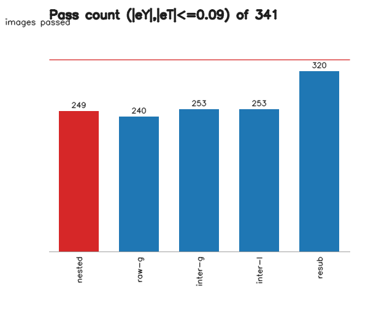
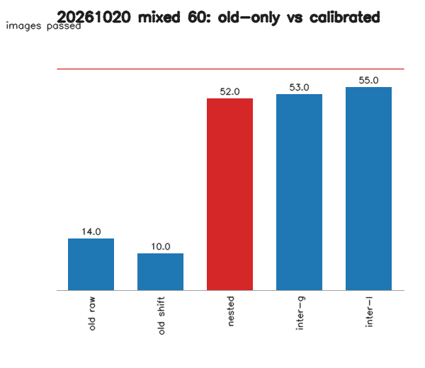
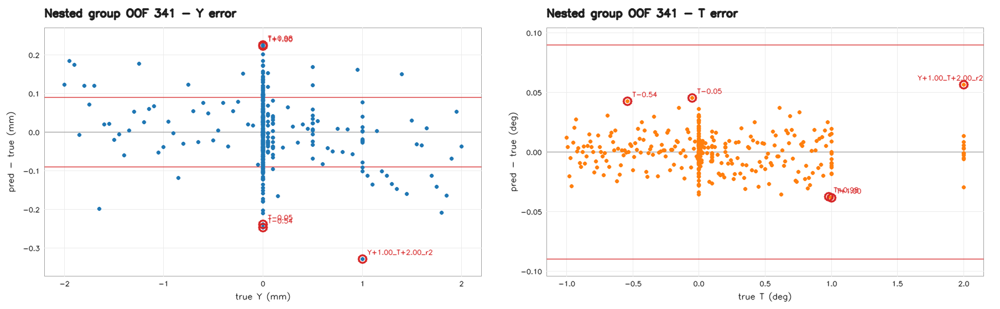
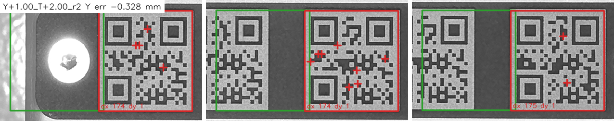

# 보고서: 새 사진 일반화 - 탐색 확장 + 국소 회귀 (10-22 16:08)

## 문제

20261020 혼합 자세 사진에서 Y 오차가 컸고(old만 학습 14/60) T+2 사진 12장은 ±130 px 탐색에서 측정에 실패했다.

## 해결 방법

NCC 탐색을 ±260 px까지 넓혀 측정을 복구하고, 20261020 조건까지 교정에 넣은 전체점 회귀 12개 설정 중 하나를 중첩 그룹 OOF로 골랐다.

## 결과

20261020은 old만 학습할 때 14/60에서 교정에 넣은 중첩 OOF 52/60이 됐고, 341장 전체 중첩 그룹 OOF는 249/341이었다.

| 지표 | 값 |
|---|---|
| 341장 중첩 OOF 통과 (\|eY\|,\|eT\|<=0.09) | 249 / 341 |
| 20261014 / 20261020 통과 | 197 / 281, 52 / 60 |
| Y 평균 / 최대 \|오차\| (mm) | 0.0645 / 0.3281 |
| T 평균 / 최대 \|오차\| (deg) | 0.0115 / 0.0568 |
| 실패 92장 중 Y 초과 / T 초과 | 92 / 0 |
| old만 학습 → 20261020 통과 (raw1260 / raw_shift) | 14 / 10 (60장) |
| 확장 탐색으로 복구한 사진 | 12 장 |
| 최종 선택 설정 (전체 341) | local raw_shift s0.1 w100 |

## 튀는 값

가장 크게 틀린 사진은 Y는 Y+1.00_T+2.00_r2(정답 Y 1.00, 추정 0.672 mm, 평균 x 이동 174.5 px), T는 Y+1.00_T+2.00_r2(정답 T 2.00, 추정 2.057 deg, 평균 x 이동 174.5 px)이고, 이 사진은 같은 fold 학습 사진과 평균 이동이 7.10 px 떨어진 끝 자세라 회귀가 밖으로 외삽했으며, 실패 92장 중 Y 초과가 92장, T 초과가 0장이었다.

| 구분 | 사진 | fold | 정답 Y | 추정 Y | 정답 T | 추정 T | 평균 x 이동 (px) | 유효점 | NCC 최소 | 탐색 pad | 학습 사진과 이동 차 (px) | 선택 설정 |
|---|---|---|---|---|---|---|---|---|---|---|---|---|
| Y 오차 상위 | Y+1.00_T+2.00_r2 | 3 | 1.00 | 0.672 | 2.00 | 2.057 | 174.55 | 616 | 0.977 | 260 | 7.10 | local raw_shift s0.01 w20 |
| Y 오차 상위 | T-0.54 | 1 | 0.00 | -0.247 | -0.54 | -0.497 | -43.88 | 603 | 0.988 | 130 | 0.77 | global raw_shift s0.1 |
| Y 오차 상위 | T-0.05 | 0 | 0.00 | -0.238 | -0.05 | -0.005 | -4.25 | 615 | 0.984 | 130 | 0.25 | local raw_shift s0.01 w100 |
| Y 오차 상위 | T+0.98 | 3 | 0.00 | 0.225 | 0.98 | 0.942 | 77.87 | 613 | 0.973 | 130 | 0.78 | local raw_shift s0.01 w20 |
| Y 오차 상위 | T+1.00 | 1 | 0.00 | 0.222 | 1.00 | 0.962 | 79.50 | 615 | 0.957 | 130 | 0.59 | global raw_shift s0.1 |
| T 오차 상위 | Y+1.00_T+2.00_r2 | 3 | 1.00 | 0.672 | 2.00 | 2.057 | 174.55 | 616 | 0.977 | 260 | 7.10 | local raw_shift s0.01 w20 |
| T 오차 상위 | T-0.05 | 0 | 0.00 | -0.238 | -0.05 | -0.005 | -4.25 | 615 | 0.984 | 130 | 0.25 | local raw_shift s0.01 w100 |
| T 오차 상위 | T-0.54 | 1 | 0.00 | -0.247 | -0.54 | -0.497 | -43.88 | 603 | 0.988 | 130 | 0.77 | global raw_shift s0.1 |

초록 상자는 기준 사진의 QR 영역, 빨간 상자는 NCC로 찾은 이 사진의 QR 영역, 빨간 십자는 무효 판정된 모서리 점이다.

## 한줄평

전체점 회귀는 학습 사진이 덮는 자세 범위 안에서만 맞는 방법이라, 20261020 조건을 교정에 넣으면 그 날짜 사진이 14/60에서 52/60으로 올랐지만 여전히 Y 평균 오차 0.065 mm가 통과 기준 0.09의 72%라서 341장 중 92장이 남았다.

## 원래 결과와 대조

원래 값은 `joint_yt_generalization_20261022/summary.csv`, `selection.json`, `final_config.json`, `measurements/audit.json`, `manifest_with_folds.csv`(유효점·평균 변위)에서 가져왔다. 26/26 일치.

| 지표 | 원래 결과 | C++ 결과 | 차이 | 판정 |
|---|---|---|---|---|
| center 재측정 = 기준 630점 (최대 \|차\| px) | 0.000000 | 0.003208 | 0.003208 | 일치 |
| 기준 630점 중 1e-4 px 안으로 같은 점 | 630 | 627 | -3 | 일치 |
| 확장 탐색으로 복구한 사진 수 | 12 | 12 | 0 | 일치 |
| 사진별 평균 x 변위 최대 \|차\| (px) | 0.00000 | 0.00009 | 0.00009 | 일치 |
| 사진별 평균 y 변위 최대 \|차\| (px) | 0.00000 | 0.00001 | 0.00001 | 일치 |
| 유효점 합계 (341x630) | 207586 | 207586 | 0 | 일치 |
| 내부 3-fold 분할 일치 (15개 중, 장수·인덱스합) | 15 | 15 | 0 | 일치 |
| fold0 선택 설정 | local raw_shift s0.01 w100 | local raw_shift s0.01 w100 | - | 일치 |
| fold1 선택 설정 | global raw_shift s0.1 | global raw_shift s0.1 | - | 일치 |
| fold2 선택 설정 | local raw_shift s0.01 w20 | local raw_shift s0.01 w20 | - | 일치 |
| fold3 선택 설정 | local raw_shift s0.01 w20 | local raw_shift s0.01 w20 | - | 일치 |
| 최종 선택 설정 | local raw_shift s0.1 w100 | local raw_shift s0.1 w100 | - | 일치 |
| 중첩 OOF 341 통과 | 249 | 249 | 0 | 일치 |
| 중첩 OOF 20261014 통과 (281) | 197 | 197 | 0 | 일치 |
| 중첩 OOF 20261020 통과 (60) | 52 | 52 | 0 | 일치 |
| 중첩 OOF Y 평균 \|오차\| (mm) | 0.0645 | 0.0645 | 0.0000 | 일치 |
| 중첩 OOF Y 최대 \|오차\| (mm) | 0.3282 | 0.3281 | -0.0001 | 일치 |
| 중첩 OOF T 평균 \|오차\| | 0.0115 | 0.0115 | 0.0000 | 일치 |
| 중첩 OOF T 최대 \|오차\| | 0.0568 | 0.0568 | 0.0000 | 일치 |
| raw_global OOF 통과 | 240 | 240 | 0 | 일치 |
| interaction_global OOF 통과 | 253 | 253 | 0 | 일치 |
| interaction_local OOF 통과 | 253 | 253 | 0 | 일치 |
| old만 학습 raw1260 -> 20261020 통과 | 14 | 14 | 0 | 일치 |
| old만 학습 raw1260 -> 20261020 Y 평균 \|오차\| | 0.3302 | 0.3300 | -0.0002 | 일치 |
| old만 학습 raw_shift -> 20261020 통과 | 10 | 10 | 0 | 일치 |
| 전체 학습 재대입 341 통과 | 320 | 320 | 0 | 일치 |
