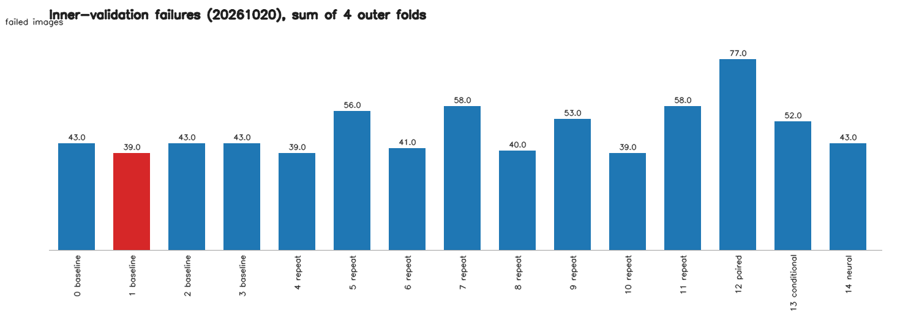
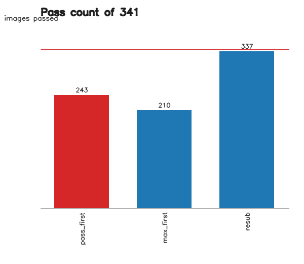
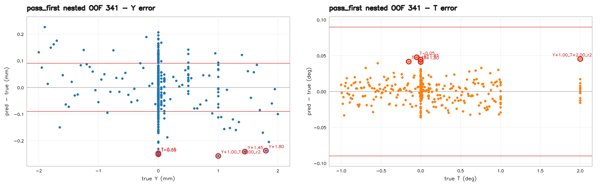
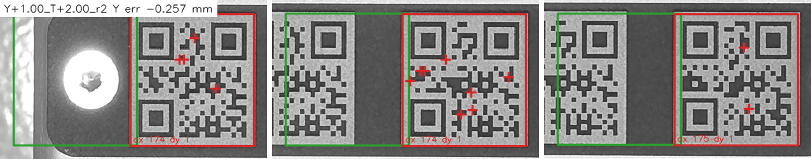
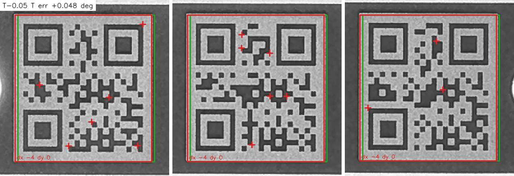

# 보고서: Y/T 반응 분리 - 사진쌍 분리 학습 (10-22 16:31)

## 문제

혼합 자세 사진으로 Y와 T 반응을 따로 학습하면 새 사진 일반화가 나아지는지 확인하려 했다.

## 해결 방법

조건 평균 반응·한 축 고정 사진쌍 차이·T 반응 제거 후 Y 해석·작은 신경망 등 15개 후보를 중첩 그룹 OOF로 비교했다.

## 결과

실패 수 우선 선택(pass_first)은 20261020 50/60, 341장 전체 243/341로 직전 실험(20261022_1608, 52/60, 249/341)보다 나아지지 않았다.

| 지표 | 값 |
|---|---|
| pass_first 중첩 OOF 통과 | 243 / 341 |
| 20261014 / 20261020 통과 | 193 / 281, 50 / 60 |
| Y 평균 / 최대 \|오차\| (mm) | 0.0698 / 0.2572 |
| T 평균 / 최대 \|오차\| (deg) | 0.0121 / 0.0479 |
| max_first 중첩 OOF 통과 | 210 / 341 (20261020 44 / 60) |
| 전체 학습 재대입 통과 | 337 / 341 |
| fold별 pass_first 후보 | repeat cond_means mix0.5 s0.01, repeat axis_pairs mix0.5 s0.01, conditional P12 remove_quad gls0.5, repeat cond_means mix0.0 s0.01 |

## 튀는 값

가장 크게 틀린 사진은 Y는 Y+1.00_T+2.00_r2(정답 Y 1.00, 추정 0.743 mm), T는 T-0.05(정답 T -0.05, 추정 -0.002 deg)이고, Y 최대 사진은 같은 명령 반복 3장의 추정 Y 폭이 0.322 mm라 같은 자세에서도 측정이 흔들렸으며, 실패 98장 중 Y 초과 98장, T 초과 0장이었다.

| 구분 | 사진 | fold | 선택 후보 | 정답 Y | 추정 Y | 정답 T | 추정 T | 평균 x 이동 (px) | 유효점 | 같은 명령 반복 추정 Y 폭 |
|---|---|---|---|---|---|---|---|---|---|---|
| Y 오차 상위 | Y+1.00_T+2.00_r2 | 3 | 4 | 1.00 | 0.743 | 2.00 | 2.045 | 174.55 | 616 | 0.322 |
| Y 오차 상위 | T-0.05 | 0 | 6 | 0.00 | -0.251 | -0.05 | -0.002 | -4.25 | 615 | - |
| Y 오차 상위 | T-0.15 | 2 | 13 | 0.00 | -0.248 | -0.15 | -0.108 | -12.34 | 609 | - |
| Y 오차 상위 | Y+1.45 | 3 | 4 | 1.45 | 1.209 | 0.00 | 0.045 | 20.42 | 617 | - |
| Y 오차 상위 | Y+1.80 | 1 | 10 | 1.80 | 1.563 | 0.00 | 0.041 | 25.31 | 606 | - |
| T 오차 상위 | T-0.05 | 0 | 6 | 0.00 | -0.251 | -0.05 | -0.002 | -4.25 | 615 | - |
| T 오차 상위 | Y+1.00_T+2.00_r2 | 3 | 4 | 1.00 | 0.743 | 2.00 | 2.045 | 174.55 | 616 | 0.322 |
| T 오차 상위 | Y+1.45 | 3 | 4 | 1.45 | 1.209 | 0.00 | 0.045 | 20.42 | 617 | - |

초록 상자는 기준 사진의 QR 영역, 빨간 상자는 NCC로 찾은 이 사진의 QR 영역, 빨간 십자는 무효 판정된 모서리 점이다.

## 한줄평

분리 학습 후보는 학습 사진에는 거의 다 맞지만(재대입 337/341) 같은 fold 밖 조건에서는 Y 평균 오차 0.070 mm로 남아, Y·T 반응 방향이 거의 같은 상태에서 학습 조건 수(20261020 19조건)만으로는 분리 정보가 늘지 않았다.

## 원래 결과와 대조

원래 값은 `joint_yt_disentangle_20261022/summary.csv`, `selection.json`, `result.json`에서 가져왔다. 신경망 후보는 난수 초기화가 달라 내부 실패 수 비교에서 뺐다(신경망 초기 가중치는 원래 torch 시드 값을 넣었고 내부 실패 수는 5개 분할 모두 같았다). 23/26 일치.

| 지표 | 원래 결과 | C++ 결과 | 차이 | 판정 |
|---|---|---|---|---|
| fold0 pass_first 선택 후보 | 6 | 6 | - | 일치 |
| fold0 max_first 선택 후보 | 12 | 12 | - | 일치 |
| fold1 pass_first 선택 후보 | 8 | 10 | - | 불일치 |
| fold1 max_first 선택 후보 | 13 | 13 | - | 일치 |
| fold2 pass_first 선택 후보 | 13 | 13 | - | 일치 |
| fold2 max_first 선택 후보 | 6 | 6 | - | 일치 |
| fold3 pass_first 선택 후보 | 4 | 4 | - | 일치 |
| fold3 max_first 선택 후보 | 5 | 5 | - | 일치 |
| 최종 pass_first 선택 후보 | 4 | 4 | - | 일치 |
| 최종 max_first 선택 후보 | 4 | 4 | - | 일치 |
| fold0 신경망 뺀 14후보 내부 실패 수 같은 후보 | 14 | 14 | 0 | 일치 |
| fold1 신경망 뺀 14후보 내부 실패 수 같은 후보 | 14 | 13 | -1 | 불일치 |
| fold2 신경망 뺀 14후보 내부 실패 수 같은 후보 | 14 | 13 | -1 | 불일치 |
| fold3 신경망 뺀 14후보 내부 실패 수 같은 후보 | 14 | 14 | 0 | 일치 |
| 최종 신경망 뺀 14후보 내부 실패 수 같은 후보 | 14 | 14 | 0 | 일치 |
| pass_first 중첩 OOF 341 통과 | 242 | 243 | 1 | 일치 |
| pass_first 20261014 통과 (281) | 192 | 193 | 1 | 일치 |
| pass_first 20261020 통과 (60) | 50 | 50 | 0 | 일치 |
| pass_first Y 평균 \|오차\| (mm) | 0.0699 | 0.0698 | 0.0000 | 일치 |
| pass_first Y 최대 \|오차\| (mm) | 0.2574 | 0.2572 | -0.0002 | 일치 |
| pass_first T 평균 \|오차\| | 0.0121 | 0.0121 | 0.0000 | 일치 |
| pass_first T 최대 \|오차\| | 0.0479 | 0.0479 | 0.0000 | 일치 |
| max_first 중첩 OOF 341 통과 | 210 | 210 | 0 | 일치 |
| max_first 20261020 통과 (60) | 44 | 44 | 0 | 일치 |
| 전체 학습 재대입 341 통과 | 337 | 337 | 0 | 일치 |
| 전체 학습 재대입 20261020 통과 | 60 | 60 | 0 | 일치 |

불일치는 모두 통과선에 붙은 내부 검증 사진 하나씩이다. fold1 후보 8과 fold2 후보 12에서 C++ 오차가 0.09보다 1e-4 mm 안으로 커서(결과.md 표) 실패가 1장씩 늘었고, 그래서 fold1 pass_first는 실패 8장 동률을 최악 오차로 갈라 후보 8 대신 10이 뽑혔다. 원인은 측정 좌표의 1e-4 px 수준 차이(scipy TRF 와 C++ TRF 의 수치 경로)다.
