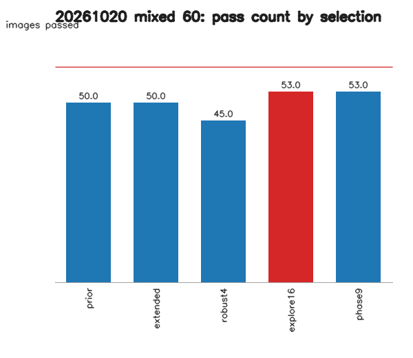
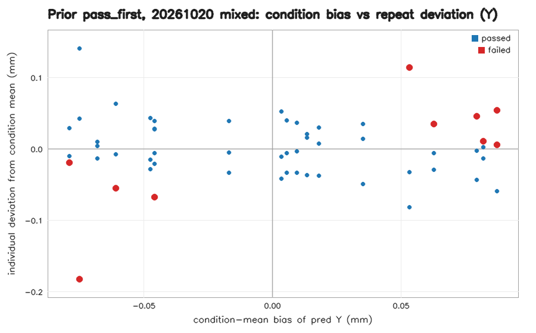
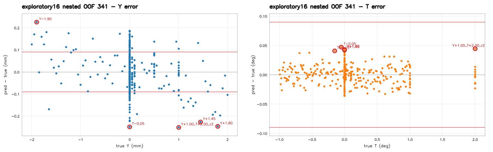
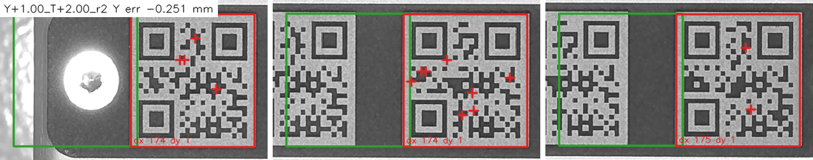
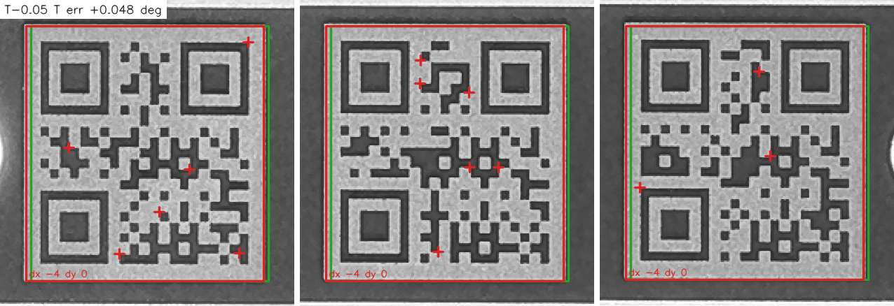

# 보고서: 실패 10장 진단과 누출 감사 재선택 (10-22 17:12)

## 문제

직전 분리 학습이 20261020에서 틀린 10장을 사진별로 보고 개선하면서, 평가 누출이 있었는지 감사하려 했다.

## 해결 방법

실패 사진을 조건 평균 편향과 개별 반복 편차로 나누고, 바깥·내부 분할의 그룹 겹침을 검사한 뒤, 사전 고정 강건 후보 4개와 추가 탐색 16개를 같은 내부 분할로 다시 골랐다.

## 결과

직접 누출(위반 0건)은 없었고, 추가 탐색 16후보는 20261020 53/60, 전체 245/341이었다.

| 지표 | 값 |
|---|---|
| 누출 검사 위반 | 0 |
| 직전 pass_first 20261020 / 341 통과 | 50 / 60, 243 / 341 |
| extended (15 + 사전 4) 20261020 / 341 | 50 / 60, 243 / 341 |
| robust_only (사전 4) 20261020 / 341 | 45 / 60, 211 / 341 |
| exploratory16 20261020 / 20261014 / 341 | 53 / 60, 192 / 281, 245 / 341 |
| exploratory16 Y 평균 / 최대 \|오차\| (mm) | 0.0679 / 0.2510 |
| exploratory16 T 평균 / 최대 \|오차\| (deg) | 0.0122 / 0.0475 |
| 실패 10장 중 복구 / 유지, 새 실패 | 4 / 6, 1 |
| phase 20261020 / 341 | 53 / 60, 248 / 341 |

## 튀는 값

직전 실패 10장(혼합 자세)의 평균 \|조건 편향\|은 0.071 mm, 평균 \|개별 반복 편차\|는 0.059 mm였고, exploratory16에서 가장 크게 틀린 사진은 Y는 Y+1.00_T+2.00_r2(정답 1.00, 추정 0.749 mm), T는 T-0.05(정답 -0.05, 추정 -0.002 deg)이다.

| 사진 | fold | 정답 Y | 정답 T | 추정 Y | eY | eT | 조건 평균 추정 Y 편향 | 개별 편차 Y | 같은 조건 통과 | 유효점 | NCC 최소 | exploratory16 추정 Y | 결과 |
|---|---|---|---|---|---|---|---|---|---|---|---|---|---|
| 20261020/Y+0.05 T+0.10/Y+0.05 T+0.10 (2).bmp | 0 | 0.05 | 0.10 | 0.217 | +0.167 | -0.029 | +0.053 | +0.114 | 2 / 3 | 620 | 0.957 | 0.210 | 실패 유지 |
| 20261020/Y+0.05 T+1.00/Y+0.05 T+1.00 (3).bmp | 0 | 0.05 | 1.00 | 0.147 | +0.097 | -0.016 | +0.063 | +0.035 | 2 / 3 | 627 | 0.961 | 0.158 | 실패 유지 |
| 20261020/Y+0.10 T+0.20/Y+0.1 T+0.2 (1).bmp | 2 | 0.10 | 0.20 | 0.002 | -0.098 | +0.010 | -0.079 | -0.019 | 2 / 3 | 618 | 0.945 | 0.029 | 복구 |
| 20261020/Y+0.10 T+2.00/Y+0.1 T+2.0 (1).bmp | 0 | 0.10 | 2.00 | -0.016 | -0.116 | +0.017 | -0.061 | -0.055 | 2 / 3 | 621 | 0.952 | 0.004 | 실패 유지 |
| 20261020/Y+0.50 T+1.00/Y+0.50 T+1.00 (2).bmp | 3 | 0.50 | 1.00 | 0.641 | +0.141 | -0.022 | +0.087 | +0.054 | 1 / 3 | 617 | 0.973 | 0.638 | 실패 유지 |
| 20261020/Y+0.50 T+1.00/Y+0.50 T+1.00 (3).bmp | 3 | 0.50 | 1.00 | 0.593 | +0.093 | -0.018 | +0.087 | +0.006 | 1 / 3 | 614 | 0.962 | 0.584 | 복구 |
| 20261020/Y+0.50 T+2.00/Y+0.50 T+2.00 (2).bmp | 2 | 0.50 | 2.00 | 0.625 | +0.125 | -0.013 | +0.079 | +0.046 | 2 / 3 | 619 | 0.981 | 0.581 | 복구 |
| 20261020/Y+1.00 T+0.01/Y+1.00 T+0.01 (2).bmp | 2 | 1.00 | 0.01 | 1.093 | +0.093 | -0.011 | +0.082 | +0.011 | 2 / 3 | 620 | 0.946 | 1.044 | 복구 |
| 20261020/Y+1.00 T+0.10/Y+1.00 T+0.10 (2).bmp | 3 | 1.00 | 0.10 | 0.887 | -0.113 | +0.023 | -0.046 | -0.067 | 2 / 3 | 626 | 0.953 | 0.894 | 실패 유지 |
| 20261020/Y+1.00 T+2.00/Y+1.00 T+2.00 (2).bmp | 3 | 1.00 | 2.00 | 0.743 | -0.257 | +0.045 | -0.075 | -0.182 | 2 / 3 | 616 | 0.977 | 0.749 | 실패 유지 |

| 구분 | 사진 | fold | 정답 Y | 추정 Y | 정답 T | 추정 T | 평균 x 이동 (px) | 유효점 | 직전 pass_first 추정 Y |
|---|---|---|---|---|---|---|---|---|---|
| Y 오차 상위 | Y+1.00_T+2.00_r2 | 3 | 1.00 | 0.749 | 2.00 | 2.044 | 174.55 | 616 | 0.743 |
| Y 오차 상위 | T-0.05 | 0 | 0.00 | -0.248 | -0.05 | -0.002 | -4.25 | 615 | -0.251 |
| Y 오차 상위 | Y+1.80 | 1 | 1.80 | 1.554 | 0.00 | 0.043 | 25.31 | 606 | 1.563 |
| Y 오차 상위 | Y+1.45 | 3 | 1.45 | 1.224 | 0.00 | 0.042 | 20.42 | 617 | 1.209 |
| Y 오차 상위 | Y-1.90 | 1 | -1.90 | -1.674 | 0.00 | -0.036 | -27.25 | 603 | -1.674 |
| T 오차 상위 | T-0.05 | 0 | 0.00 | -0.248 | -0.05 | -0.002 | -4.25 | 615 | -0.251 |
| T 오차 상위 | Y+1.00_T+2.00_r2 | 3 | 1.00 | 0.749 | 2.00 | 2.044 | 174.55 | 616 | 0.743 |
| T 오차 상위 | Y+1.80 | 1 | 1.80 | 1.554 | 0.00 | 0.043 | 25.31 | 606 | 1.563 |

초록 상자는 기준 사진의 QR 영역, 빨간 상자는 NCC로 찾은 이 사진의 QR 영역, 빨간 십자는 무효 판정된 모서리 점이다.

## 한줄평

강건 가중은 튀는 조건의 영향을 줄여 20261020을 50에서 53장으로 올렸지만 20261014는 193에서 192장으로 줄어 전체 이득이 2장뿐이고, 같은 341장을 보며 후보를 늘린 선택이라 이 차이도 독립 검증 성능으로 볼 수 없다.

## 원래 결과와 대조

원래 값은 `joint_yt_erroraudit_20261022/result.json`, `summary.csv`, `comparison_summary.csv`, `phase_summary.csv`, `robust/exploratory_nested_*.json·csv`에서 가져왔다. bags 12 후보의 난수는 원래 numpy 시드 난수열을 그대로 넣었다. 22/23 일치.

| 지표 | 원래 결과 | C++ 결과 | 차이 | 판정 |
|---|---|---|---|---|
| 직전 pass_first 20261020 실패 수 | 10 | 10 | 0 | 일치 |
| 누출 검사 위반 수 (그룹 겹침·시험 사진 사용) | 0 | 0 | 0 | 일치 |
| extended 341 통과 | 242 | 243 | 1 | 일치 |
| extended 20261020 통과 | 50 | 50 | 0 | 일치 |
| robust_only 341 통과 | 211 | 211 | 0 | 일치 |
| robust_only 20261020 통과 | 45 | 45 | 0 | 일치 |
| exploratory16 341 통과 | 244 | 245 | 1 | 일치 |
| exploratory16 20261014 통과 | 191 | 192 | 1 | 일치 |
| exploratory16 20261020 통과 | 53 | 53 | 0 | 일치 |
| exploratory16 20261020 Y 평균 \|오차\| | 0.0497 | 0.0491 | -0.0006 | 일치 |
| exploratory16 20261020 Y 최대 \|오차\| | 0.2511 | 0.2510 | -0.0001 | 일치 |
| exploratory16 20261020 T 평균 \|오차\| | 0.0088 | 0.0087 | -0.0001 | 일치 |
| exploratory16 341 Y 평균 \|오차\| | 0.0682 | 0.0679 | -0.0003 | 일치 |
| 10장 중 exploratory16 복구 | 4 | 4 | 0 | 일치 |
| 10장 중 실패 유지 | 6 | 6 | 0 | 일치 |
| 20261020 새 실패 | 1 | 1 | 0 | 일치 |
| exploratory16 재대입 341 통과 | 335 | 335 | 0 | 일치 |
| phase 341 통과 | 248 | 248 | 0 | 일치 |
| phase 20261020 통과 | 53 | 53 | 0 | 일치 |
| exploratory16 선택 후보 같은 분할 (5개 중) | 5 | 4 | -1 | 불일치 |
| robust_only 선택 후보 같은 분할 (5개 중) | 5 | 5 | 0 | 일치 |
| phase 선택 후보 같은 분할 (5개 중) | 5 | 5 | 0 | 일치 |
| 강건 16후보 x 5분할 내부 실패 수 같은 칸 (80개 중) | 80 | 78 | -2 | 일치 |

불일치는 fold0 exploratory16 선택 하나다. 원래는 후보 1(new_means s0.01 huber1.5)의 내부 실패가 8장이었는데 C++ 은 9장이라, 실패 8장 동률 중 최악 오차로 후보 11이 뽑혔다. 직전 실험(20261022_1631)에서 본 것처럼 통과선 0.09에 1e-4 mm 안으로 붙은 내부 검증 오차가 측정 좌표의 1e-4 px 수준 차이로 뒤집힌 경우다. 같은 이유로 직전 pass_first 의 fold1 선택도 원래 후보 8 대신 10이다.
