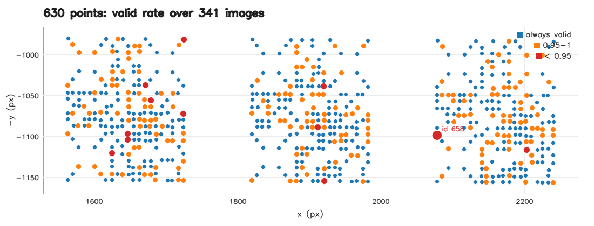
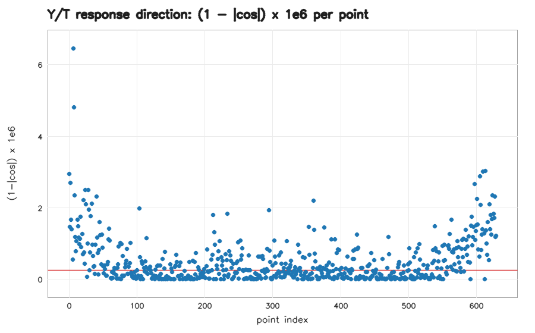
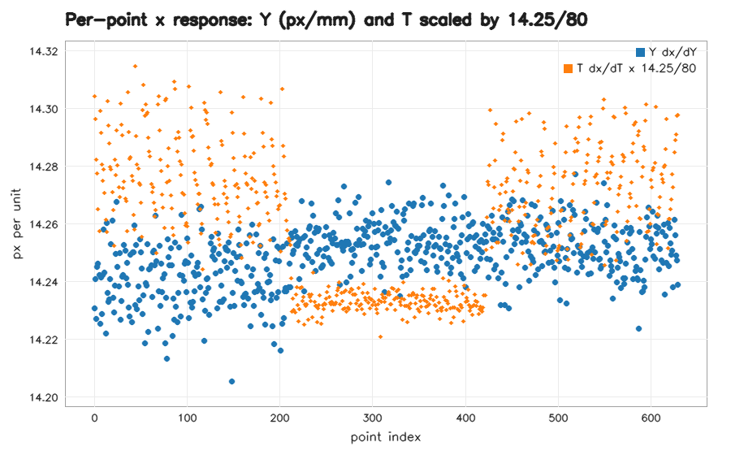
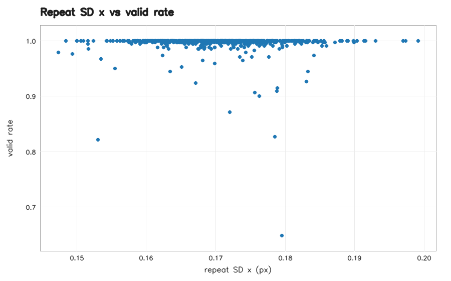
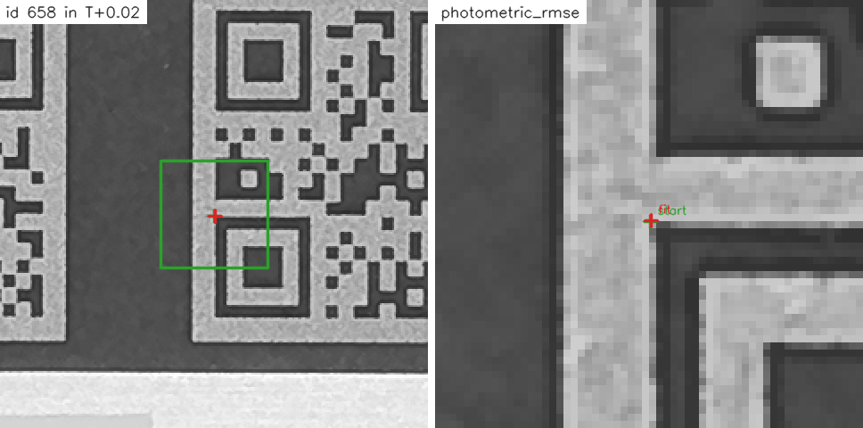

# 보고서: 630점 목록 - 점별 유효율과 반응 방향 (10-22 17:36)

## 문제

341장 x 630점 측정값이 얼마나 유효하고 Y/T가 각 점을 어느 방향으로 움직이는지 점 단위로 정리하려 했다.

## 해결 방법

점마다 유효율·경계 맞춤 품질 중앙값·단일 축 사진 Y/T 기울기·두 기울기의 코사인·같은 명령 반복 SD를 계산했다.

## 결과

유효 비율은 0.9954이고 Y/T 반응 |코사인| 중앙값이 0.99999975로, 모든 점에서 Y와 T가 거의 같은 방향(x)으로 움직였다.

| 지표 | 값 |
|---|---|
| 유효 비율 | 0.9954 |
| 항상 유효한 점 | 417 / 630 |
| 사진별 유효점 최소 | 620 |
| 점별 유효 장수 최소 | 221 / 341 |
| Y/T \|코사인\| 중앙값 | 0.99999975 |
| Y 기울기 x 중앙 (QR1/2/3, px/mm) | 14.24 / 14.25 / 14.25 |
| T 기울기 x 중앙 (QR1/2/3, px/deg) | 80.14 / 79.90 / 80.13 |
| 반복 SD 중앙 x / y (px) | 0.1705 / 0.0256 |

## 튀는 값

유효율이 가장 낮은 점은 QR3의 id 658(2078.3, 1099.0)로 341장 중 221장만 유효했고, rmse 중앙 14.61가 전체 중앙 10.76보다 커서 경계 모델이 잘 맞지 않는 자리다.

| id | QR | x | y | 패치 | 유효 장수 | 유효율 | rmse 중앙 | 창 안정성 중앙 | 대비 중앙 | YT 코사인 | 반복 SD x |
|---|---|---|---|---|---|---|---|---|---|---|---|
| 658 | 3 | 2078.3 | 1099.0 | 0001 | 221 | 0.6481 | 14.61 | 0.0672 | 116.9 | 0.9999991 | 0.1796 |
| 121 | 1 | 1724.3 | 1072.3 | 0010 | 280 | 0.8211 | 13.45 | 0.0629 | 126.6 | 0.9999999 | 0.1531 |
| 690 | 3 | 2203.0 | 1116.1 | 0001 | 282 | 0.8270 | 13.42 | 0.0457 | 113.7 | 0.9999994 | 0.1785 |
| 164 | 1 | 1646.7 | 1096.9 | 0010 | 297 | 0.8710 | 14.28 | 0.0409 | 126.5 | 1.0000000 | 0.1720 |
| 499 | 2 | 1920.7 | 1154.5 | 0100 | 307 | 0.9003 | 13.60 | 0.0496 | 130.1 | 0.9999997 | 0.1763 |
| 399 | 2 | 1911.9 | 1088.5 | 1000 | 309 | 0.9062 | 13.72 | 0.0252 | 128.8 | 0.9999998 | 0.1756 |
| 56 | 1 | 1671.3 | 1037.7 | 0100 | 310 | 0.9091 | 13.47 | 0.0357 | 127.0 | 0.9999996 | 0.1788 |
| 5 | 1 | 1724.6 | 981.5 | 0010 | 312 | 0.9150 | 13.61 | 0.0484 | 120.3 | 0.9999995 | 0.1789 |
| 197 | 1 | 1624.6 | 1120.5 | 0100 | 315 | 0.9238 | 13.88 | 0.0837 | 116.2 | 1.0000000 | 0.1671 |
| 177 | 1 | 1646.6 | 1103.8 | 1000 | 316 | 0.9267 | 13.24 | 0.0416 | 130.0 | 0.9999997 | 0.1831 |

왼쪽은 T+0.02 사진에서 그 점 주변 240 px, 오른쪽은 60 px 확대다. 초록 십자는 기준 위치 + NCC 이동(맞춤 시작점), 빨간 십자는 맞춘 위치, 글자는 무효 이유다.

## 한줄평

630점은 모두 QR 판 위의 좁은 영역(가로 약 680 px)에 있어 Y 1 mm와 T 1 deg가 각 점을 같은 x 방향으로 14.3 px, 79.9 px 옮기므로, 점 하나하나의 반응 방향으로는 두 축을 구분할 수 없고(|코사인| 0.9999997) 구분은 크기의 미세한 공간 차이에만 기대야 한다.

## 원래 결과와 대조

원래 값은 `eda_630_inventory_20261022/summary.json`에서 가져왔다. 원래 입력은 joint_center_630 `results/measurements.npz`(컴파일 LM 측정)였고 C++도 같은 LM 변형으로 다시 쟀다. 20/20 일치.

| 지표 | 원래 결과 | C++ 결과 | 차이 | 판정 |
|---|---|---|---|---|
| 유효 비율 | 0.995406 | 0.995406 | 0.000000 | 일치 |
| 항상 유효한 점 수 | 417 | 417 | 0 | 일치 |
| 한 번도 유효하지 않은 점 수 | 0 | 0 | 0 | 일치 |
| 사진별 유효점 최소 | 620 | 620 | 0 | 일치 |
| 사진별 유효점 최대 | 630 | 630 | 0 | 일치 |
| 점별 유효 장수 최소 | 221 | 221 | 0 | 일치 |
| 점별 유효 장수 최대 | 341 | 341 | 0 | 일치 |
| 유효율 최저 점 id | 658 | 658 | - | 일치 |
| Y/T 반응 \|코사인\| 중앙값 | 0.999999747 | 0.999999747 | 0.000000000 | 일치 |
| 반복 SD 중앙 x (px) | 0.17047 | 0.17047 | 0.00000 | 일치 |
| 반복 SD 중앙 y (px) | 0.02558 | 0.02558 | 0.00000 | 일치 |
| QR1 Y 기울기 중앙 dx (px/mm) | 14.2414 | 14.2414 | 0.0000 | 일치 |
| QR1 T 기울기 중앙 dx (px/deg) | 80.1368 | 80.1368 | 0.0000 | 일치 |
| QR2 Y 기울기 중앙 dx (px/mm) | 14.2536 | 14.2536 | 0.0000 | 일치 |
| QR2 T 기울기 중앙 dx (px/deg) | 79.9037 | 79.9037 | 0.0000 | 일치 |
| QR3 Y 기울기 중앙 dx (px/mm) | 14.2519 | 14.2519 | 0.0000 | 일치 |
| QR3 T 기울기 중앙 dx (px/deg) | 80.1339 | 80.1339 | 0.0000 | 일치 |
| 품질 중앙 rmse | 10.7588 | 10.7588 | 0.0000 | 일치 |
| 품질 중앙 창 안정성 | 0.04042 | 0.04042 | 0.00000 | 일치 |
| 품질 중앙 대비 | 122.624 | 122.624 | 0.000 | 일치 |
