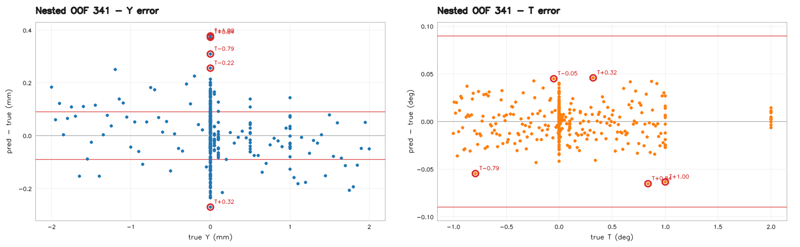
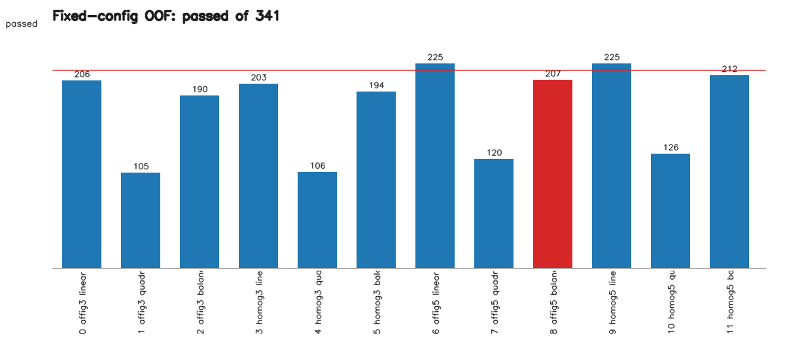
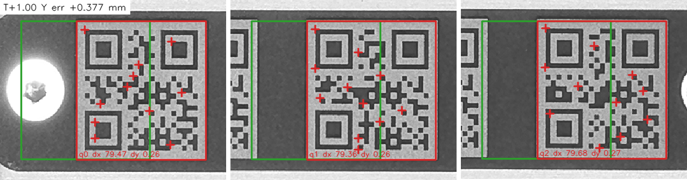
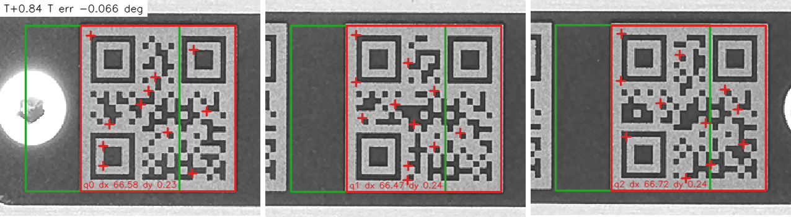
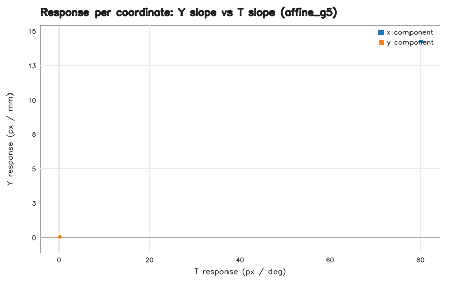

# 보고서: 관측 재설계 - QR별 직접 정합 (10-22 17:40)

## 문제

QR 안에서 Y와 T가 거의 같은 방향으로 움직여 분리가 어려워, QR 관측 방식을 다시 설계해야 했다.

## 해결 방법

QR마다 center에 ECC affine·homography로 직접 정합해 630점 변위를 만들고, 세 판정기 12설정을 원래와 같은 중첩 OOF로 골라 341장을 평가했다.

## 결과

중첩 OOF 341장 중 219장(원래 218장, 0.09 mm 경계에 걸린 1장 차이)이 Y·T 동시 통과했고, 10-20은 53/60이지만 10-14는 166/281로 큰 T 사진에서 Y가 틀렸다. 같은 날 보고된 QR 밖 외부 5곳 정합의 341/341은 QR 영역 규칙 위반으로 철회됐다.

| 지표 | 값 |
|---|---|
| 동시 통과 (\|eY\|<=0.09, \|eT\|<=0.09) | 219 / 341 |
| 10-14 / 10-20 통과 | 166 / 281, 53 / 60 |
| Y 평균 / 최대 \|오차\| (mm) | 0.0817 / 0.3775 |
| T 평균 / 최대 \|오차\| (deg) | 0.0146 / 0.0656 |
| Y 단독 통과 / T 단독 통과 | 219 / 341, 341 / 341 |
| 측정 실패 | 0 |
| fold별 선택 설정 | 8, 8, 9, 11 (재적용 8) |
| (철회) 외부 5곳 정합 | 341 / 341, QR 밖 사용 |

## 튀는 값

가장 크게 틀린 사진은 Y는 T+1.00(정답 Y 0.00, 추정 0.377 mm), T는 T+0.84(정답 T 0.84, 추정 0.774 deg)이다. Y가 0인 T 사진인데 단일축 직선 대비 잔차(0.066 px)를 T와 직교하는 Y 방향에 투영하면 Y +0.659 mm에 해당하고(Y 0.09 mm 신호는 그 방향으로 0.0020 px뿐), 정합 잔차가 그대로 Y 오차가 됐다.

| 구분 | 사진 | fold / 선택 | 정답 Y (mm) | 추정 Y | 정답 T (deg) | 추정 T | q0 / q1 / q2 평균 dx (px) | 단일축 직선 대비 잔차 RMS (px) | 잔차의 Y 구분 방향 성분 (mm 환산) |
|---|---|---|---|---|---|---|---|---|---|
| Y 오차 상위 | 20261014/Theta/T+1.00.bmp | 1 / 8 | 0.00 | 0.377 | 1.00 | 0.936 | 79.47 / 79.36 / 79.68 | 0.0656 | +0.659 |
| Y 오차 상위 | 20261014/Theta/T+0.84.bmp | 1 / 8 | 0.00 | 0.372 | 0.84 | 0.774 | 66.58 / 66.47 / 66.72 | 0.0308 | +0.394 |
| Y 오차 상위 | 20261014/Theta/T-0.79.bmp | 2 / 9 | 0.00 | 0.310 | -0.79 | -0.845 | -64.18 / -63.88 / -64.00 | 0.0991 | +0.438 |
| Y 오차 상위 | 20261014/Theta/T+0.32.bmp | 2 / 9 | 0.00 | -0.270 | 0.32 | 0.366 | 24.84 / 24.79 / 24.91 | 0.1004 | -0.613 |
| Y 오차 상위 | 20261014/Theta/T-0.22.bmp | 0 / 8 | 0.00 | 0.256 | -0.22 | -0.263 | -18.02 / -17.92 / -17.96 | 0.2046 | -0.319 |
| T 오차 상위 | 20261014/Theta/T+0.84.bmp | 1 / 8 | 0.00 | 0.372 | 0.84 | 0.774 | 66.58 / 66.47 / 66.72 | 0.0308 | +0.394 |
| T 오차 상위 | 20261014/Theta/T+1.00.bmp | 1 / 8 | 0.00 | 0.377 | 1.00 | 0.936 | 79.47 / 79.36 / 79.68 | 0.0656 | +0.659 |
| T 오차 상위 | 20261014/Theta/T-0.79.bmp | 2 / 9 | 0.00 | 0.310 | -0.79 | -0.845 | -64.18 / -63.88 / -64.00 | 0.0991 | +0.438 |

초록 상자는 center의 QR 상자, 빨간 상자는 그 fold에서 고른 측정의 QR 평균 변위만큼 옮긴 상자, 빨간 십자는 630점 중 20개마다 한 점의 정합 위치다. 단일축 직선 대비 잔차는 10-14 Y·T 스캔에서 좌표별로 맞춘 직선(T 절편 + T 기울기 x T + Y 기울기 x Y)과의 차이이고, 10-14 전체 중앙값은 0.1075 px다.

## 한줄평

QR 안 1260좌표에서 Y 1mm 반응과 T 1deg 반응의 cos가 1.00000로 거의 같은 방향이고 T와 직교하는 Y 성분은 1mm당 0.022 px(0.09 mm면 0.0020 px)뿐이라, 정합 방식을 바꿔도 큰 T 사진의 정합 잔차(중앙값 0.108 px)를 넘지 못해 10-14에서 115장이 Y로 떨어졌다.

## 원래 결과와 대조

원래 값은 `joint_yt_reboot_20261022/direct_summary.csv`, `direct_selection.json`, `direct_fixed_predictions.csv`, `direct/features.npz`(평균 변위), `direct/measurement_audit.json`에서 가져왔다. 철회 사실은 `candidate_status_20261023.json`. 15/18 일치.

| 지표 | 원래 결과 | C++ 결과 | 차이 | 판정 |
|---|---|---|---|---|
| 중첩 OOF 341 통과 장수 | 218 | 219 | 1 | 불일치 |
| 중첩 OOF 10-14 통과 (281장) | 165 | 166 | 1 | 불일치 |
| 중첩 OOF 10-20 통과 (60장) | 53 | 53 | 0 | 일치 |
| 중첩 OOF Y 평균 \|오차\| (mm) | 0.0817 | 0.0817 | 0.0000 | 일치 |
| 중첩 OOF Y 최대 \|오차\| (mm) | 0.3774 | 0.3775 | 0.0001 | 일치 |
| 중첩 OOF T 평균 \|오차\| (deg) | 0.0146 | 0.0146 | 0.0000 | 일치 |
| 중첩 OOF T 최대 \|오차\| (deg) | 0.0656 | 0.0656 | 0.0000 | 일치 |
| 전체 학습 재적용 통과 | 216 | 216 | 0 | 일치 |
| fold 0~3 + 재적용 선택 설정 | 8, 8, 9, 11, 8 | 8, 8, 9, 11, 8 | - | 일치 |
| 고정 설정 6 (affine_g5 linear) 통과 | 225 | 225 | 0 | 일치 |
| 고정 설정 8 (affine_g5 balanced) 통과 | 207 | 207 | 0 | 일치 |
| 고정 설정 9 (homography_g5 linear) 통과 | 224 | 225 | 1 | 불일치 |
| 고정 설정 11 (homography_g5 balanced) 통과 | 212 | 212 | 0 | 일치 |
| T-1.00 affine_g5 평균 Dx (px) | -80.9942 | -80.9942 | 0.0000 | 일치 |
| T-1.00 homography_g5 평균 Dx (px) | -80.9926 | -80.9926 | 0.0000 | 일치 |
| T+0.01 affine_g3 평균 Dx (px) | 0.1731 | 0.1731 | 0.0000 | 일치 |
| Y+0.05 T+0.01 (1) homography_g5 평균 Dy (px) | 0.4519 | 0.4519 | 0.0000 | 일치 |
| 측정 실패 (4측정 합) | 0 | 0 | 0 | 일치 |

불일치 원인: 측정 변위는 원래 `features.npz`와 좌표 RMS 0.00001 px(최대 0.001 px, affine_g3) 차이다(OpenCV 3.4와 cv2 5.0의 가우시안·NCC·마스크 warp 반올림). C++ 변위를 원래 Python 판정기에 넣은 결과와 이 C++ 판정기 결과는 0.000001 mm 안으로 같았다(별도 확인). shrink 0.01 GLS가 작은 잔차 방향을 크게 키워 이 차이가 예측에서 최대 약 0.001 mm가 되고, 원래 오차 0.090001 mm로 경계에 걸려 떨어졌던 10-14 Y+0.20이 C++에서는 0.08997 mm로 통과해 1장이 바뀌었다. 고정 설정 9의 1장 차이도 같은 이유다.
