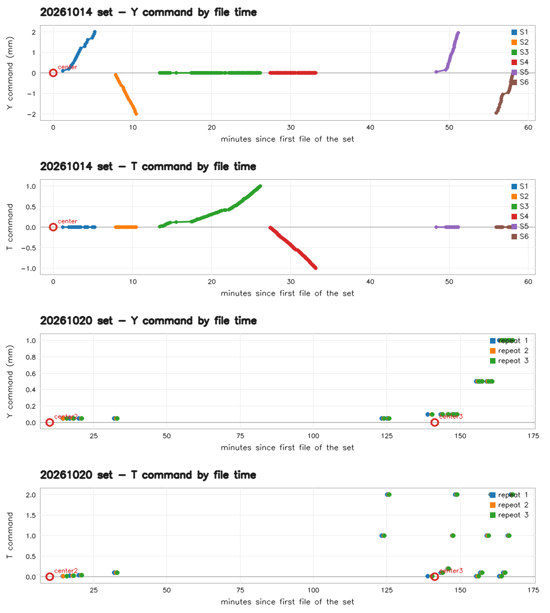
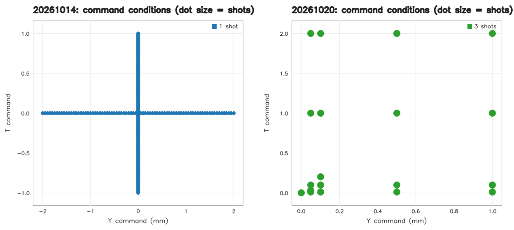
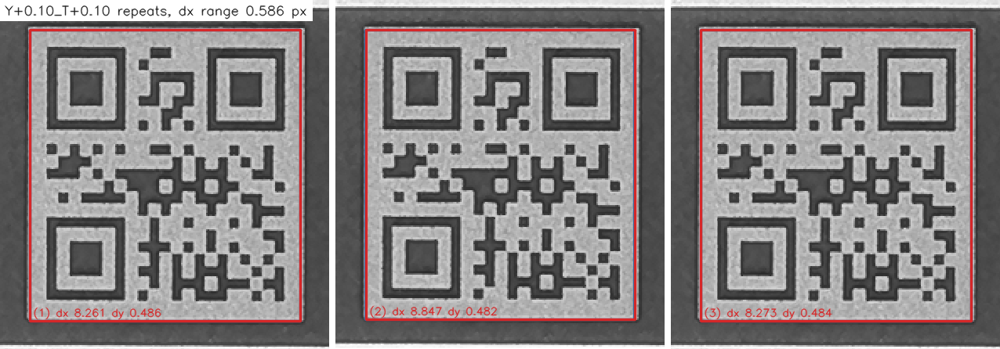
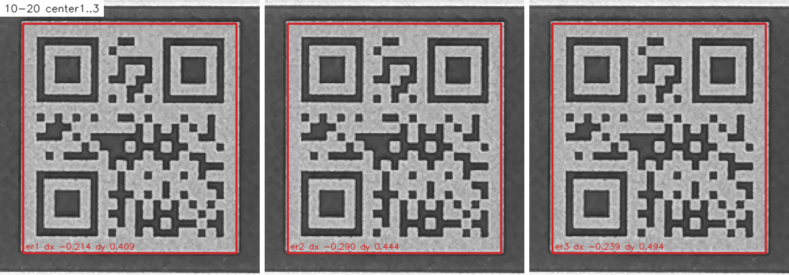
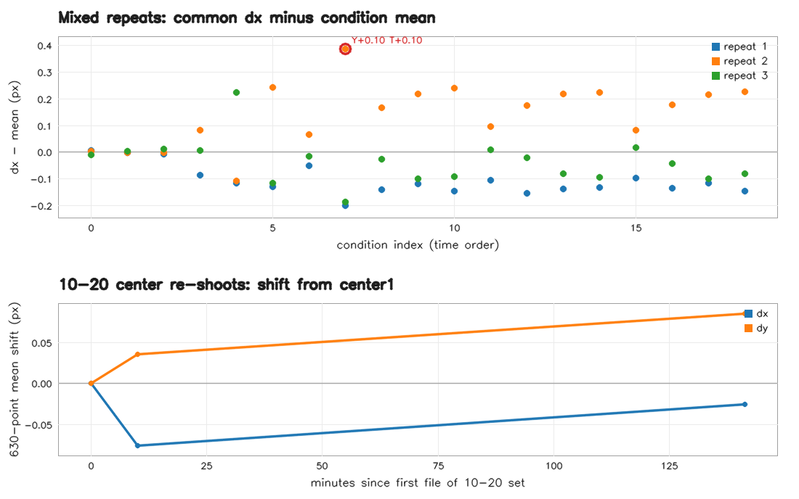

# 보고서: 341장 촬영 기록 정리 - 파일 시각 정렬 (10-22 17:43)

## 문제

341장의 촬영 순서와 trial 구성, 같은 명령 반복을 정리해야 했다.

## 해결 방법

원본 zip에 남은 사진별 파일 시각으로 341장을 시간순으로 놓고, 파일명 그룹이 끊기지 않는 시간 블록을 trial로, 같은 명령 사진을 반복 조건으로 묶었다.

## 결과

10-14는 단일축 trial 6개와 center 1장, 10-20은 혼합 19조건 x 3장과 center 3장이고, 같은 명령 반복은 20조건이다.

| 지표 | 값 |
|---|---|
| 사진 / 고유 해시 | 341 / 341 |
| 단일축 trial (S1~S6) | 6 (Y 4, T 2) |
| 혼합 조건 / 관측 칸 | 19 / 28 |
| 반복 조건 (혼합 19 + center 1) | 20 |
| center | 4 (10-14 1, 10-20 3) |
| 2분 이상 공백 / 최대 공백 | 12 / 5414 초 |
| 같은 시각 겹침 | 0 |
| 시각 출처 | 원본 zip 중앙 디렉터리의 NTFS 수정 시각 (clean 메타데이터에는 시각 없음) |

| trial | group | axis | count | start | end | duration_min | start_command | end_command | minimum | maximum | step_values | monotonic | median_gap_s |
|---|---|---|---|---|---|---|---|---|---|---|---|---|---|
| S1 | Y 0.1 간격 + | Y | 20 | 2026-10-04 12:14:14 | 2026-10-04 12:18:18 | 4.067 | 0.10 | 2.00 | 0.10 | 2.00 | +0.10 | True | 8.0 |
| S2 | Y 0.1 간격 - | Y | 20 | 2026-10-04 12:20:56 | 2026-10-04 12:23:31 | 2.583 | -0.10 | -2.00 | -2.00 | -0.10 | -0.10 | True | 7.0 |
| S3 | Θ + | T | 100 | 2026-10-04 12:26:30 | 2026-10-04 12:39:11 | 12.683 | 0.01 | 1.00 | 0.01 | 1.00 | +0.01 | True | 6.0 |
| S4 | Θ - | T | 100 | 2026-10-04 12:40:27 | 2026-10-04 12:46:12 | 5.750 | -0.01 | -1.00 | -1.00 | -0.01 | -0.01 | True | 3.0 |
| S5 | Y 0.05 홀수 + | Y | 20 | 2026-10-04 13:01:26 | 2026-10-04 13:04:10 | 2.733 | 0.05 | 1.95 | 0.05 | 1.95 | +0.10 | True | 5.0 |
| S6 | Y 0.05 홀수 - | Y | 20 | 2026-10-04 13:09:00 | 2026-10-04 13:11:04 | 2.067 | -1.95 | -0.05 | -1.95 | -0.05 | +0.10 | True | 4.0 |

## 튀는 값

같은 명령 반복에서 공통 dx가 가장 크게 흩어진 조건은 Y+0.10 T+0.10이고, 3장을 42초 안에 찍었는데 dx 범위가 0.586 px로 T 0.01이 만드는 이동(0.801 px)의 0.73배다.

| 조건 (Y, T) | 장수 | 시각 | 반복별 공통 dx (px) | dx 범위 (px) | dx 표준편차 | dy 범위 (px) |
|---|---|---|---|---|---|---|
| +0.10, +0.10 | 3 | 21:56:36 / 21:57:04 / 21:57:18 | 8.261 / 8.847 / 8.273 | 0.5863 | 0.3349 | 0.0039 |
| +0.10, +2.00 | 3 | 22:01:32 / 22:02:06 / 22:02:16 | 161.027 / 161.413 / 161.082 | 0.3866 | 0.2091 | 0.0045 |
| +0.05, +2.00 | 3 | 21:38:22 / 21:38:50 / 21:39:04 | 160.763 / 161.136 / 160.776 | 0.3727 | 0.2114 | 0.0210 |
| +1.00, +2.00 | 3 | 22:20:32 / 22:20:56 / 22:21:08 | 174.174 / 174.547 / 174.241 | 0.3722 | 0.1985 | 0.0279 |
| +0.50, +1.00 | 3 | 22:12:16 / 22:12:38 / 22:12:52 | 86.708 / 87.066 / 86.767 | 0.3575 | 0.1917 | 0.0174 |

파란 상자는 그 조건 첫 사진의 가운데 QR 위치, 빨간 상자는 이 사진의 위치다(630점 평균 이동만큼 옮긴 center 상자). 두 번째 그림은 같은 방식으로 본 10-20 center1~3이다(center1 기준).

## 한줄평

파일 시각은 촬영 장비 기록이 아니라 파일 수정 시각이지만 341장 모두 서로 다르고(겹침 0) 파일명 그룹이 7개 연속 블록으로 끊기지 않아 trial 경계를 시간으로 확정할 수 있었고, 같은 명령도 반복 사이 공통 dx가 최대 0.586 px 달라 반복을 같은 자세로 볼 수 없다.

## 원래 결과와 대조

원래 값은 `eda_capture_inventory_20261022/`의 `audit.json`, `single_axis_trials.csv`, `center_chronology.csv`, `repeated_conditions.csv`, `gaps_at_least_2min.csv`, `all_341_shots.csv`(taken_at 합), `report.html`에서 가져왔다. 26/26 일치.

| 지표 | 원래 결과 | C++ 결과 | 차이 | 판정 |
|---|---|---|---|---|
| 사진 수 | 341 | 341 | 0 | 일치 |
| 단일축 trial 수 | 6 | 6 | 0 | 일치 |
| 10-14 시간 블록 수 (center 포함) | 7 | 7 | 0 | 일치 |
| 혼합 조건 수 | 19 | 19 | 0 | 일치 |
| 반복 조건 수 (2장 이상) | 20 | 20 | 0 | 일치 |
| center 수 | 4 | 4 | 0 | 일치 |
| 고유 해시 수 | 341 | 341 | 0 | 일치 |
| 같은 시각 겹침 | 0 | 0 | 0 | 일치 |
| 2분 이상 공백 수 | 12 | 12 | 0 | 일치 |
| 341장 시각 합 (초, KST) | 610830048058 | 610830048058 | 0 | 일치 |
| S1 그룹·시작~끝 | Y 0.1 간격 + 2026-10-04 12:14:14 ~ 12:18:18 | Y 0.1 간격 + 2026-10-04 12:14:14 ~ 12:18:18 | - | 일치 |
| S2 그룹·시작~끝 | Y 0.1 간격 - 2026-10-04 12:20:56 ~ 12:23:31 | Y 0.1 간격 - 2026-10-04 12:20:56 ~ 12:23:31 | - | 일치 |
| S3 그룹·시작~끝 | Θ + 2026-10-04 12:26:30 ~ 12:39:11 | Θ + 2026-10-04 12:26:30 ~ 12:39:11 | - | 일치 |
| S4 그룹·시작~끝 | Θ - 2026-10-04 12:40:27 ~ 12:46:12 | Θ - 2026-10-04 12:40:27 ~ 12:46:12 | - | 일치 |
| S5 그룹·시작~끝 | Y 0.05 홀수 + 2026-10-04 13:01:26 ~ 13:04:10 | Y 0.05 홀수 + 2026-10-04 13:01:26 ~ 13:04:10 | - | 일치 |
| S6 그룹·시작~끝 | Y 0.05 홀수 - 2026-10-04 13:09:00 ~ 13:11:04 | Y 0.05 홀수 - 2026-10-04 13:09:00 ~ 13:11:04 | - | 일치 |
| S1~S6 사진 간격 중앙값 (초) | 8, 7, 6, 3, 5, 4 | 8, 7, 6, 3, 5, 4 | - | 일치 |
| center 4장 시각 | 12:13:03, 19:33:08, 19:43:08, 21:54:26 | 12:13:03, 19:33:08, 19:43:08, 21:54:26 | - | 일치 |
| 반복 2 > 반복 1 혼합 조건 수 | 17 | 17 | 0 | 일치 |
| 반복 2-1 dx 중앙값 (px) | 0.3145 | 0.3145 | 0.0000 | 일치 |
| 10-20 center1 공통 dx (px) | -0.2138 | -0.2138 | 0.0000 | 일치 |
| 10-20 center2 공통 dx (px) | -0.2896 | -0.2896 | 0.0000 | 일치 |
| 10-20 center3 공통 dy (px) | 0.4942 | 0.4942 | 0.0000 | 일치 |
| (0,0) 3장 dx 표준편차 (px) | 0.0386 | 0.0386 | 0.0000 | 일치 |
| Y+0.10 T+0.10 dx 표준편차 (px) | 0.3349 | 0.3349 | 0.0000 | 일치 |
| 유효 점 합 (341 x 630 중) | 213843 | 213843 | 0 | 일치 |

시각 출처: `data/clean/*/_metadata/file_inventory.csv`(relative_path, source_member, bytes, sha256, zip_crc32)와 `manifest.csv`, `provenance.json`에는 사진별 시각이 없다. clean 사본의 파일 시스템 수정 시각은 2026-10-28 추출 시각이라 촬영 순서가 아니다. 원래 실험은 hw-analysis EDA `shots.csv`의 `taken_at`을 썼고, 그 값은 `hw-analysis/data/hw/bmp`에 풀린 BMP의 파일 수정 시각(Asia/Seoul, 초 아래 버림)이었다(원래 audit: 341/341 일치). 그 BMP들은 원본 zip에서 풀렸고, zip 중앙 디렉터리에 사진마다 NTFS 수정 시각(100 ns, UTC)이 들어 있다. 그래서 C++는 clean의 `provenance.json` `source_archive`가 가리키는 zip을 열어, `file_inventory.csv`의 `source_member` 이름으로 그 시각을 찾고 +9시간 한 뒤 초 아래를 버렸다. 이는 '오직 data/clean' 입력 규칙의 예외이며, 사진 바이트는 data/clean에서만 읽었다.
