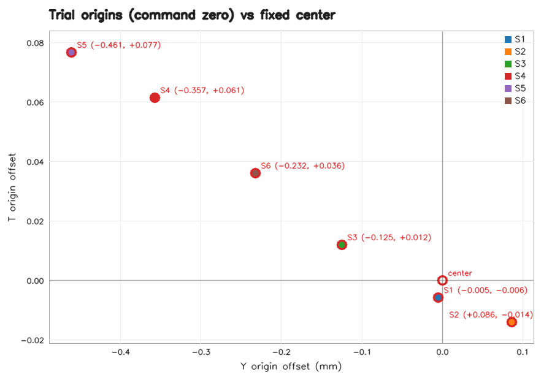
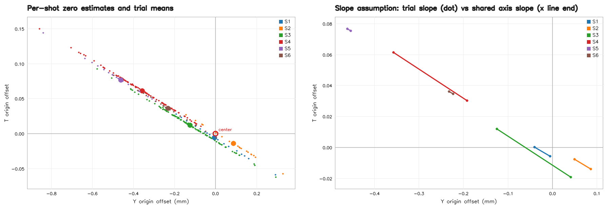
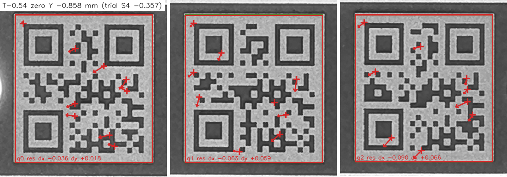
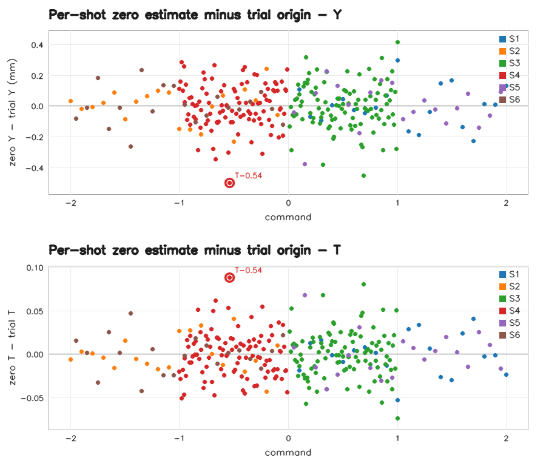

# 보고서: trial 원점 - 절편 외삽 역산 (10-22 17:50)

## 문제

단일축 trial마다 명령 0일 때의 원점이 고정 center에서 얼마나 어긋나는지 Y/T로 환산해야 했다.

## 해결 방법

trial별 직선 절편을 630점 변위 1260성분에서 명령 0으로 외삽하고, 그 변위를 축별 평균 기울기 J에 최소제곱으로 맞춰 Y0/T0를 구했다.

## 결과

trial 원점 Y는 S5 -0.460608 mm부터 S2 0.086185 mm까지 나왔고, T는 -0.0140~0.0766이다.

| trial | 축 | 장수 | 원점 Y (mm) | 원점 T | 원점 평균 dx / dy (px) | 공통 기울기 Y / T | 설명 안 된 잔차 RMS (px) |
|---|---|---|---|---|---|---|---|
| S1 (Y 0.1 간격 +) | Y | 20 | -0.0051 | -0.0058 | -0.540 / -0.001 | -0.0402 / +0.0003 | 0.0458 |
| S2 (Y 0.1 간격 -) | Y | 20 | +0.0862 | -0.0140 | +0.110 / +0.035 | +0.0499 / -0.0078 | 0.0538 |
| S3 (Θ +) | T | 100 | -0.1249 | +0.0119 | -0.835 / +0.032 | +0.0409 / -0.0192 | 0.0495 |
| S4 (Θ -) | T | 100 | -0.3574 | +0.0614 | -0.194 / +0.073 | -0.1916 / +0.0303 | 0.0681 |
| S5 (Y 0.05 홀수 +) | Y | 20 | -0.4606 | +0.0766 | -0.449 / +0.078 | -0.4527 / +0.0754 | 0.0725 |
| S6 (Y 0.05 홀수 -) | Y | 20 | -0.2322 | +0.0361 | -0.428 / +0.080 | -0.2231 / +0.0347 | 0.0766 |

## 튀는 값

trial 평균에서 가장 벗어난 사진은 Theta/T-0.54.bmp(S4, 명령 -0.54)로, 명령을 빼고 남은 변위가 Y0 -0.858 mm(trial -0.357)로 환산됐고, 남은 평균 이동은 dx -0.256 px뿐인데 J가 T와 거의 평행해 작은 모양 차이가 Y로 크게 옮겨졌다.

| 구분 | 사진 | trial | 명령 | 사진별 Y0 (mm) | trial Y0 | 사진별 T0 | trial T0 | 명령 제거 후 평균 dx / dy (px) | 유효 점 |
|---|---|---|---|---|---|---|---|---|---|
| Y0 편차 상위 | Theta/T-0.54.bmp | S4 | -0.54 | -0.8576 | -0.3574 | +0.1499 | +0.0614 | -0.256 / +0.121 | 630 |
| Y0 편차 상위 | Theta/T+0.69.bmp | S3 | +0.69 | -0.5771 | -0.1249 | +0.0924 | +0.0119 | -0.853 / +0.074 | 627 |
| Y0 편차 상위 | Theta/T+1.00.bmp | S3 | +1.00 | +0.2923 | -0.1249 | -0.0621 | +0.0119 | -0.796 / +0.025 | 628 |
| Y0 편차 상위 | Theta/T+0.32.bmp | S3 | +0.32 | -0.5058 | -0.1249 | +0.0798 | +0.0119 | -0.844 / +0.059 | 626 |
| Y0 편차 상위 | Y/Y+0.15.bmp | S5 | +0.15 | -0.8387 | -0.4606 | +0.1444 | +0.0766 | -0.428 / +0.097 | 629 |
| T0 편차 상위 | Theta/T-0.54.bmp | S4 | -0.54 | -0.8576 | -0.3574 | +0.1499 | +0.0614 | -0.256 / +0.121 | 630 |
| T0 편차 상위 | Theta/T+0.69.bmp | S3 | +0.69 | -0.5771 | -0.1249 | +0.0924 | +0.0119 | -0.853 / +0.074 | 627 |
| T0 편차 상위 | Theta/T+1.00.bmp | S3 | +1.00 | +0.2923 | -0.1249 | -0.0621 | +0.0119 | -0.796 / +0.025 | 628 |

T0 편차가 가장 큰 사진도 같은 사진이다.

초록 상자는 그 trial 직선이 이 명령에서 예측한 QR 평균 위치, 빨간 상자는 이 사진에서 잰 평균 위치, 빨간 화살표는 25점마다 한 점의 (측정 - 직선 예측)을 100배 한 것이다.

## 한줄평

J의 Y 열과 T 열 cos가 0.9999972(조건수 2451)라 Y 1mm 중 T와 구분되는 변위가 0.0240 px RMS뿐이어서, trial 원점 변위 중 J로 설명 안 되는 0.046~0.077 px의 작은 모양 차이와 기울기 가정이 Y0를 수백 µm 흔들어 S5와 S2가 0.547 mm 벌어졌다.

## 원래 결과와 대조

원래 값은 `eda_trial_origins_20261022/trial_origins.csv`, `audit.json`, `per_shot_zero_estimates.csv`에서 가져왔다. 27/27 일치.

| 지표 | 원래 결과 | C++ 결과 | 차이 | 판정 |
|---|---|---|---|---|
| S1~S6 순서 (시간순 그룹) | Y1+, Y1-, T+, T-, Y2+, Y2- | Y1+, Y1-, T+, T-, Y2+, Y2- | - | 일치 |
| S1 원점 Y (mm) | -0.005138 | -0.005138 | 0.000000 | 일치 |
| S2 원점 Y (mm) | 0.086185 | 0.086185 | 0.000000 | 일치 |
| S3 원점 Y (mm) | -0.124878 | -0.124878 | 0.000000 | 일치 |
| S4 원점 Y (mm) | -0.357366 | -0.357366 | 0.000000 | 일치 |
| S5 원점 Y (mm) | -0.460608 | -0.460608 | 0.000000 | 일치 |
| S6 원점 Y (mm) | -0.232172 | -0.232172 | 0.000000 | 일치 |
| S1 원점 T | -0.005789 | -0.005789 | 0.000000 | 일치 |
| S2 원점 T | -0.014016 | -0.014016 | 0.000000 | 일치 |
| S3 원점 T | 0.011923 | 0.011923 | 0.000000 | 일치 |
| S4 원점 T | 0.061387 | 0.061387 | 0.000000 | 일치 |
| S5 원점 T | 0.076644 | 0.076644 | 0.000000 | 일치 |
| S6 원점 T | 0.036125 | 0.036125 | 0.000000 | 일치 |
| S1 설명 안 된 잔차 RMS (px) | 0.045833 | 0.045833 | 0.000000 | 일치 |
| S2 설명 안 된 잔차 RMS (px) | 0.053803 | 0.053803 | 0.000000 | 일치 |
| S3 설명 안 된 잔차 RMS (px) | 0.049512 | 0.049512 | 0.000000 | 일치 |
| S4 설명 안 된 잔차 RMS (px) | 0.068071 | 0.068071 | 0.000000 | 일치 |
| S5 설명 안 된 잔차 RMS (px) | 0.072535 | 0.072535 | 0.000000 | 일치 |
| S6 설명 안 된 잔차 RMS (px) | 0.076572 | 0.076572 | 0.000000 | 일치 |
| S3 기울기 평균 dx (px/deg) | 80.298987 | 80.298987 | 0.000000 | 일치 |
| S1 기울기 평균 dx (px/mm) | 14.359770 | 14.359770 | 0.000000 | 일치 |
| S5 공통 기울기 원점 Y (mm) | -0.452674 | -0.452674 | 0.000000 | 일치 |
| J 조건수 | 2450.525 | 2450.525 | 0.000 | 일치 |
| J 두 열 cos | 0.9999972174 | 0.9999972174 | 0.0000000000 | 일치 |
| 사진별 역추정 장수 | 280 | 280 | 0 | 일치 |
| \|사진별 Y0\| 최대 사진 | Theta/T-0.54.bmp | Theta/T-0.54.bmp | - | 일치 |
| \|사진별 Y0\| 최대 값 (mm) | -0.857597 | -0.857597 | 0.000000 | 일치 |
