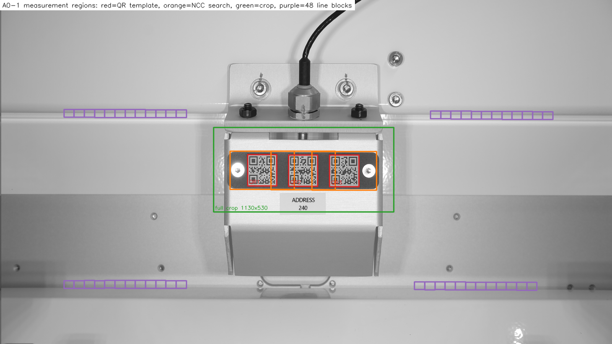
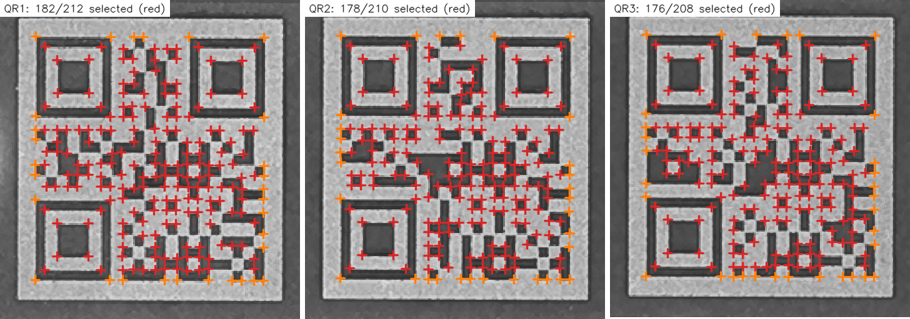
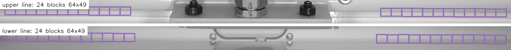
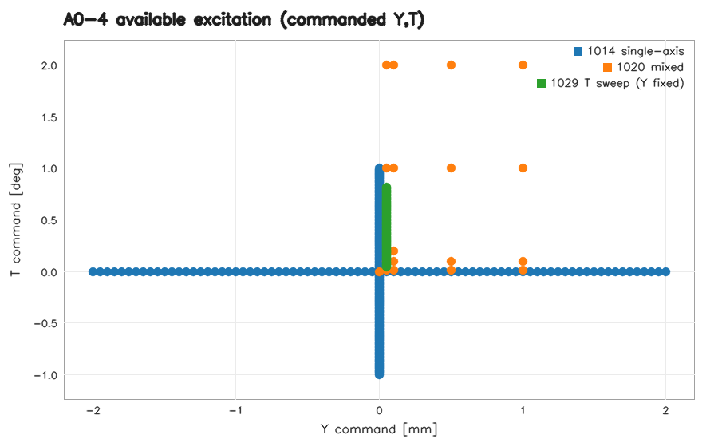
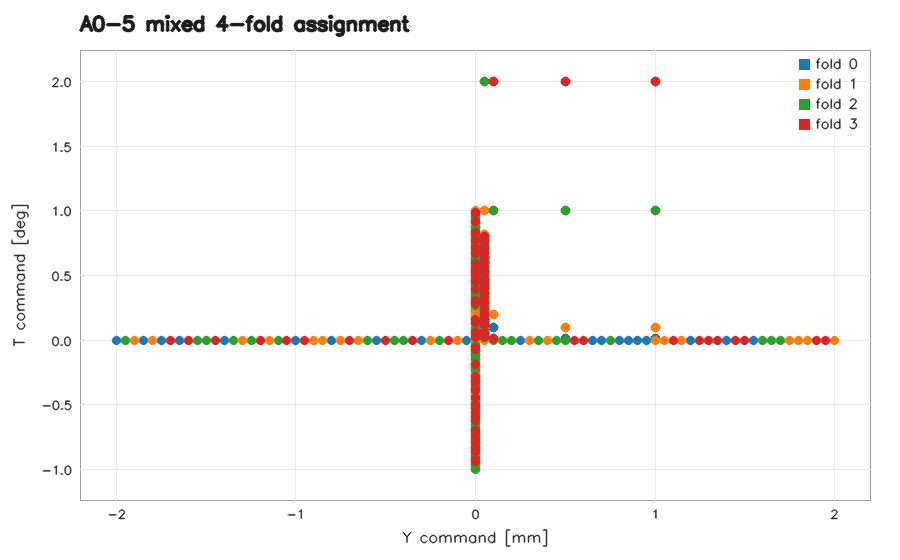
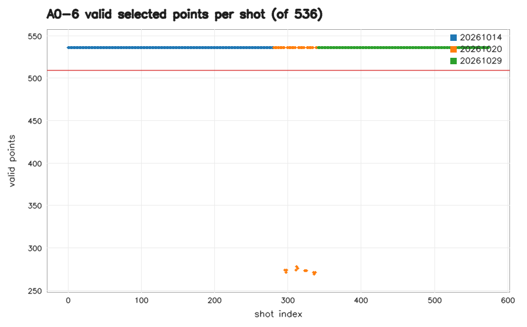
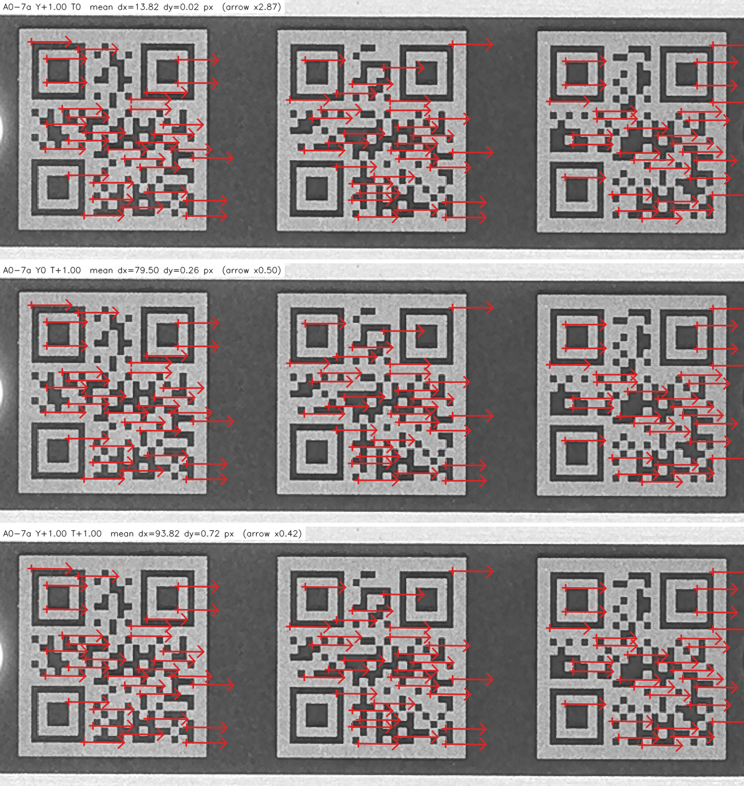
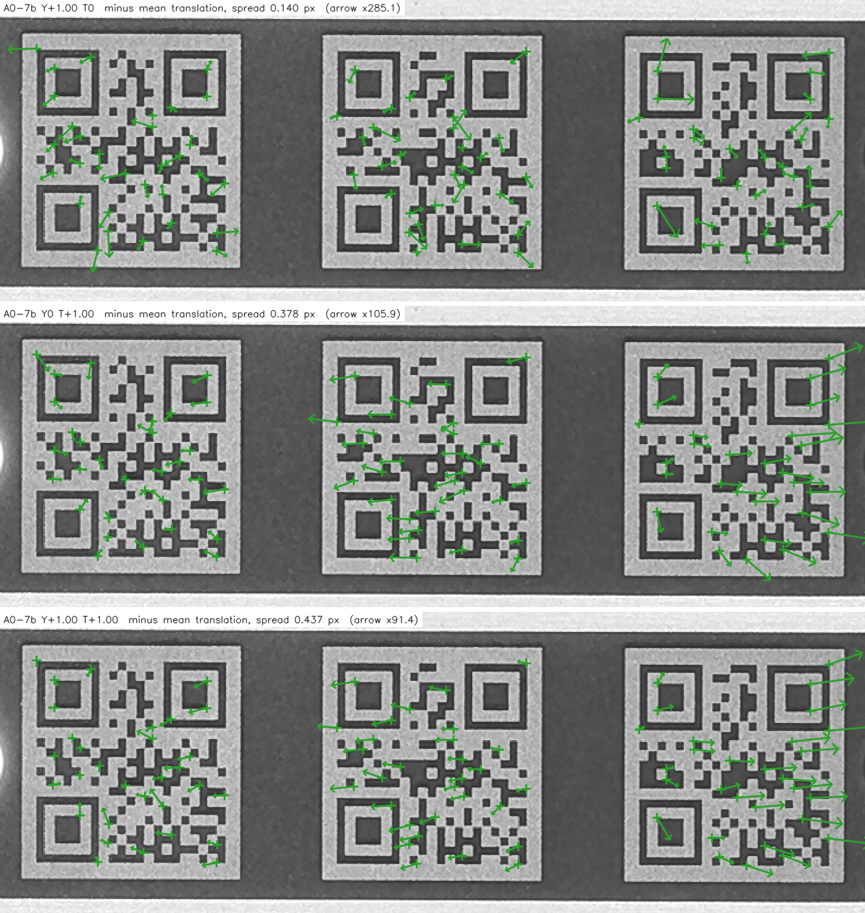
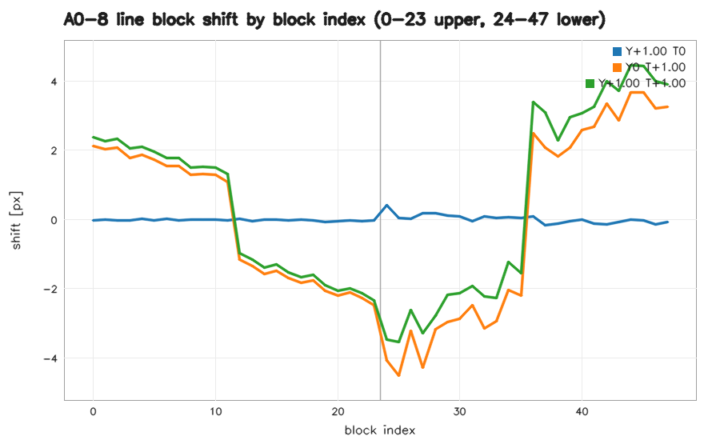

# A0 결과 — 분할 고정, 점 측정 캐시, 자극 범위

이 파일은 `실험/src/main.cpp` 가 다시 쓴다. 해석은 [보고서](보고서.md)에 있다.

허용 절대오차 ±0.045 (5회 반복 정밀도 0.09 의 절반, 2026-11-02 재정의), 판정용 '작다' 경계 0.015.

## 1. 측정 영역 확인

## 2. 쓸 수 있는 자극 (명령 범위)

| 세트 | Y 명령 값 | T 명령 값 | 조건 수 | Y 자극 | T 자극 | 두 축 동시 |
|---|---|---|---|---|---|---|
| 20261014 | -2.00 ~ 2.00 (81종) | -1.00 ~ 1.00 (201종) | 281 | 있음 | 있음 | 없음 |
| 20261020 | 0.00 ~ 1.00 (5종) | 0.00 ~ 2.00 (8종) | 20 | 있음 | 있음 | 19 조건 |
| 20261029 | 0.05 하나 | 0.04 ~ 0.82 (78종) | 78 | 없음 | 있음 | 78 조건 |

조건별 장수는 [excitation_conditions.csv](results/excitation_conditions.csv) 에 있다.

## 3. 혼합 4-fold 구성

| fold | 1014 | 1020 | 1029 | 합계 | 묶음 수 |
|---|---|---|---|---|---|
| -1 (center) | 1 | 0 | 0 | 1 | 1 |
| 0 | 70 | 15 | 61 | 146 | 95 |
| 1 | 70 | 15 | 60 | 145 | 95 |
| 2 | 70 | 15 | 57 | 142 | 94 |
| 3 | 70 | 15 | 56 | 141 | 94 |

1014 의 280장은 기존 `validation/splits.json` 배정을 그대로 썼다. 1020·1029 는 세트별 (Y,T) 오름차순 묶음에 fold 를 돌려 가며 준 계층 배정이다.

## 4. 날짜 3-fold

| fold | 세트 | 장수 |
|---|---|---|
| 0 | 20261014 | 281 |
| 1 | 20261020 | 60 |
| 2 | 20261029 | 234 |

## 5. 측정 요약

| 세트 | 장수 | 측정 성공 | 유효점 중앙값/630 | 선택점 유효 중앙값/536 | 최소 NCC 중앙값 | 선 블록 유효 중앙값/48 |
|---|---|---|---|---|---|---|
| 20261014 | 281 | 281 | 630 | 536 | 0.9799 | 48 |
| 20261020 | 60 | 60 | 630 | 536 | 0.9502 | 48 |
| 20261029 | 234 | 234 | 630 | 536 | 0.9546 | 48 |

## 6. 측정 실패

없다. 575장 전부 측정했다.

## 7. 측정이 실제로 무엇을 보았나

판 전체 평행이동(화살표 길이)은 Y 와 T 가 함께 만든다. 두 축을 가르는 것은 평균을 뺀 나머지 구조다.

## 8. 캐시 파일

| 파일 | 크기(원소) |
|---|---|
| cache/disp.f32 | 724500 float32 |
| cache/valid.u8 | 362250 |
| cache/quality.f32 | 1811250 float32 |
| cache/lines.f32 | 55200 float32 |
| cache/zero.f32 | 1260 float32 |
