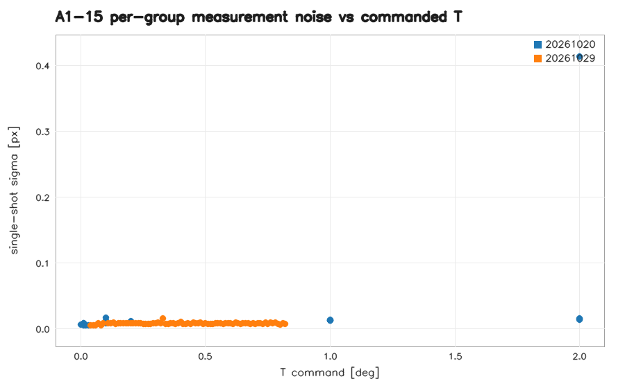
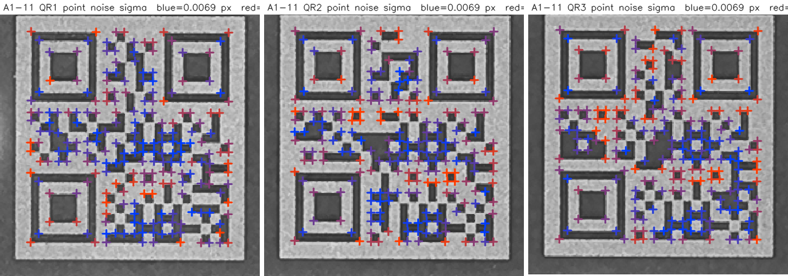
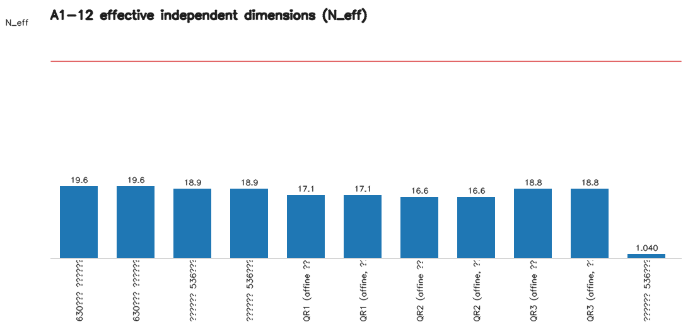
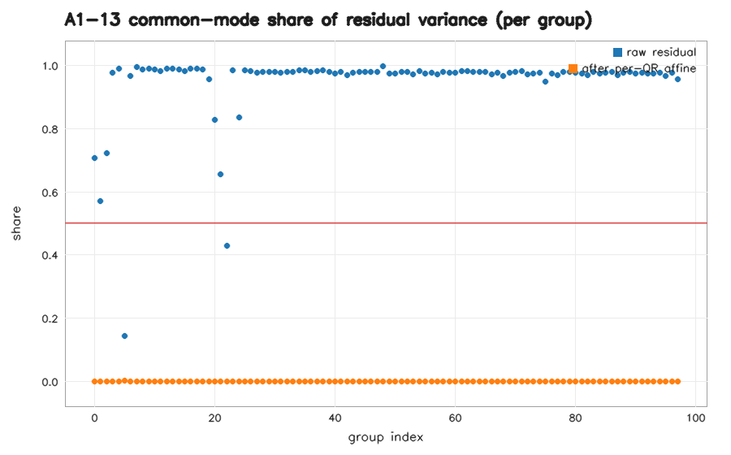
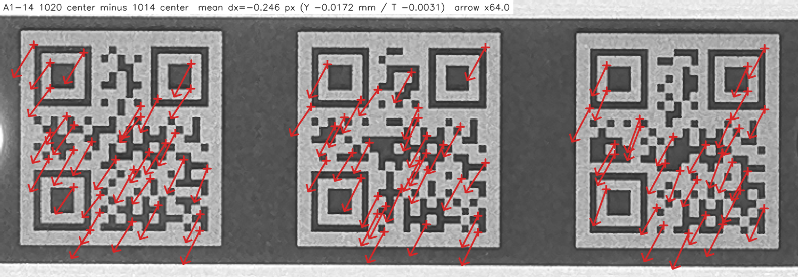

# A1 결과 — 반복 잡음, 점 간 상관, 세션 영점

`실험/src/main.cpp` 가 다시 쓴다. 해석과 판정은 [보고서](보고서.md). 계획은 [계획서](../계획서.md).

허용 절대오차 ±0.045, 판정용 '작다' 경계 0.015 (2026-11-02 기준).

## 1. 반복 잡음

반복 2장 이상인 묶음 98개, 잔차 294장.

| 값 | 중앙값 | p95 | 최대 |
|---|---|---|---|
| raw 잔차 RMS (px) | 0.0496 | 0.1137 | 0.3636 |
| 한 장 측정 잡음 sigma (px) | 0.0087 | 0.0147 | 0.4136 |

raw 와 affine 의 차이는 **반복 촬영 사이에 판이 실제로 움직인 양**이다. 측정 잡음이 아니다.

묶음별 값: [noise_by_group.csv](results/noise_by_group.csv)

## 2. 점별 잡음

| 값 | 중앙값 | p05 | p95 |
|---|---|---|---|
| 점별 sigma (px) | 0.00903 | 0.00690 | 0.01211 |

## 3. 유효 독립 차원 (H11)

| 점 집합 | 명목 차원 | 잔차 장수 | tr S | N_eff | N_eff / 명목 | 최대 고유값 비율 |
|---|---|---|---|---|---|---|
| 630점 전부 (affine 잔차) | 630 | 282 | 19.9572 | 19.56 | 0.0310 | 0.163 |
| 630점 전부 (affine, 이상 묶음 제외) | 630 | 282 | 19.9572 | 19.56 | 0.0310 | 0.163 |
| 선택 536점 (affine 잔차) | 536 | 282 | 16.2159 | 18.86 | 0.0352 | 0.169 |
| 선택 536점 (affine, 이상 묶음 제외) | 536 | 282 | 16.2159 | 18.86 | 0.0352 | 0.169 |
| QR1 (affine 잔차) | 212 | 282 | 6.4981 | 17.14 | 0.0809 | 0.162 |
| QR1 (affine, 이상 묶음 제외) | 212 | 282 | 6.4981 | 17.14 | 0.0809 | 0.162 |
| QR2 (affine 잔차) | 210 | 282 | 6.6874 | 16.57 | 0.0789 | 0.168 |
| QR2 (affine, 이상 묶음 제외) | 210 | 282 | 6.6874 | 16.57 | 0.0789 | 0.168 |
| QR3 (affine 잔차) | 208 | 282 | 6.7717 | 18.84 | 0.0906 | 0.173 |
| QR3 (affine, 이상 묶음 제외) | 208 | 282 | 6.7717 | 18.84 | 0.0906 | 0.173 |
| 선택 536점 (raw 잔차) | 536 | 282 | 1226.9389 | 1.04 | 0.0019 | 0.981 |

빨간 선은 명목 536점의 10% 다. **N_eff 가 이 선 아래면 H11 성립 조건 하나를 만족한다.**

이상 묶음(한 장 잡음 > 0.05 px): 1개, [outlier_groups.csv](results/outlier_groups.csv)

N_eff 는 630점이 모두 유효한 묶음에서만 냈다. 점이 깨진 장 12장(묶음 4개)은 전부 **T+2.00** 이고, 이는 1014 학습 범위 ±1.00 밖이다. 범위 밖 실패로 따로 센다.

## 4. 공통 모드

| 잔차 | 공통 모드 비율 중앙값 |
|---|---|
| raw | 0.978 |
| affine 뺀 뒤 | 0.000 |

**계획서의 '공통 모드 > 50%' 판정 기준은 이 자료에서 쓸 수 없다.** 이유는 두 가지다.
raw 잔차의 공통 모드는 반복 촬영 사이에 판이 실제로 움직인 양이라 측정 잡음의 상관이 아니다. affine 을 뺀 잔차는 QR별 아핀에 상수항이 들어 있어 공통 모드가 정의상 0 이 된다. 그래서 H11 판정은 N_eff 하나로만 한다. (판정 기준 변경: 2026-11-02, 결과를 본 뒤)

## 5. 세션 영점 (H12)

| 비교 | 판 dx 차이 px | 판 dy 차이 px | Y 환산 mm | T 환산 | dx SD 배수 | dy SD 배수 |
|---|---|---|---|---|---|---|
| 1014 center -> 1020 기준 위치 3장 | -0.2458 | 0.4423 | -0.0173 | -0.0031 | 2.89 | 81.15 |
| 1020 Y+0.05 T+0.10 -> 1029 T+0.09/0.11 내삽 | 0.0056 | -0.0007 | 0.0004 | 0.0001 | 0.07 | 0.13 |

세션 내 반복 SD 중앙값은 판 dx 0.0852 px, dy 0.0055 px 다. 측정 잡음(0.0087 px)보다 훨씬 크므로, 반복 3장 사이에 판이 실제로 움직였다는 뜻이다.

Y 환산과 T 환산을 **둘 다** 적었다. 판 가로 이동만 보면 같은 dx 가 두 해석을 모두 허용하기 때문이다. 둘 중 하나로 단정하지 않는다.

## 6. 판정 기준 대비

| 가설 | 조건 | 실측 | 결과 |
|---|---|---|---|
| H11 | N_eff(선택점, 이상 묶음 제외) < 명목의 10% = 53.6 | 18.86 (전체 묶음일 때 18.86) | **성립** |
| H11 | 공통 모드 > 0.5 | 쓸 수 없음 (4절) | 판정에서 제외 |
| H12 | 1014 center -> 1020 기준 위치 3장: dx SD 3배 초과 그리고 환산 > 0.015 | 2.89배, Y 0.0173 / T 0.0031 | 기각 |
| H12 | 1020 Y+0.05 T+0.10 -> 1029 T+0.09/0.11 내삽: dx SD 3배 초과 그리고 환산 > 0.015 | 0.07배, Y 0.0004 / T 0.0001 | 기각 |

## 7. 이 실험이 답하지 못한 것

- 반복 3장 사이에 로봇을 다시 움직였는지 기록이 없다. raw 잔차의 대부분은 측정이 아니라 판의 실제 움직임이지만, 그것이 재현 오차인지 드리프트인지 이 자료로는 나눌 수 없다. B1 촬영이 필요하다.
- 1014 에는 반복 촬영이 없어 세 날짜의 잡음을 같은 방식으로 비교하지 못했다.
- 날짜 간 비교는 두 경로 모두 서로 다른 명령이나 내삽을 거친다. 같은 명령의 날짜 간 직접 비교 자료가 없다.
