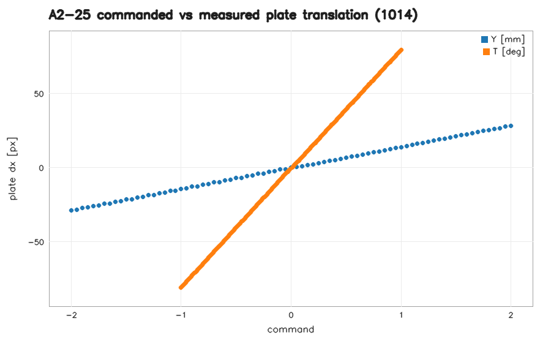
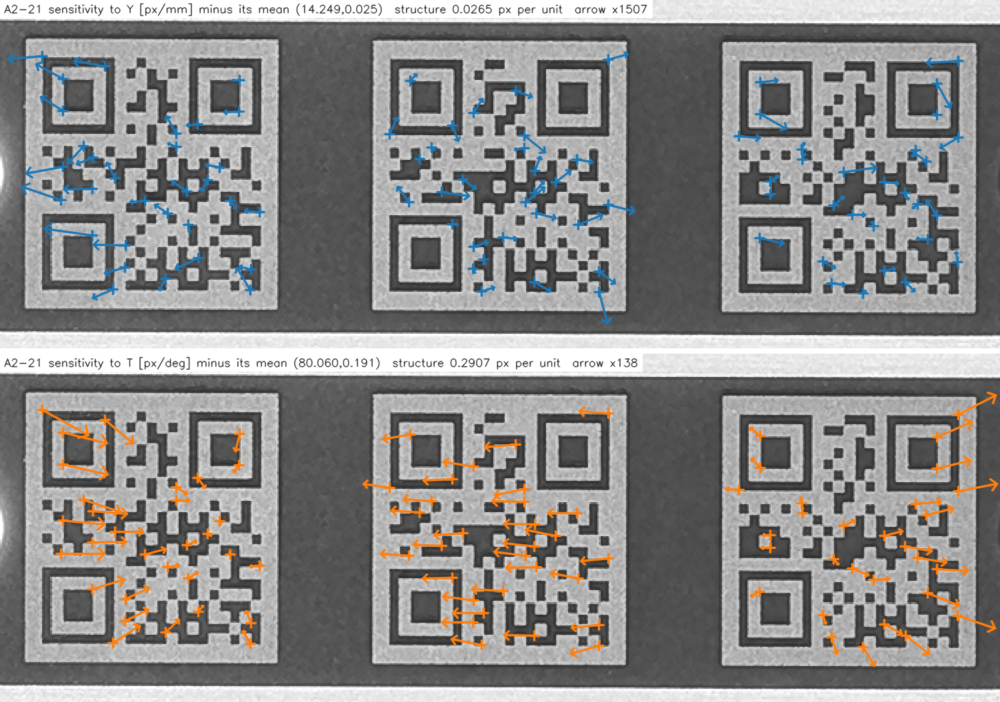
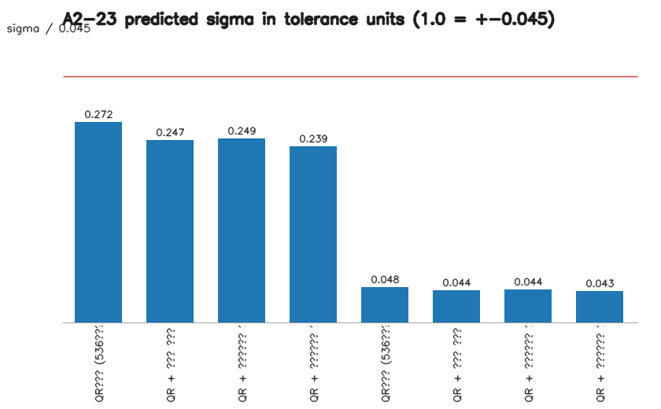
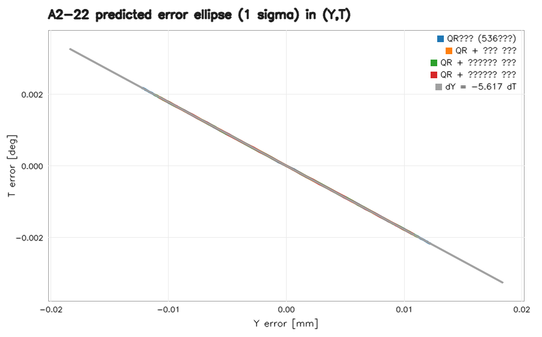
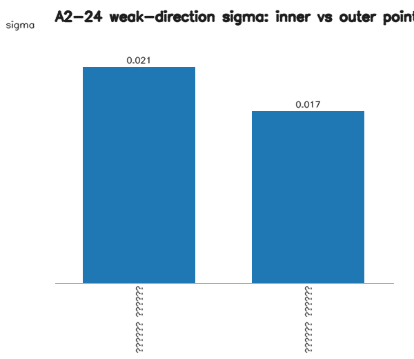

# A2 결과 — 정보 행렬과 약한 방향

`실험/src/main.cpp` 가 다시 쓴다. 해석은 [보고서](보고서.md). 계획은 [계획서](../계획서.md).

허용 절대오차 ±0.045, 판정용 '작다' 경계 0.015.
잡음 표본 282장, 점 공분산의 표본 고유방향 164개 (차원 1072).

## 1. 감도 J 와 선형성

| 항목 | 전체 범위 (|Y|<=2, |T|<=1) | 좁은 범위 (|Y|<=0.5, |T|<=0.5) | 차이 % |
|---|---|---|---|
| 판 dx 감도 (px per Y mm) | 14.2489 | 13.8581 | -2.74 |
| 판 dx 감도 (px per T deg) | 80.0600 | 79.5508 | -0.64 |
| 팀 기준값 | 14.2500 / 80.0400 |  |  |
| 적합 잔차 중앙값 (px) | 0.13879 | 0.12549 |  |

점별 감도: [sensitivity.csv](results/sensitivity.csv)

## 2. Y 와 T 는 무엇이 다른가

두 그림 모두 **평균(판 전체 평행이동)을 뺀 나머지**다. 평균은 캡션에 적었다. 평행이동만 보면 두 축은 한 숫자로 합쳐지므로, 구별은 이 나머지 구조에서만 나온다.

## 3. 관측 조건별 정보 행렬

| 관측 조건 | F11 (Y) | F22 (T) | sigma_Y mm | sigma_T deg | sigma_Y / 0.045 | sigma_T / 0.045 | 약한 방향 sigma | 약한 방향 각도 deg | 조건수 |
|---|---|---|---|---|---|---|---|---|---|
| QR만 (536점) | 1443320443.72 | 45565018640.01 | 0.01224 | 0.00218 | 0.272 | 0.048 | 0.01243 | 0.00 | 7267529.3 |
| QR + 위 선 | 1443320490.96 | 45565066228.40 | 0.01110 | 0.00197 | 0.247 | 0.044 | 0.01127 | 0.00 | 5971333.6 |
| QR + 아래 선 | 1443320503.14 | 45565053638.25 | 0.01121 | 0.00200 | 0.249 | 0.044 | 0.01139 | 0.00 | 6093621.0 |
| QR + 양쪽 선 | 1443320599.09 | 45565078344.38 | 0.01076 | 0.00191 | 0.239 | 0.043 | 0.01093 | 0.00 | 5611688.0 |
| QR만, 대각 근사 (참고) | 1516265911.24 | 47868139362.80 | 0.01198 | 0.00213 | 0.266 | 0.047 | 0.01217 | 0.00 | 7310726.8 |
| QR만, raw 잔차 (자세 차이 포함) | 22017.57 | 692293.88 | 0.11040 | 0.01969 | 2.453 | 0.438 | 0.11214 | 0.00 | 8981.0 |
| QR + 양쪽 선, raw 잔차 | 22138.78 | 750753.29 | 0.02299 | 0.00395 | 0.511 | 0.088 | 0.02330 | 0.75 | 418.5 |

표의 마지막 두 줄은 **아핀을 빼지 않은 잔차**로 낸 것이다. 아핀 제거는 J 가 사는 부분공간(판 전체 평행이동과 1차항)을 같이 지우므로, 위쪽 값들은 낙관적인 하한이다. raw 잔차에는 반복 촬영 사이에 판이 실제로 움직인 양(A1: dx SD 0.085 px)이 들어 있어, 측정만의 하한이 아니라 **같은 명령을 반복했을 때 실제로 재현되는 범위**에 가깝다.

## 4. H03 안쪽 대 바깥

| 점 집합 | 점 수 | sigma_Y mm | sigma_T deg | 약한 방향 sigma | 약한 방향 각도 deg |
|---|---|---|---|---|---|
| 안쪽 절반 (QR 중심에 가까움) | 268 | 0.02072 | 0.00369 | 0.02105 | 0.00 |
| 바깥 절반 (QR 중심에서 멂) | 268 | 0.01649 | 0.00293 | 0.01675 | 0.00 |

## 5. Adiv 조건 대조

| 번호 | Adiv 1989 조건 | 우리 실측 | 해당? |
|---|---|---|---|
| 1 | FOV 가 작다 | f=4492 px(A13) -> 가로 46.3도, 세로 26.9도. Adiv 예시는 60도 | 해당 |
| 2 | 국소성 인자 gamma 가 작다 | QR만 gamma_x 0.18 / gamma_y 0.09. **선을 더하면 0.77 / 0.53**. Adiv 예시는 1, 1/2, 1/4 | **강하게 해당 (선 없을 때)** |
| 3 | 평면이 기껏해야 적당히 기울어 있다 | QR 판이 카메라에 거의 정면 | 해당 |
| 4 | 물체가 멀리 있다 | Z=315 mm(A13). 병진/거리 비 r/d <= 2/315 = 0.006. Adiv 예시는 0.1 | **강하게 해당** |
| 5 | 평행이동의 절대값이 작다 | 최소 명령 Y 0.05 mm = Z 의 0.016% | **강하게 해당** |
| 6 | 영상 해상도가 낮다 | 3840x2160. Adiv 예시는 128x128 | 해당 아님 (유리) |
| 7 | 화소 단위 잡음이 높다 | 점 측정 잡음 0.0087 px (A1) | 해당 아님 (유리) |
| 8 | 흐름장이 성기다 | 536점이 영상 면적의 약 2%에 몰려 있다 | 해당 |
| 9 | 인접 흐름 벡터의 잡음이 강하게 상관 | **N_eff 18.9 / 536 = 3.5%** (A1) | **강하게 해당** |

Adiv 1989 번역.md 262~270행의 **9개** 조건이다. 9개 중 **7개 해당**, 2개(해상도, 잡음)는 우리에게 유리하다.
(2026-11-02 정정: 처음에 8개로 적고 '인접 흐름 벡터의 잡음 상관'을 빠뜨렸다. 그것이 A1 이 직접 잰 조건이다.)

**2번 국소성 인자가 핵심이다.** Adiv 가 시험한 가장 나쁜 경우가 gamma = 1/4 인데, QR 만 쓰면 gamma 가 0.09~0.18 로 **그보다 더 나쁘다**. 허용된 위·아래 가로선을 더하면 0.53~0.77 로 올라가 Adiv 의 가장 좋은 경우(gamma = 1)에 가까워진다. A3 에서 선을 빼니 통과율이 95.7%에서 24.6%로 무너진 것이 이 수치로 설명된다.

## 6. 판정 기준 대비

| 조건 | 실측 | 판정 |
|---|---|---|
| 약한 방향이 dY = -5.617 dT 와 10도 이내 | QR만 0.00도, 양쪽 선 0.00도 | **맞다** |
| 약한 방향 sigma > 0.015 (정보 부족) | 양쪽 선 0.01093 | 정보는 충분. 편향 쪽을 먼저 본다 |
| sigma_Y, sigma_T 가 허용오차 대비 | Y 0.239, T 0.043 | |
| 같은 판정을 raw 잔차로 | 약한 방향 0.02330, Y 0.511, T 0.088 | **정보 부족** |
