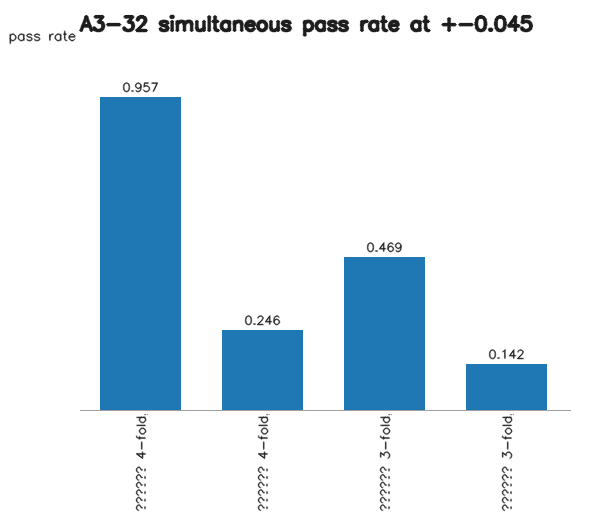
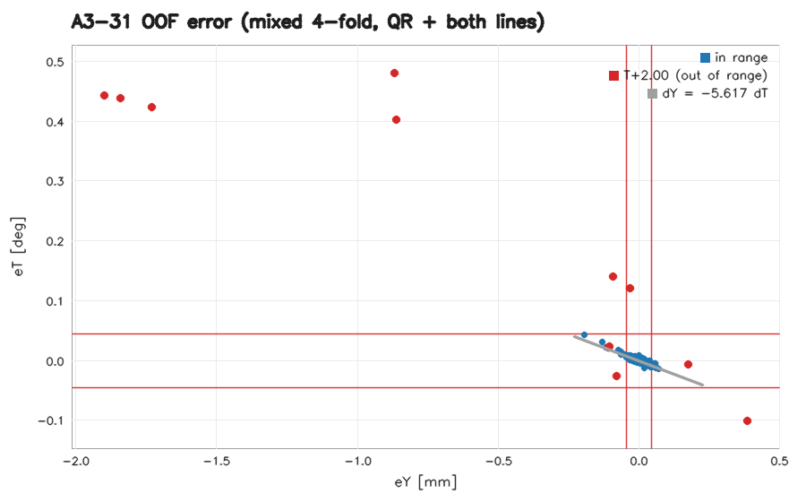
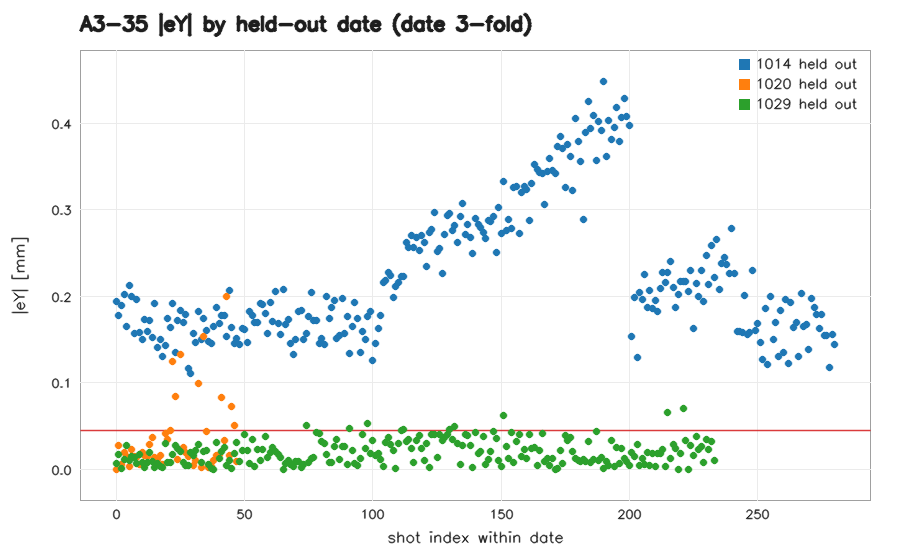
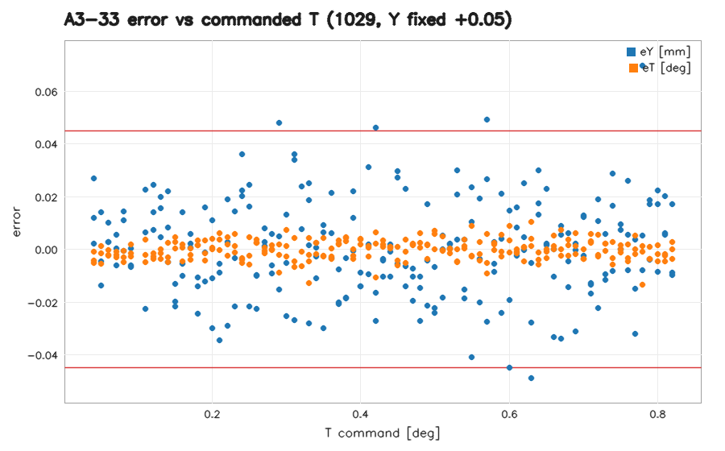
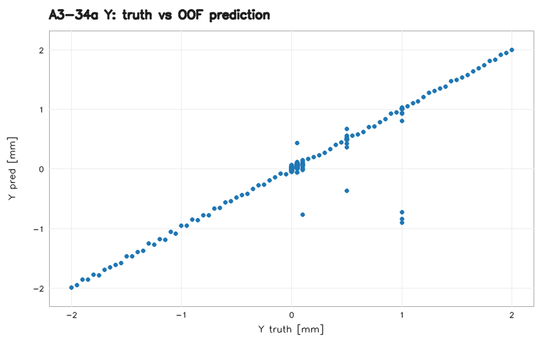
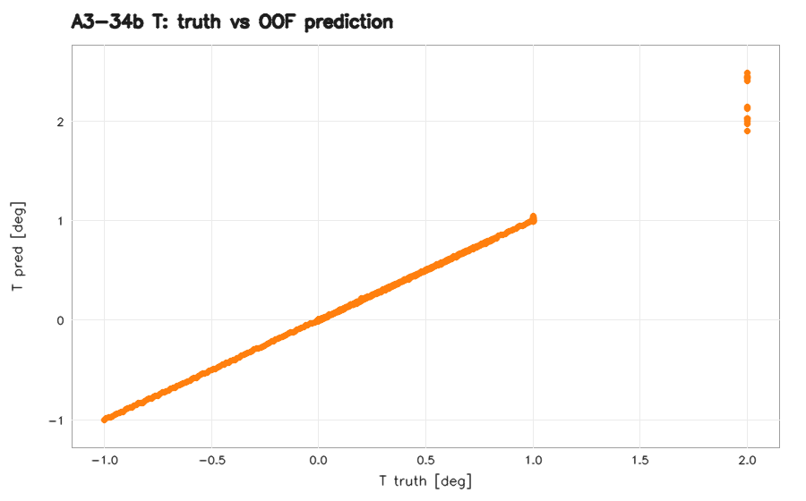

# A3 결과 — 실제 오차의 방향과 날짜 일반화

`실험/src/main.cpp` 가 다시 쓴다. 해석은 [보고서](보고서.md). 계획은 [계획서](../계획서.md).

기준 모델: QR별 아핀 18 + 선 48 = 66차원 선형. **전달한 joint/control 모델이 아니다.** fold 마다 다시 학습해야 해서 만든 진단용 대리 모델이다.

허용 절대오차 ±0.045. ±0.09 열은 이전 실험과 견주기 위한 참고다.

## 1. 성적

| 평가 | 장수 | Y 평균 | Y 최대 | T 평균 | T 최대 | 동시 통과 ±0.045 | 참고: ±0.09 | 오차 상관 r | 주축 각도 deg |
|---|---|---|---|---|---|---|---|---|---|
| 혼합 4-fold, QR+양쪽 선 | 562 | 0.0171 | 0.1927 | 0.0033 | 0.0427 | 0.9573 | 0.9929 | -0.914 | 0.18 |
| 혼합 4-fold, QR만 | 562 | 0.1248 | 0.5337 | 0.0224 | 0.0973 | 0.2456 | 0.4609 | -0.996 | 0.01 |
| 날짜 3-fold, QR+양쪽 선 | 563 | 0.1227 | 0.4479 | 0.0239 | 0.0713 | 0.4689 | 0.4920 | -0.978 | 0.01 |
| 날짜 3-fold, QR만 | 563 | 0.7021 | 2.0559 | 0.1297 | 0.3624 | 0.1421 | 0.2433 | -0.999 | 0.27 |
| (참고) T+2.00 범위 밖만 | 12 | 0.6814 | 1.8995 | 0.2191 | 0.4805 | 0.0000 | 0.0833 |  |  |

## 2. 오차가 어느 방향으로 몰리는가 (H01)

상관 r = -0.914, 주축이 ΔY = −5.617ΔT 와 이루는 각 0.18°.

## 3. 날짜 일반화 (H18)

| 빠진 날짜 | 장수 | Y 평균 | Y 최대 | T 평균 | T 최대 | 동시 통과 ±0.045 |
|---|---|---|---|---|---|---|
| 1014 | 281 | 0.2232 | 0.4479 | 0.0433 | 0.0713 | 0.0000 |
| 1020 | 48 | 0.0349 | 0.1994 | 0.0065 | 0.0434 | 0.8125 |
| 1029 | 234 | 0.0200 | 0.0703 | 0.0041 | 0.0133 | 0.9615 |

## 4. T 크기와 예측

## 5. 판정 기준 대비

| 가설 | 조건 | 실측 | 판정 |
|---|---|---|---|
| H01 | |r| > 0.8 그리고 주축이 약한 방향과 10° 이내 | r -0.914, 0.18° | **성립** |
| H18 | 날짜 fold 통과율이 혼합 fold보다 10%p 이상 낮음 | 혼합 95.7% 대 날짜 46.9% (차 48.8%p) | **성립** |
