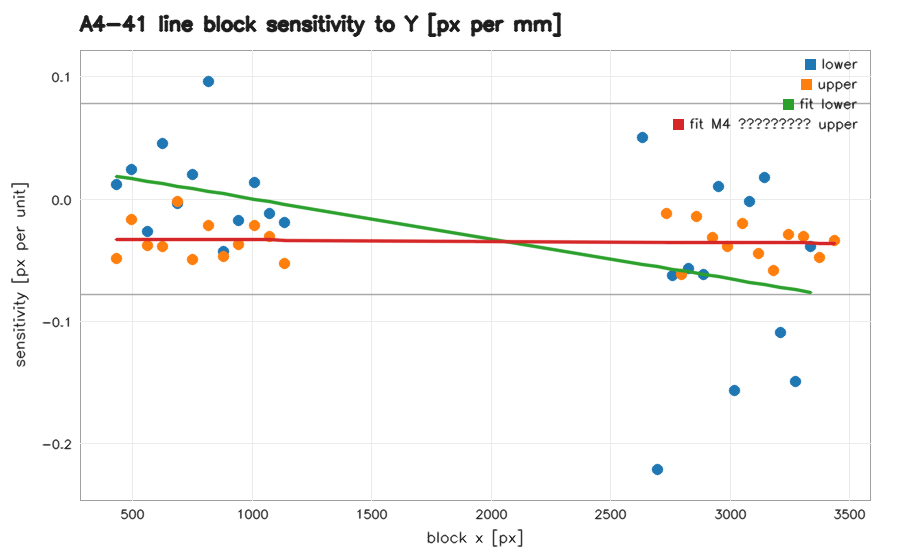
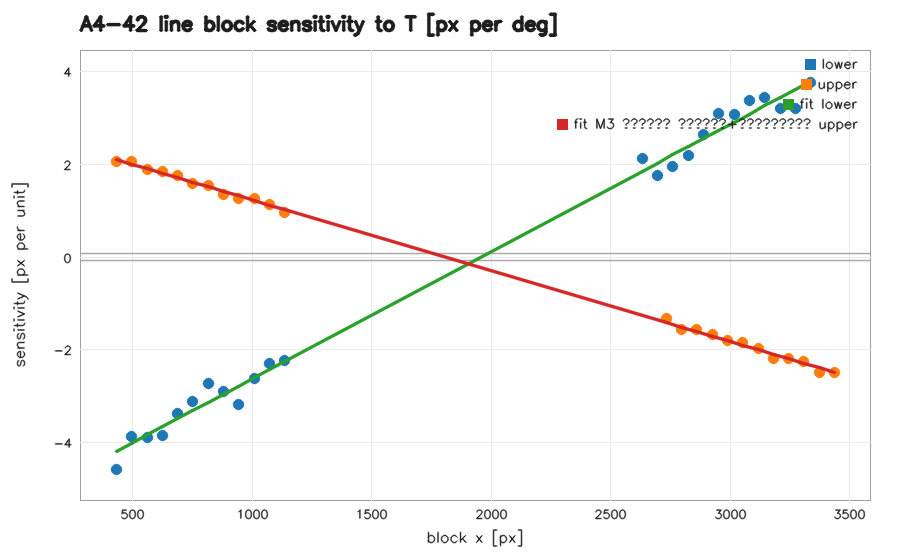
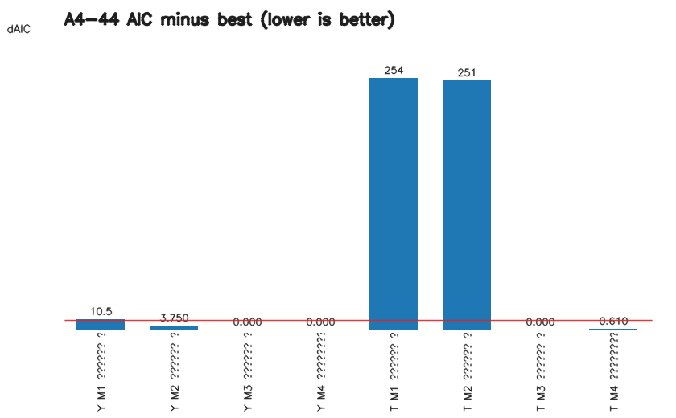

# A4 결과 — 가로선 반응의 원인

`실험/src/main.cpp` 가 다시 쓴다. 해석은 [보고서](보고서.md). 계획은 [계획서](../계획서.md).

1014 단일축 281장으로 블록별 감도를 냈다. 선 측정 잡음 중앙값 0.02602 px.

## 1. 블록별 감도

| 축 | 감도 RMS (px per unit) | 잡음 대비 |
|---|---|---|
| Y | 0.05999 | 2.3배 |
| T | 2.52754 | 97.1배 |

회색 선은 잡음의 3배다. 블록별 값: [block_sensitivity.csv](results/block_sensitivity.csv)

## 2. 모델 비교 (AIC)

| 축 | 모델 | 뜻 | 모수 | RSS | AIC | AIC - 최소 | 계수 |
|---|---|---|---|---|---|---|---|
| Y | M1 선별 상수 | 깊이 시차 (H04) | 2 | 0.1245596 | -281.80 | 10.49 | -0.03443, -0.02870 |
| Y | M2 공통 기울기 | 롤 (H06) | 2 | 0.1082416 | -288.54 | 3.75 | -0.00051, -0.01627 |
| Y | M3 선별 상수+기울기 | 회전 투영 (H05) | 4 | 0.0921042 | -292.29 | 0.00 | -0.03241, 0.03302, -0.00104, -0.03276 |
| Y | M4 쌍선형 | 일반 1차 변환 | 4 | 0.0920959 | -292.29 | 0.00 | -0.07593, 0.02016, 0.06099, -0.02958 |
| T | M1 선별 상수 | 깊이 시차 (H04) | 2 | 304.7752360 | 92.72 | 253.79 | -0.19356, -0.20117 |
| T | M2 공통 기울기 | 롤 (H06) | 2 | 287.8931175 | 89.99 | 251.06 | -1.18440, 0.51704 |
| T | M3 선별 상수+기울기 | 회전 투영 (H05) | 4 | 1.4174445 | -161.07 | 0.00 | 2.75359, -5.36466, -1.52386, 2.74070 |
| T | M4 쌍선형 | 일반 1차 변환 | 4 | 1.4354498 | -160.47 | 0.61 | 8.15468, -4.37641, -7.56571, 3.97667 |

빨간 선이 판정선 10이다.

**M4(쌍선형)는 M3 과 같은 모델이다.** 선이 위·아래 두 줄뿐이라 y 가 사실상 두 값만 가지므로 {상수, x, y, xy} 와 {위상수, 아래상수, 위기울기, 아래기울기} 가 같은 4차원 공간을 친다. RSS 가 거의 같은 것이 그 증거다. 그래서 판정은 **M3 대 단순 모델(M1, M2)**로 한다. (판정 절차 보완: 2026-11-02, 결과를 본 뒤)

## 3. 판정 기준 대비

| 조건 | 실측 | 판정 |
|---|---|---|
| Y 감도가 잡음의 3배 초과 (H04 깊이 시차) | 2.3배 | 지지 안 됨 |
| T 축: M3(회전 투영)이 단순 모델 M1/M2 보다 AIC 10 이상 낮음 | 차 251.1 | **M3 채택 = 회전 투영(H05)** |
| Y 축: 같은 비교 | 차 3.7 | 보류 (B4로) |
| M3 기울기 부호 (T) | b_up -1.52386, b_lo 2.74070 | **반대 부호 → 회전 투영(H05)** |
| M3 기울기 부호 (Y) | b_up -0.00104, b_lo -0.03276 | 같은 부호 |
