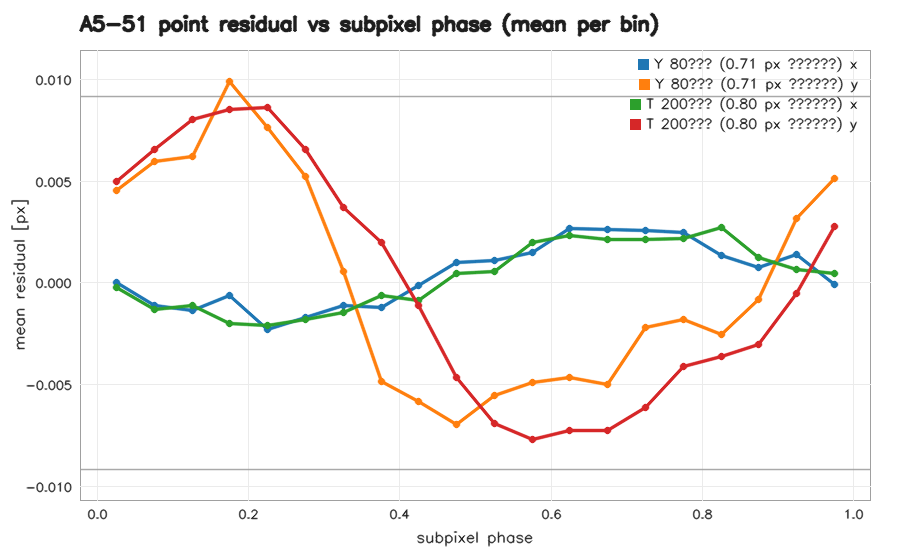
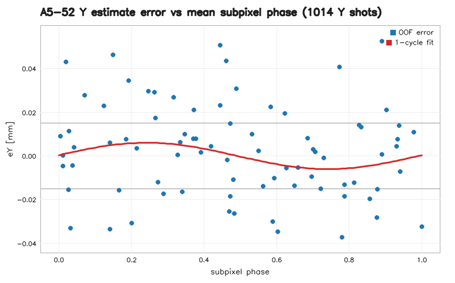
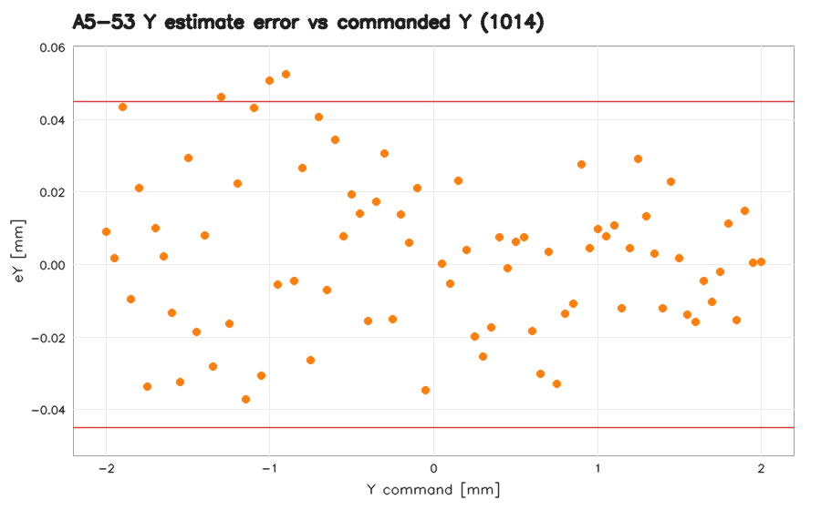

# A5 결과 — 부화소 위상 편향

`실험/src/main.cpp` 가 다시 쓴다. 해석은 [보고서](보고서.md). 계획은 [계획서](../계획서.md).

점 측정 잡음 RMS 0.00916 px (A1 과 같은 정의).

## 1. 점 잔차의 위상 의존

| 자료 | 성분 | 표본 수 | 1주기 진폭 px | 2주기 진폭 px | 측정 잡음 대비 | 잡음 px |
|---|---|---|---|---|---|---|
| Y 80장 (0.71 px 간격) | x | 42880 | 0.00207 | 0.00020 | 0.23 | 0.00916 |
| Y 80장 (0.71 px 간격) | y | 42880 | 0.00665 | 0.00221 | 0.73 | 0.00916 |
| T 200장 (0.80 px 간격) | x | 107200 | 0.00219 | 0.00002 | 0.24 | 0.00916 |
| T 200장 (0.80 px 간격) | y | 107200 | 0.00805 | 0.00115 | 0.88 | 0.00916 |

회색 선은 측정 잡음 크기다. 위상칸별 값: [phase_bias.csv](results/phase_bias.csv)

## 2. Y 추정에 남는 주기 성분

| 값 | 크기 |
|---|---|
| 1주기 진폭 (mm) | 0.00602 |
| 2주기 진폭 (mm) | 0.00324 |
| 허용오차 ±0.045 대비 | 0.134 |
| 표본 | 80장 |

## 3. 판정 기준 대비

| 조건 | 실측 | 판정 |
|---|---|---|
| 점 잔차 1주기 진폭 > 잡음의 3배 | 0.00207 대 0.02748 | 없음 |
| Y 추정 주기 성분 > 0.015 mm | 0.00602 | 기각. 위상 편향은 주원인이 아니다 |

## 4. 하지 않은 것

보간 차수·창 크기를 바꾼 재측정은 하지 않았다. 2026-10-29의 부화소 정합 비교 실험이 9가지 방법을 이미 비교했고 채택한 NCC+LK15+GN스플라인이 가장 좋았다(사진 한 장 잡음 0.015 px). 그 결과를 인용한다.
