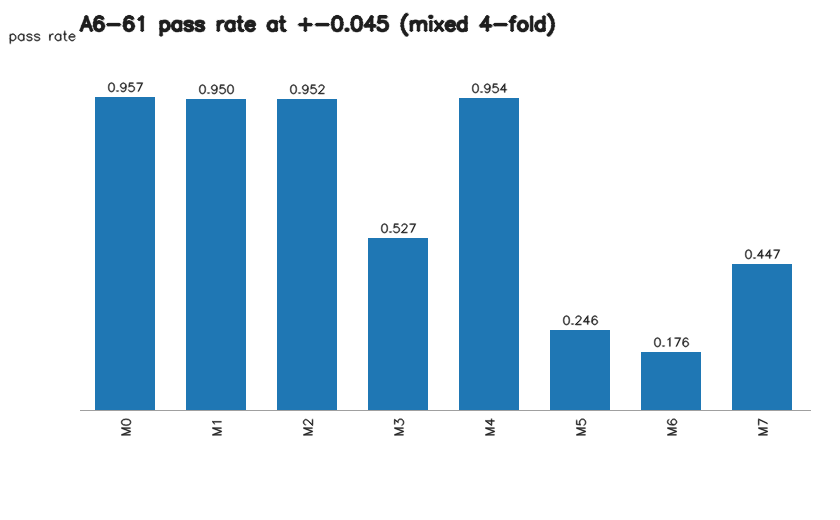
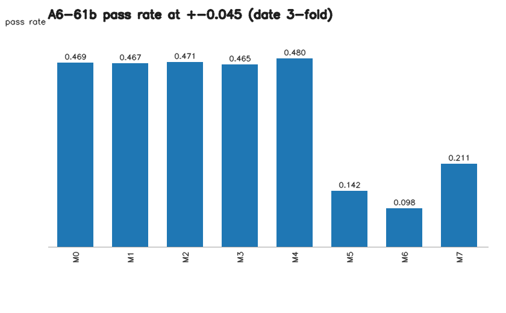
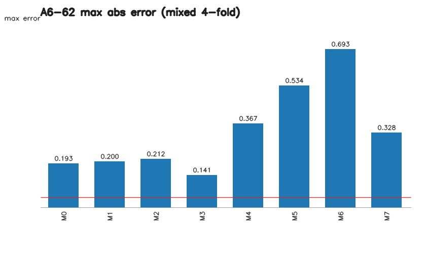
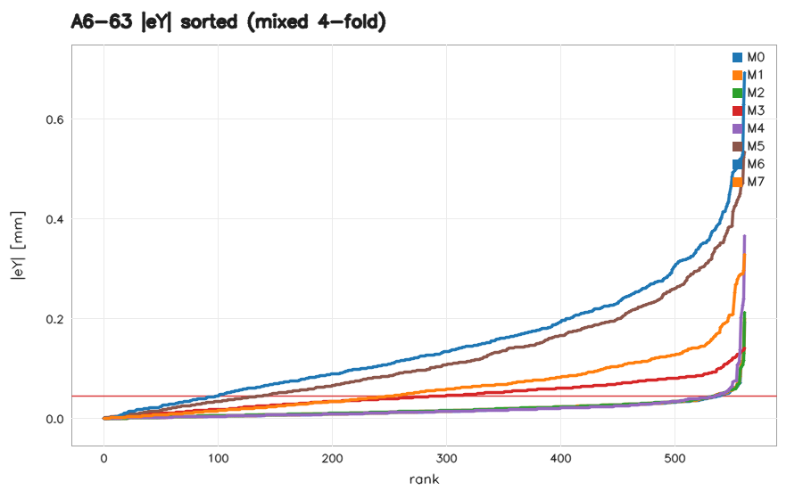
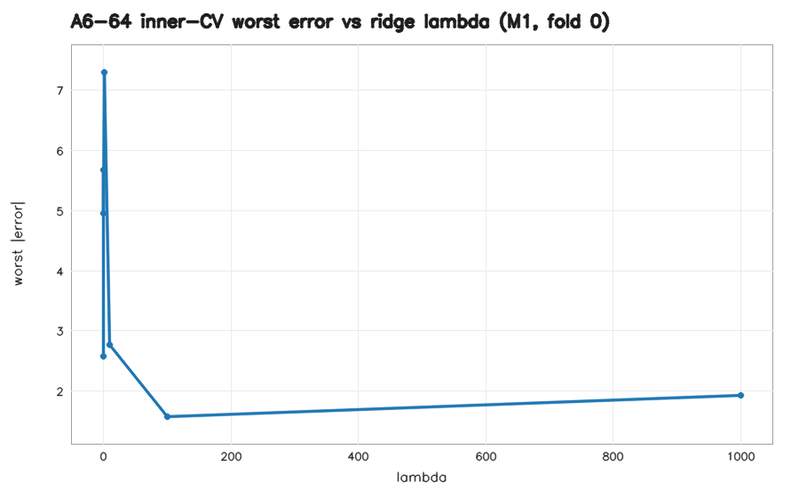

# A6 결과 — 추정 모델 대조

`실험/src/main.cpp` 가 다시 쓴다. 해석은 [보고서](보고서.md). 계획은 [계획서](../계획서.md).

모두 같은 A0 캐시, 같은 분할을 쓴다. 특징 추출 + 예측 시간은 사진당 0.026 ms 다. **점 측정 자체의 비용은 모델 간에 같고 A0 에서 쟀다(575장 15초).**

## 1. 모델별 성적

| ID | 모델 | 분할 | 장수 | Y 평균 | Y 최대 | T 평균 | T 최대 | 통과 ±0.045 | 참고 ±0.09 | 최대오차 대조비 |
|---|---|---|---|---|---|---|---|---|---|---|
| M0 | OLS 66d (대조) | 혼합 4-fold | 562 | 0.0171 | 0.1927 | 0.0033 | 0.0427 | 0.9573 | 0.9929 | 1.000 |
| M0 | OLS 66d (대조) | 날짜 3-fold | 563 | 0.1227 | 0.4479 | 0.0239 | 0.0713 | 0.4689 | 0.4920 |  |
| M1 | Ridge 66d | 혼합 4-fold | 562 | 0.0175 | 0.2004 | 0.0032 | 0.0423 | 0.9502 | 0.9929 | 1.040 |
| M1 | Ridge 66d | 날짜 3-fold | 563 | 0.1227 | 0.4479 | 0.0239 | 0.0713 | 0.4671 | 0.4920 |  |
| M2 | 백색화 + Ridge 66d | 혼합 4-fold | 562 | 0.0179 | 0.2123 | 0.0036 | 0.0337 | 0.9520 | 0.9911 | 1.101 |
| M2 | 백색화 + Ridge 66d | 날짜 3-fold | 563 | 0.1315 | 0.4125 | 0.0287 | 0.0705 | 0.4707 | 0.4920 |  |
| M3 | 물리 전방 역해 (J, raw Sigma) | 혼합 4-fold | 562 | 0.0461 | 0.1411 | 0.0181 | 0.0394 | 0.5267 | 0.9431 | 0.732 |
| M3 | 물리 전방 역해 (J, raw Sigma) | 날짜 3-fold | 282 | 0.0478 | 0.1134 | 0.0266 | 0.0392 | 0.4645 | 0.9574 |  |
| M4 | OLS + 2차항 | 혼합 4-fold | 562 | 0.0179 | 0.3668 | 0.0033 | 0.0693 | 0.9537 | 0.9875 | 1.903 |
| M4 | OLS + 2차항 | 날짜 3-fold | 563 | 0.1016 | 0.4222 | 0.0224 | 0.0850 | 0.4796 | 0.5595 |  |
| M5 | QR만 18d | 혼합 4-fold | 562 | 0.1248 | 0.5337 | 0.0224 | 0.0973 | 0.2456 | 0.4609 | 2.769 |
| M5 | QR만 18d | 날짜 3-fold | 563 | 0.7021 | 2.0559 | 0.1297 | 0.3624 | 0.1421 | 0.2433 |  |
| M6 | 선만 48d | 혼합 4-fold | 562 | 0.1501 | 0.6927 | 0.0032 | 0.0384 | 0.1762 | 0.3683 | 3.594 |
| M6 | 선만 48d | 날짜 3-fold | 563 | 0.4706 | 2.5819 | 0.0224 | 0.0564 | 0.0977 | 0.2131 |  |
| M7 | 전체점 1260d -> PCA 40 | 혼합 4-fold | 562 | 0.0640 | 0.3281 | 0.0124 | 0.0602 | 0.4466 | 0.7527 | 1.703 |
| M7 | 전체점 1260d -> PCA 40 | 날짜 3-fold | 563 | 0.4346 | 2.6200 | 0.1089 | 0.4543 | 0.2114 | 0.3535 |  |

## 2. 정규화

| 모델 | fold | lambda |
|---|---|---|
| M1 | 0 | 0.00000 |
| M1 | 1 | 0.00000 |
| M1 | 2 | 0.01000 |
| M1 | 3 | 0.01000 |
| M1 | 0 | 0.00000 |
| M1 | 1 | 0.01000 |
| M1 | 2 | 0.00000 |
| M2 | 0 | 0.00000 |
| M2 | 1 | 0.00000 |
| M2 | 2 | 0.10000 |
| M2 | 3 | 0.10000 |
| M2 | 0 | 0.01000 |
| M2 | 1 | 0.01000 |
| M2 | 2 | 0.01000 |
| M4 | 0 | 0.01000 |
| M4 | 1 | 0.01000 |
| M4 | 2 | 0.01000 |
| M4 | 3 | 0.01000 |
| M4 | 0 | 0.01000 |
| M4 | 1 | 0.01000 |
| M4 | 2 | 0.01000 |
| M7 | 0 | 1.00000 |
| M7 | 1 | 1.00000 |
| M7 | 2 | 10.00000 |
| M7 | 3 | 0.01000 |
| M7 | 0 | 0.10000 |
| M7 | 1 | 0.00000 |
| M7 | 2 | 1.00000 |

## 3. 판정 기준 대비

대조 M0 의 최대오차는 0.1927 다. 20% 이상 줄이고 통과율이 떨어지지 않는 모델만 후보다.

| ID | 최대오차 대조비 | 통과율 | 판정 |
|---|---|---|---|
| M0 | 1.000 | 0.9573 | 대조 |
| M1 | 1.040 | 0.9502 | 기각 |
| M2 | 1.101 | 0.9520 | 기각 |
| M3 | 0.732 | 0.5267 | 기각 |
| M4 | 1.903 | 0.9537 | 기각 |
| M5 | 2.769 | 0.2456 | 기각 |
| M6 | 3.594 | 0.1762 | 기각 |
| M7 | 1.703 | 0.4466 | 기각 |
