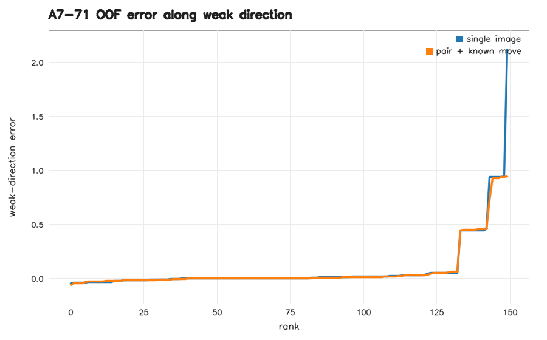
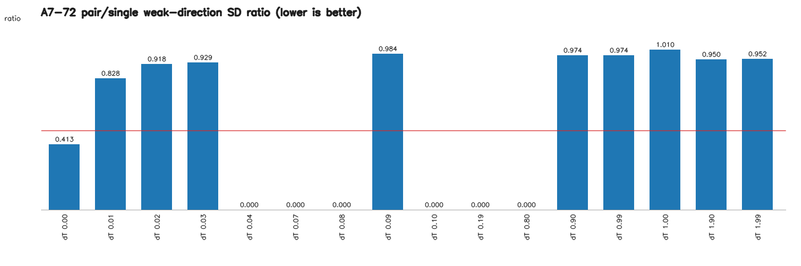

# A7 결과 — 알려진 탐색 이동의 효과 (오프라인)

`실험/src/main.cpp` 가 다시 쓴다. 해석은 [보고서](보고서.md). 계획은 [계획서](../계획서.md).

**이것은 오프라인 조합이다.** 서로 다른 시점의 정지 사진을 짝지은 것이며, 실제로 움직이고 다시 찍은 자료가 아니다. 백래시·정지 오차·드리프트가 빠져 있다.

짝 273개를 만들고, 두 사진이 같은 fold 인 150개만 썼다.

## 1. 단일 대 짝

| 추정기 | 장수 | Y 평균 | Y 최대 | T 평균 | T 최대 | 약한 방향 SD | 통과 ±0.045 |
|---|---|---|---|---|---|---|---|
| 단일 사진 | 150 | 0.0965 | 2.1333 | 0.0054 | 0.1053 | 0.26877 | 0.8067 |
| 짝 (알려진 이동 1회) | 150 | 0.0858 | 0.9500 | 0.0092 | 0.0933 | 0.21715 | 0.7933 |

## 2. 명령 차 크기별

| |dT| | 짝 수 | 단일 약한 방향 SD | 짝 약한 방향 SD | 비 |
|---|---|---|---|---|
| 0.00 | 10 | 0.63571 | 0.26251 | 0.413 |
| 0.01 | 59 | 0.02029 | 0.01679 | 0.828 |
| 0.02 | 38 | 0.01850 | 0.01698 | 0.918 |
| 0.03 | 20 | 0.01881 | 0.01747 | 0.929 |
| 0.04 | 1 |  |  | 0.000 |
| 0.07 | 1 |  |  | 0.000 |
| 0.08 | 1 |  |  | 0.000 |
| 0.09 | 4 | 0.43459 | 0.42762 | 0.984 |
| 0.10 | 1 |  |  | 0.000 |
| 0.19 | 1 |  |  | 0.000 |
| 0.80 | 1 |  |  | 0.000 |
| 0.90 | 3 | 0.44523 | 0.43366 | 0.974 |
| 0.99 | 3 | 0.44519 | 0.43375 | 0.974 |
| 1.00 | 3 | 0.48980 | 0.49468 | 1.010 |
| 1.90 | 2 | 0.34897 | 0.33167 | 0.950 |
| 1.99 | 2 | 0.34917 | 0.33255 | 0.952 |

## 3. 판정 기준 대비

| 조건 | 실측 | 판정 |
|---|---|---|
| 짝의 약한 방향 SD가 단일의 절반 이하 | 0.21715 대 0.26877 (비 0.808) | 기각 또는 부분 효과 |
