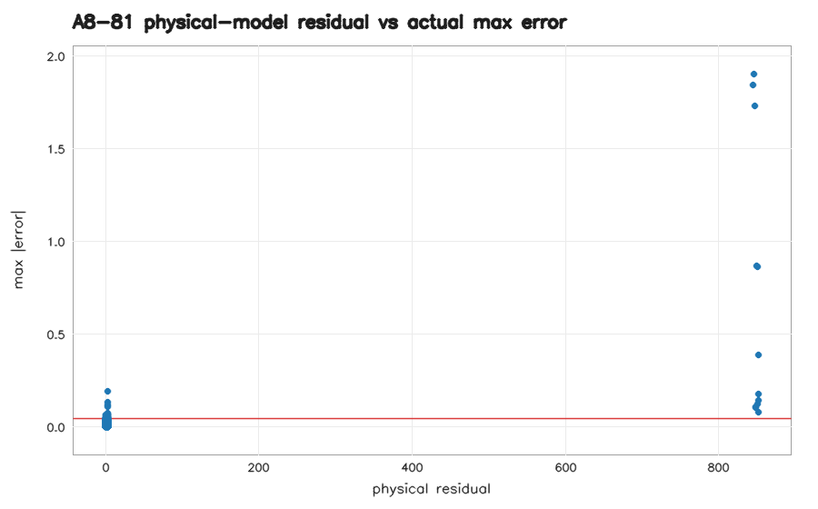
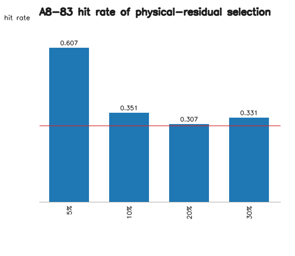
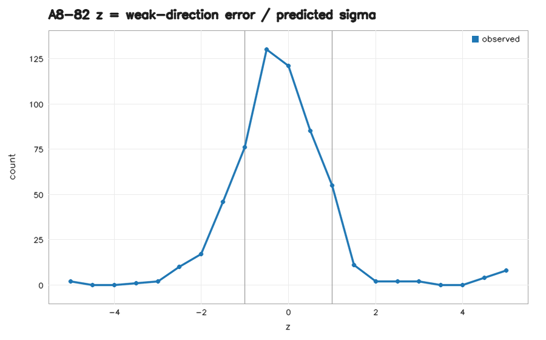

# A8 결과 — 사진별 불안정 판정

`실험/src/main.cpp` 가 다시 쓴다. 해석은 [보고서](보고서.md). 계획은 [계획서](../계획서.md).

기준 모델(M0) 혼합 4-fold OOF 오차 574장에 대해, 정답을 쓰지 않는 지표들이 그 오차를 예측하는지 봤다.

## 1. 지표와 실제 오차

| 지표 | 순위 상관 (최대오차) | 순위 상관 (약한방향 |e|) | 상위 10% 적중률 | 상위 20% 적중률 |
|---|---|---|---|---|
| 물리 모델 잔차 | 0.053 | 0.054 | 0.351 | 0.307 |
| 유효점 수 (적을수록) | 0.020 | 0.019 | 0.228 | 0.281 |
| 최소 NCC (낮을수록) | 0.031 | 0.031 | 0.281 | 0.228 |
| 유효 선블록 (적을수록) | -0.000 | -0.001 | 0.035 | 0.193 |
| GN 잔차 중앙값 | 0.063 | 0.063 | 0.351 | 0.316 |
| GN 잔차 p95 | 0.079 | 0.079 | 0.368 | 0.307 |

사진별 값: [diagnostics.csv](results/diagnostics.csv)

## 2. 예측 sigma 의 보정

| 값 | 크기 |
|---|---|
| 약한 방향 예측 sigma | 0.02329 |
| 실제 약한 방향 오차 SD | 0.14898 |
| **z 의 표준편차** | **6.395** |

## 3. 판정 기준 대비

| 조건 | 실측 | 판정 |
|---|---|---|
| z 의 SD 가 0.7~1.4 | 6.395 | 쓸 수 없다 |
| 어떤 지표의 |순위 상관| > 0.5 | 최고 GN 잔차 p95 0.079 | 쓸 수 없다 |
| 상위 10% 선별 적중률 > 0.3 | 0.351 | **조건부 탐색이 쓸모 있다** |
