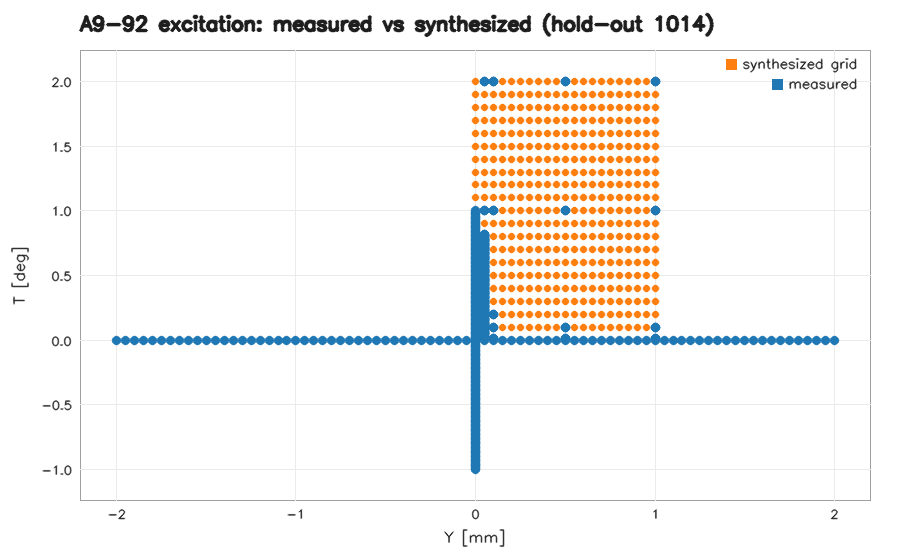
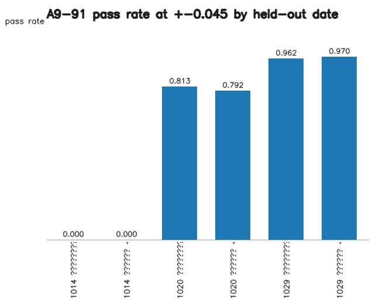

# A9 결과 — 실측 영점 기반 데이터 증강

`실험/src/main.cpp` 가 다시 쓴다. 해석은 [보고서](보고서.md). 계획은 [계획서](../계획서.md).

**합성 성적은 실측 추정 성적이 아니다.** 증강은 특징 수준에서 만들며 영상이 아니다.

## 1. 생성기

| 빠진 날짜 | 학습 사진 | 합성 사진 | Y 범위 | T 범위 | YxT 결합항 사용 | 잔차 풀 크기 |
|---|---|---|---|---|---|---|
| 1014 | 294 | 441 | 0.00 ~ 1.00 | 0.00 ~ 2.00 | 예 | 294 |
| 1020 | 515 | 441 | -2.00 ~ 2.00 | -1.00 ~ 1.00 | 예 | 515 |
| 1029 | 341 | 441 | -2.00 ~ 2.00 | -1.00 ~ 2.00 | 예 | 341 |

잔차 풀은 학습 사진의 모델 잔차를 그대로 재표집한다. 독립 가우스를 쓰지 않아 A1 이 잰 상관 구조(N_eff 19)가 유지된다.

## 2. 날짜 fold 성적

| 빠진 날짜 | 학습 | 장수 | Y 평균 | Y 최대 | T 평균 | T 최대 | 통과 ±0.045 |
|---|---|---|---|---|---|---|---|
| 1014 | 실측만 | 281 | 0.2232 | 0.4479 | 0.0433 | 0.0713 | 0.0000 |
| 1014 | 실측 + 증강 | 281 | 0.2351 | 0.4447 | 0.0451 | 0.0690 | 0.0000 |
| 1020 | 실측만 | 48 | 0.0349 | 0.1994 | 0.0065 | 0.0434 | 0.8125 |
| 1020 | 실측 + 증강 | 48 | 0.0351 | 0.1984 | 0.0066 | 0.0432 | 0.7917 |
| 1029 | 실측만 | 234 | 0.0200 | 0.0703 | 0.0041 | 0.0133 | 0.9615 |
| 1029 | 실측 + 증강 | 234 | 0.0196 | 0.0707 | 0.0041 | 0.0133 | 0.9701 |

## 3. 판정 기준 대비

최대오차가 줄고 통과율이 떨어지지 않아야 채택 후보다.

| 빠진 날짜 | Y 최대오차 | 통과율 | 판정 |
|---|---|---|---|
| 1014 | 0.4479 -> 0.4447 | 0.0000 -> 0.0000 | **개선** |
| 1020 | 0.1994 -> 0.1984 | 0.8125 -> 0.7917 | 개선 없음 |
| 1029 | 0.0703 -> 0.0707 | 0.9615 -> 0.9701 | 개선 없음 |

종합: 일부 날짜에서 개선
