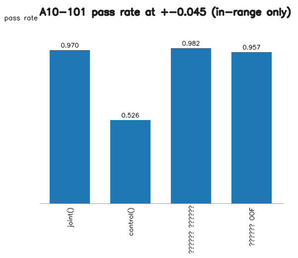
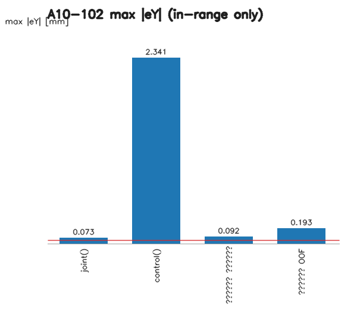
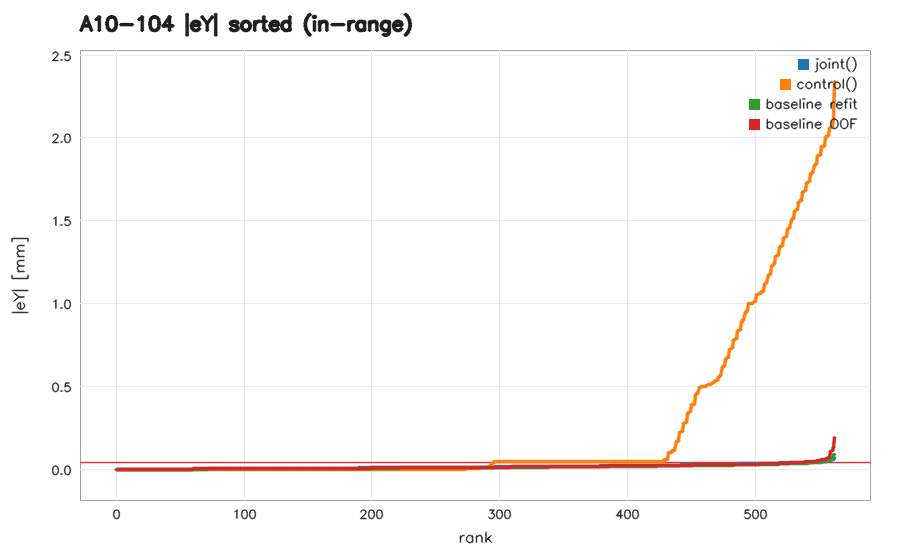
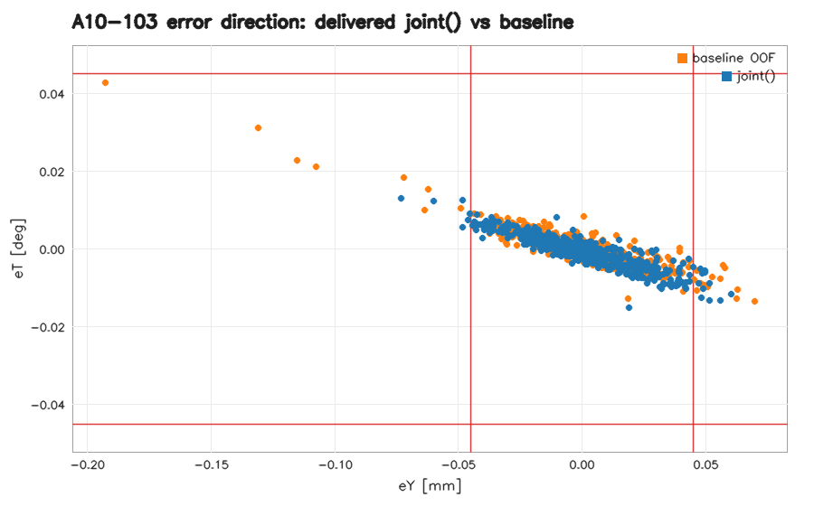

# A10 결과 — 전달 모듈 대조

`실험/src/main.cpp` 가 다시 쓴다. 해석은 [보고서](보고서.md).

**공정성 주의.** `joint()`·`control()` 은 이 575장으로 학습된 모델이다. 여기 성적은 **재대입(개발) 성적**이고 교차검증이 아니다. 기준 모델도 같은 조건으로 보려고 '전수 재대입' 줄을 함께 넣었다. '혼합 4-fold OOF' 줄만 학습에 안 쓴 사진의 성적이다.

## 1. 관측에 무엇을 쓰나

| 모듈 | QR | 위·아래 바 | 출력 |
|---|---|---|---|
| `joint()` | 3 QR × 9 표본점 × 2 = 54 | **48블록 이동량 (쓴다)** | (Y, T) 동시 |
| `control()` | 선택 536점 P12 (12차원) | **쓰지 않는다** | Y 또는 T 하나 |
| 기준 모델 (A3·A6) | QR별 아핀 18 | **48블록 (쓴다)** | (Y, T) 동시 |

## 2. 성적 (범위 안, T ≤ 1.00)

| 추정기 | 장수 | 예외 | Y 평균 | Y 최대 | T 평균 | T 최대 | 통과 ±0.045 | 참고 ±0.09 | 시간 중앙 ms | 시간 p95 ms |
|---|---|---|---|---|---|---|---|---|---|---|
| joint() 전달 모듈 (QR+위아래 바) | 563 | 0 | 0.0170 | 0.0731 | 0.0033 | 0.0150 | 0.9698 | 1.0000 | 711.2 | 971.8 |
| control() 전달 모듈 (QR만, Y or T) | 563 | 0 | 0.2524 | 2.3406 | 0.0464 | 0.4300 | 0.5258 | 0.7673 | 39.7 | 62.8 |
| 기준 모델 66d, 전수 재대입 | 563 | 0 | 0.0145 | 0.0923 | 0.0027 | 0.0185 | 0.9822 | 0.9982 | 0.0 | 0.0 |
| 기준 모델 66d, 혼합 4-fold OOF | 563 | 0 | 0.0170 | 0.1927 | 0.0033 | 0.0427 | 0.9574 | 0.9929 | 0.0 | 0.0 |

## 3. 성적 (T+2.00 포함 전체 575장)

| 추정기 | 장수 | 예외 | Y 평균 | Y 최대 | T 평균 | T 최대 | 통과 ±0.045 | 참고 ±0.09 | 시간 중앙 ms | 시간 p95 ms |
|---|---|---|---|---|---|---|---|---|---|---|
| joint() 전달 모듈 | 575 | 0 | 0.0171 | 0.0744 | 0.0034 | 0.0150 | 0.9652 | 1.0000 | 711.0 | 960.8 |
| control() 전달 모듈 | 575 | 0 | 0.2819 | 2.3406 | 0.0871 | 2.0000 | 0.5148 | 0.7513 | 39.8 | 65.1 |
| 기준 모델 66d, 전수 재대입 | 575 | 0 | 0.0147 | 0.0923 | 0.0028 | 0.0185 | 0.9774 | 0.9983 | 0.0 | 0.0 |
| 기준 모델 66d, OOF | 575 | 0 | 0.0309 | 1.8995 | 0.0078 | 0.4805 | 0.9374 | 0.9739 | 0.0 | 0.0 |

## 4. control() 의 축 선택

단일축 사진 280장 중 축을 맞힌 것 280장 (100.00%).

`control()` 은 구조적으로 한 축만 반환한다. 혼합 자세에서는 **다른 축을 반드시 0 으로 내므로** 그 축의 오차가 명령값 전체가 된다. 위 표의 control 행에서 Y·T 평균이 큰 이유다.

## 5. 오차 방향

## 6. 측정 실패

없다.
