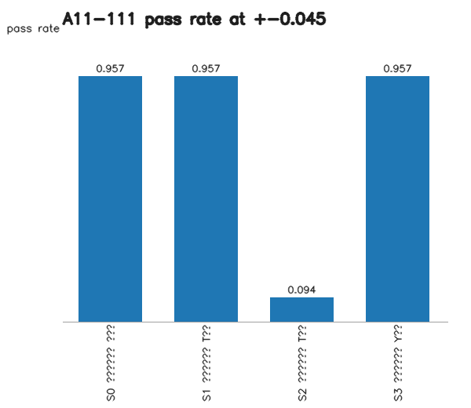
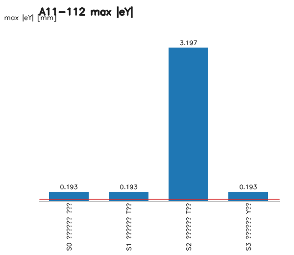
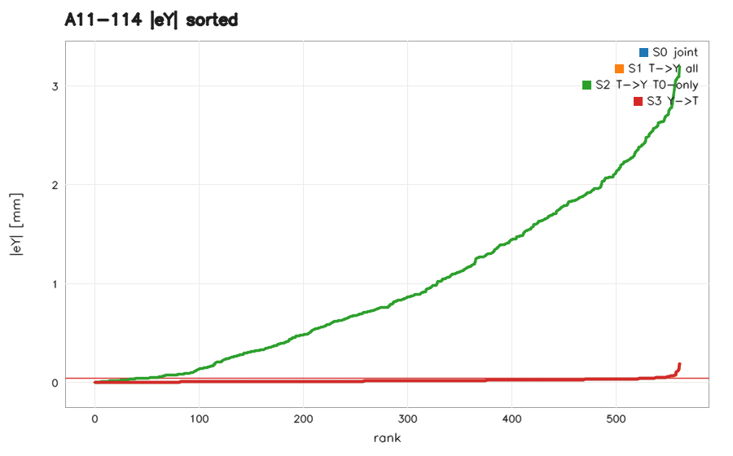
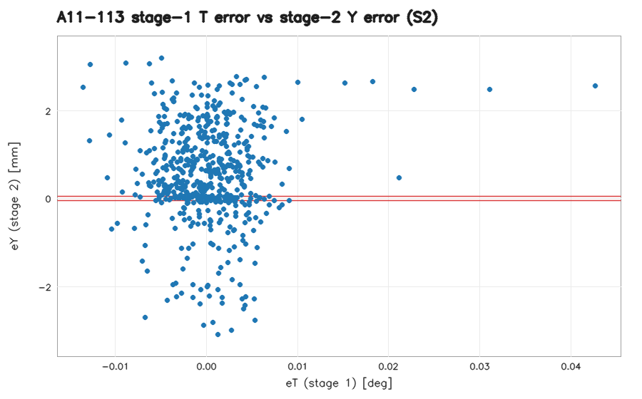

# A11 결과 — 순차 추정 (T 먼저, Y 나중)

`실험/src/main.cpp` 가 다시 쓴다. 해석은 [보고서](보고서.md).

**중요.** 실제로 T 를 맞춘 뒤 다시 찍은 자료가 없다. 그래서 1단계 추정값으로 **특징에서 T 기여를 대수적으로 빼고** 2단계 Y 를 추정했다. 실제 2단계 운용에서는 로봇이 움직이고 다시 찍으므로 백래시·정지 오차가 더 붙는다. 이 결과는 **추정 구조만 순차로 바꿨을 때**의 상한이다.

## 1. 네 가지 구조

| ID | 구조 | 2단계 학습 자료 |
|---|---|---|
| S0 | Y·T 동시 추정 (대조) | 전체 |
| S1 | T 먼저 → Y | 전체 학습 사진에서 T 기여를 뺀 잔차 |
| S2 | T 먼저 → Y | **T=0 사진만** (규칙의 'T≈0 전제') |
| S3 | Y 먼저 → T (역순) | 전체 학습 사진에서 Y 기여를 뺀 잔차 |

## 2. 성적 (범위 안, T ≤ 1.00)

| 추정 구조 | 장수 | Y 평균 | Y 최대 | T 평균 | T 최대 | 통과 ±0.045 | 참고 ±0.09 |
|---|---|---|---|---|---|---|---|
| S0 동시 추정 (대조) | 562 | 0.0171 | 0.1927 | 0.0033 | 0.0427 | 0.9573 | 0.9929 |
| S1 순차 T→Y, 2단계 전체 자료 학습 | 562 | 0.0171 | 0.1927 | 0.0033 | 0.0427 | 0.9573 | 0.9929 |
| S2 순차 T→Y, 2단계 T=0 자료만 학습 | 562 | 0.9749 | 3.1973 | 0.0033 | 0.0427 | 0.0943 | 0.1566 |
| S3 순차 Y→T (역순) | 562 | 0.0171 | 0.1927 | 0.0033 | 0.0427 | 0.9573 | 0.9929 |

## 3. 1단계 오차가 2단계로 번지는 정도

| 구조 | 1단계 오차 SD | 2단계 오차 SD | 두 오차의 상관 | 전파 기울기 (2단계/1단계) |
|---|---|---|---|---|
| S1 (T 먼저) | 0.00469 | 0.02379 | -0.914 | -4.641 |
| S2 (T 먼저, T=0 학습) | 0.00469 | 1.13527 | 0.053 | 12.848 |
| S3 (Y 먼저) | 0.02378 | 0.00469 | -0.914 | -0.180 |

전파 기울기는 1단계 오차 1단위가 2단계 오차 몇 단위를 만드는지다. 감도 비로 보면 T 1 단위는 Y 약 5.62 mm 에 해당하므로, 기울기가 그 값에 가까우면 **1단계 오차가 그대로 2단계로 넘어간다**는 뜻이다.
