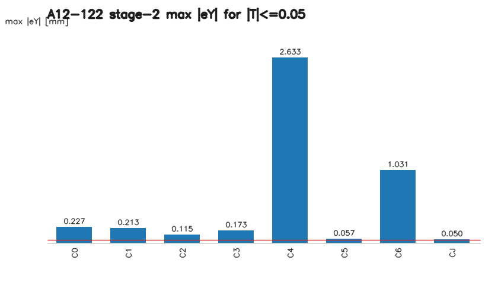
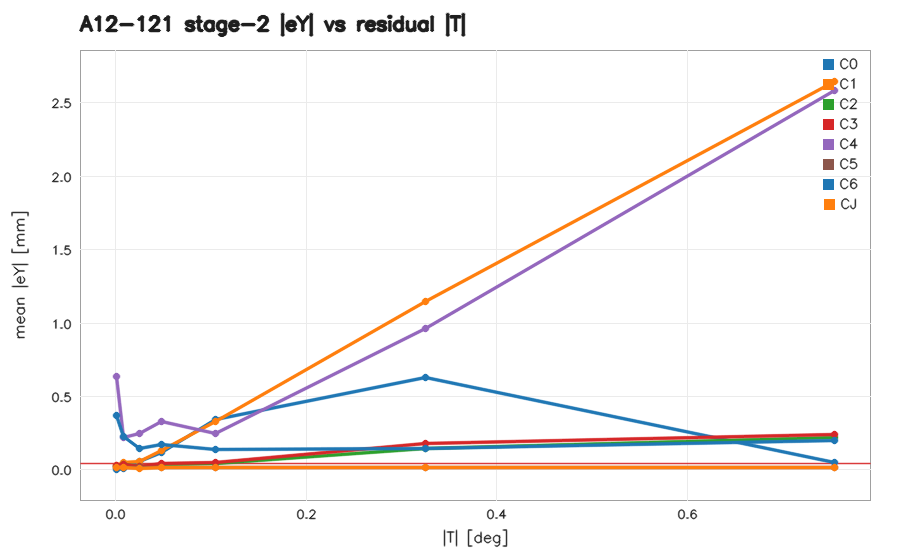
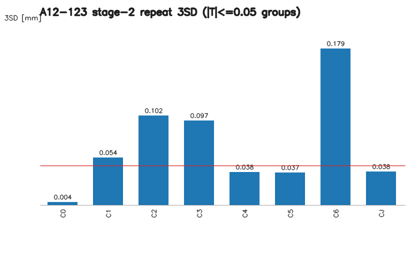

# A12 결과 — 2차 Y 추정기 개선 후보

`실험/src/main.cpp` 가 다시 쓴다. 해석은 [보고서](보고서.md).

2차 진입 영역을 **|T| <= 0.05** 로 보고, 그 영역에서 학습한 Y 전용 추정기들을 비교한다. C0(control)·CJ(joint)는 A10 의 실측을 가져왔다(재대입 성적). C1~C6 은 혼합 4-fold OOF 다.

## 1. 성적

| ID | 2차 Y 추정기 | T=0 n | T=0 |eY|평균 | T=0 최대 | |T|<=0.05 평균 | |T|<=0.05 최대 | |T|<=0.05 통과 | 전 범위 평균 | 전 범위 최대 |
|---|---|---|---|---|---|---|---|---|---|
| C0 | control() 전달 모듈 (QR만) | 84 | 0.0022 | 0.0391 | 0.0173 | 0.2271 | 0.8983 | 0.2524 | 2.3406 |
| C1 | P12 12d, |T|<=0.05 학습 (control 재현) | 83 | 0.0320 | 0.1255 | 0.0444 | 0.2128 | 0.6068 | 1.4064 | 4.0265 |
| C2 | P12 12d + 선 48d, |T|<=0.05 학습 | 83 | 0.0257 | 0.1148 | 0.0274 | 0.1148 | 0.8120 | 0.1377 | 0.6790 |
| C3 | QR아핀 18d + 선 48d, |T|<=0.05 학습 | 83 | 0.0300 | 0.1725 | 0.0309 | 0.1725 | 0.7863 | 0.1586 | 0.8418 |
| C4 | 물리 보정: 선으로 T 빼고 판이동/14.25 | 83 | 0.6334 | 2.6325 | 0.5249 | 2.6325 | 0.0940 | 1.4183 | 5.6009 |
| C5 | QR아핀 18d + 선 48d, 전체 T 학습 | 83 | 0.0178 | 0.0571 | 0.0173 | 0.0571 | 0.9658 | 0.0171 | 0.1928 |
| C6 | P12 12d, 전체 T 학습 | 83 | 0.3711 | 1.0310 | 0.3178 | 1.0310 | 0.1111 | 0.2013 | 1.1020 |
| CJ | joint() 전달 모듈 (참고) | 84 | 0.0180 | 0.0496 | 0.0167 | 0.0496 | 0.9661 | 0.0170 | 0.0731 |

## 2. 남은 T 가 커질 때

| ID | |T| 0.000~0.001 | |T| 0.001~0.015 | |T| 0.015~0.035 | |T| 0.035~0.060 | |T| 0.060~0.150 | |T| 0.150~0.500 | |T| 0.500~1.010 |
|---|---|---|---|---|---|---|---|
| C0 | 0.0022 | 0.0092 | 0.0537 | 0.1191 | 0.3397 | 0.6282 | 0.0465 |
| C1 | 0.0320 | 0.0485 | 0.0539 | 0.1322 | 0.3272 | 1.1463 | 2.6456 |
| C2 | 0.0257 | 0.0387 | 0.0191 | 0.0340 | 0.0397 | 0.1429 | 0.2189 |
| C3 | 0.0300 | 0.0343 | 0.0230 | 0.0410 | 0.0491 | 0.1771 | 0.2411 |
| C4 | 0.6334 | 0.2199 | 0.2486 | 0.3277 | 0.2481 | 0.9645 | 2.5849 |
| C5 | 0.0178 | 0.0176 | 0.0124 | 0.0171 | 0.0141 | 0.0159 | 0.0187 |
| C6 | 0.3711 | 0.2303 | 0.1455 | 0.1699 | 0.1387 | 0.1448 | 0.2005 |
| CJ | 0.0180 | 0.0142 | 0.0115 | 0.0139 | 0.0129 | 0.0174 | 0.0178 |

## 3. 반복 흩어짐

| ID | 묶음 수 | 반복 SD 중앙값 | p95 | 3SD(중앙)  |
|---|---|---|---|---|
| C0 | 9 | 0.00119 | 0.00665 | 0.0036 |
| C1 | 9 | 0.01813 | 0.02329 | 0.0544 |
| C2 | 9 | 0.03416 | 0.05248 | 0.1025 |
| C3 | 9 | 0.03228 | 0.05543 | 0.0969 |
| C4 | 9 | 0.01252 | 0.02927 | 0.0376 |
| C5 | 9 | 0.01244 | 0.02952 | 0.0373 |
| C6 | 9 | 0.05975 | 0.10862 | 0.1793 |
| CJ | 9 | 0.01281 | 0.02987 | 0.0384 |

## 4. 불안정 지표 (정답을 쓰지 않는다)

| 추정기 | 지표 | 순위 상관 |eY| | 상위10% 적중 | 상위20% 적중 |
|---|---|---|---|---|
| C0 | d1 |T_line| (남은 T) | -0.085 | 0.000 | 0.054 |
| C0 | d2 |T_line - T_qr| (불일치) | -0.160 | 0.018 | 0.062 |
| C0 | d3 판 dx 불일치 | -0.193 | 0.000 | 0.054 |
| C1 | d1 |T_line| (남은 T) | 0.991 | 0.875 | 0.920 |
| C1 | d2 |T_line - T_qr| (불일치) | -0.072 | 0.125 | 0.259 |
| C1 | d3 판 dx 불일치 | 0.805 | 0.839 | 0.812 |
| C3 | d1 |T_line| (남은 T) | 0.530 | 0.196 | 0.348 |
| C3 | d2 |T_line - T_qr| (불일치) | 0.057 | 0.214 | 0.295 |
| C3 | d3 판 dx 불일치 | 0.540 | 0.268 | 0.509 |

무작위 적중률은 상위10% 선별에서 0.10, 상위20% 에서 0.20 이다.

## 5. 게이팅: d1 임계를 넘으면 2차를 하지 않는다

| 추정기 | d1 임계 (deg) | 통과한 사진 | 비율 | 그중 |eY| 평균 | 최대 | ±0.045 통과 |
|---|---|---|---|---|---|---|
| C0 | 1.0000 | 553 | 0.982 | 0.2483 | 2.3406 | 0.5335 |
| C0 | 0.0500 | 116 | 0.206 | 0.0157 | 0.2271 | 0.9052 |
| C0 | 0.0200 | 102 | 0.181 | 0.0049 | 0.0626 | 0.9706 |
| C0 | 0.0100 | 89 | 0.158 | 0.0026 | 0.0391 | 1.0000 |
| C0 | 0.0050 | 73 | 0.130 | 0.0024 | 0.0391 | 1.0000 |
| C0 | 0.0027 | 52 | 0.092 | 0.0027 | 0.0391 | 1.0000 |
| C1 | 1.0000 | 552 | 0.982 | 1.3682 | 4.0265 | 0.1286 |
| C1 | 0.0500 | 115 | 0.205 | 0.0425 | 0.2128 | 0.6174 |
| C1 | 0.0200 | 101 | 0.180 | 0.0344 | 0.1255 | 0.6931 |
| C1 | 0.0100 | 88 | 0.157 | 0.0330 | 0.1255 | 0.7159 |
| C1 | 0.0050 | 72 | 0.128 | 0.0337 | 0.1255 | 0.7083 |
| C1 | 0.0027 | 51 | 0.091 | 0.0306 | 0.1255 | 0.7451 |
| C3 | 1.0000 | 552 | 0.982 | 0.1595 | 0.8418 | 0.3496 |
| C3 | 0.0500 | 115 | 0.205 | 0.0308 | 0.1725 | 0.7913 |
| C3 | 0.0200 | 101 | 0.180 | 0.0303 | 0.1725 | 0.8020 |
| C3 | 0.0100 | 88 | 0.157 | 0.0299 | 0.1725 | 0.8068 |
| C3 | 0.0050 | 72 | 0.128 | 0.0300 | 0.1725 | 0.8056 |
| C3 | 0.0027 | 51 | 0.091 | 0.0289 | 0.0889 | 0.8039 |

