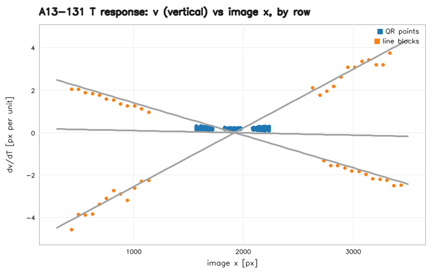
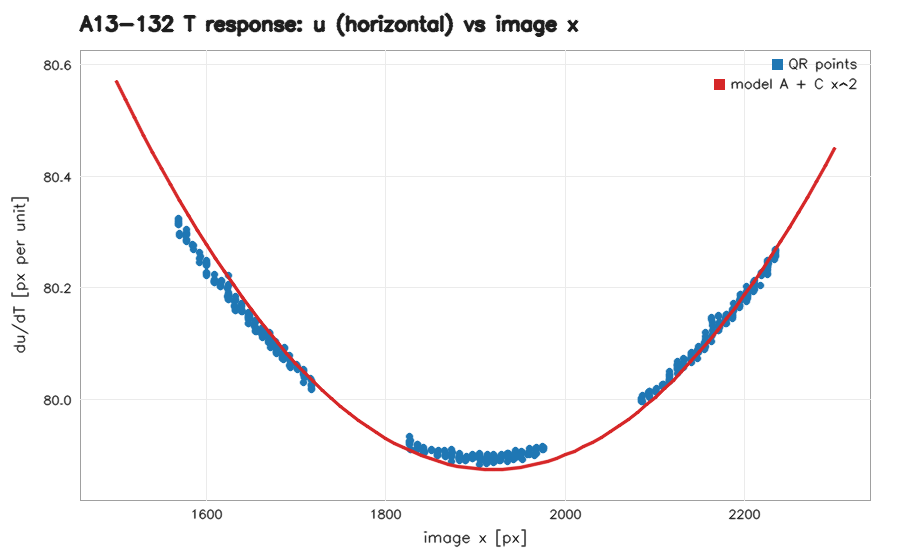
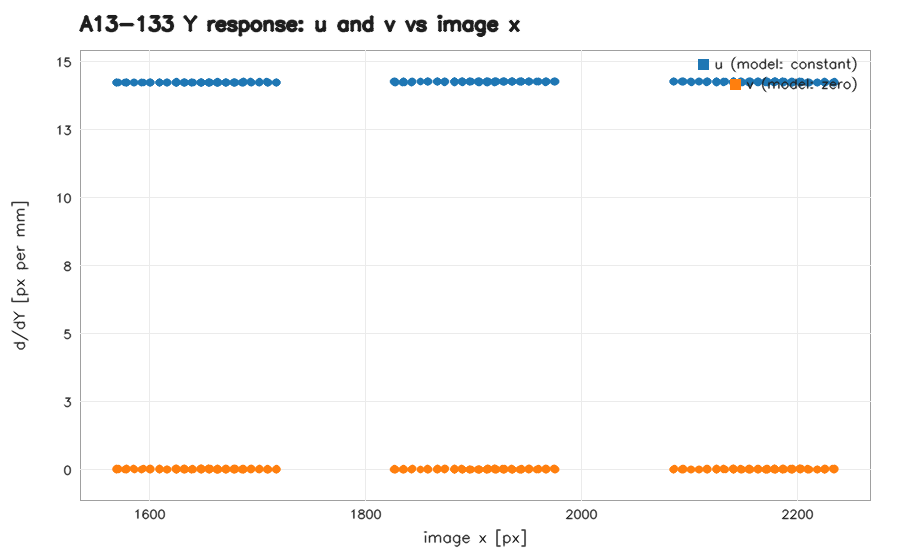
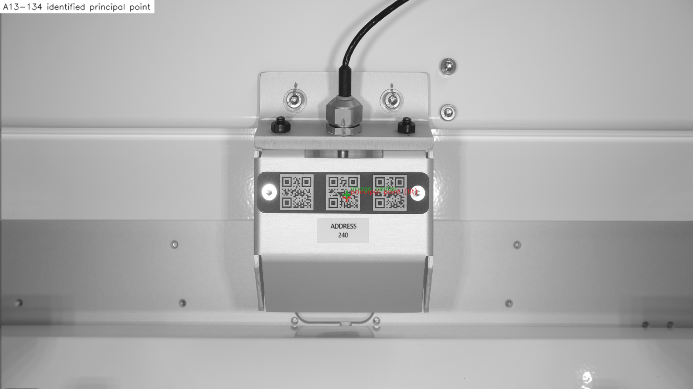

# A13 결과 — 물리 모형 자기 보정: f, 주점, Z, T 물리 단위

`실험/src/main.cpp` 가 다시 쓴다. 해석은 [보고서](보고서.md).

근거 문서: `docs/hye/문헌연구/01_주제_관련/원인분석/논문/2.1.1_원인의_수식_정리.docx` 의 식 (1)(2)(5).

모형은 u 의 x^2 계수와 v 의 xy 계수가 **같은 C** 를 쓴다고 말한다. 이 제약이 있어야 f 가 식별된다.

## 1. 모형이 맞는가 (제약 없는 2차 적합)

| 응답 | 상수 | x | y | x^2 | xy | y^2 | 잔차 RMS |
|---|---|---|---|---|---|---|---|
| T -> u (QR 536점) | 79.89616 | 0.04788 | -0.02388 | 3.53316 | 0.03102 | -0.48733 | 0.00668 |
| T -> v (QR 536점) | 0.18605 | 0.02208 | 0.04294 | 0.05581 | 3.78089 | -0.15573 | 0.01742 |
| Y -> u (QR 536점) | 14.25492 | 0.01608 | -0.01247 | -0.11977 | 0.01597 | -0.11310 | 0.00412 |
| Y -> v (QR 536점) | 0.02362 | 0.00009 | -0.00842 | 0.01547 | -0.07424 | 0.12907 | 0.00463 |

x, y 는 영상 중심 기준으로 1000 px 로 나눈 값이다.

| 검증 | 값 | 뜻 |
|---|---|---|
| u 의 x^2 계수 (제약 없음) | 0.000003533 | 1e-6 px/T/px^2 단위로 환산 |
| v 의 xy 계수 (제약 없음) | 0.000003781 | 모형은 둘이 같아야 한다 (= C) |
| 두 계수의 비 | 0.9345 | 모형이 맞으면 1 |
| 제약 모형의 C | 0.000003958 | QR + 선 |
| u 의 x 1차 계수 | 0.04788 | 모형은 0 |
| u 의 y 1차 계수 | -0.02388 | 모형은 0 |
| v 의 상수 계수 | 0.18605 | 모형은 0 |

## 2. 제약 모형 적합

| 적합 | 관측 | A (px/T) | C (px/T/px^2) | 주점 x0 | 주점 y0 | 잔차 RMS |
|---|---|---|---|---|---|---|
| QR 536점 + 선 48 | 1120 | 79.8748 | 0.000003958 | 1919.0 | 1097.0 | 0.14018 |
| QR 536점만 | 1072 | 79.9633 | 0.000000288 | 2440.0 | 2040.0 | 0.10831 |

## 3. 유도한 물리량

| 유도값 | QR + 선 | QR만 | 비고 |
|---|---|---|---|
| 초점거리 f (px) | 4492.4 | 16648.5 | d=0 가정. 실제로는 f*sqrt(1+d/Z) |
| 주점 x0 (px) | 1919.0 | 2440.0 | 영상 중심 1920 |
| 주점 y0 (px) | 1097.0 | 2040.0 | 영상 중심 1080 |
| T 1 명령단위 = (rad) | -0.017780 | -0.004803 |  |
| T 1 명령단위 = (deg) | -1.0187 | -0.2752 | **T 물리 단위** |
| 카메라-판 거리 Z (mm) | 315.3 | 1168.4 | Z = f / (14.25 px/mm) |
| 등가 회전 반경 (mm) | 315.9 | 1169.4 | 문서 식 (7) 은 322 mm |
| Y 감도 p (px/mm) | 14.2489 | 14.2489 | 팀 기준 14.25 |

## 4. 그림

