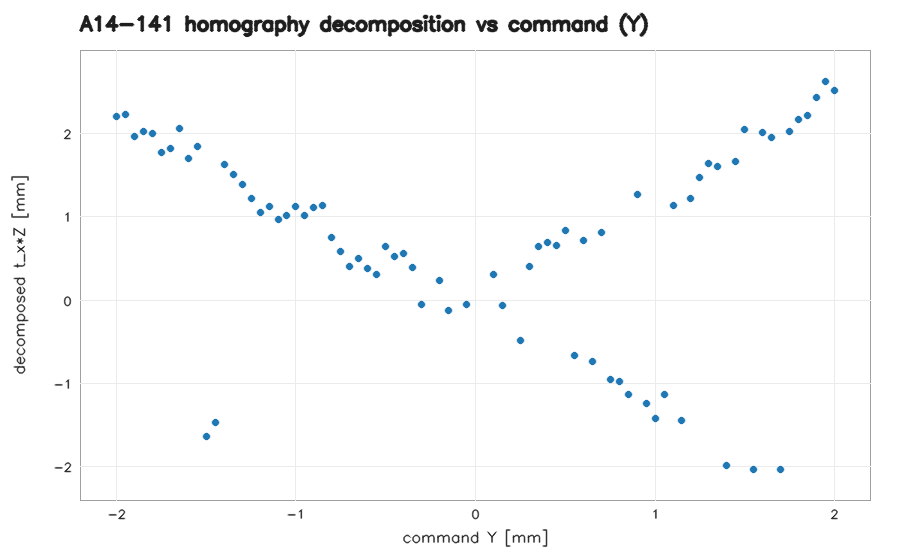
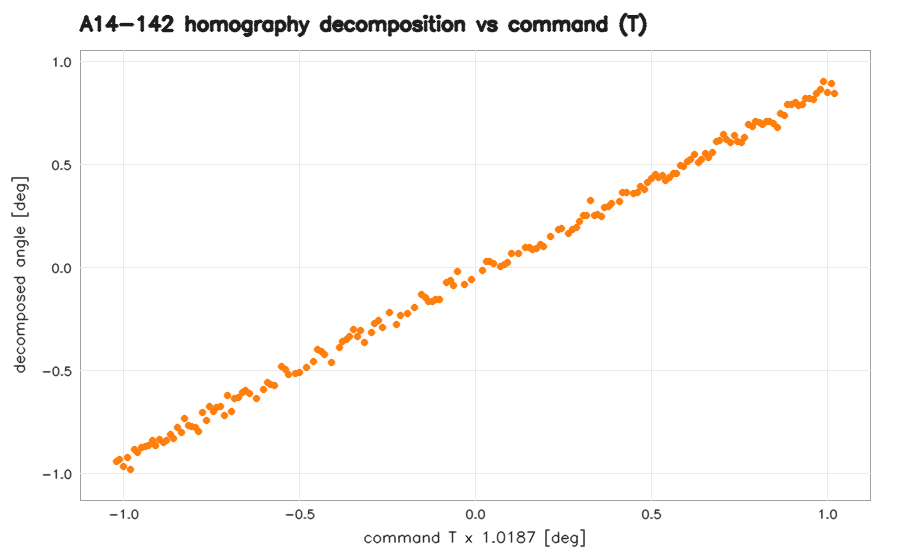
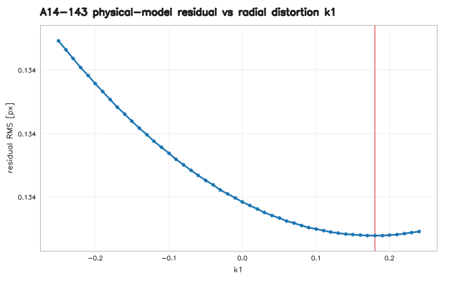

# A14 결과 — A13 의 K 로 문헌 방법을 세운다

`실험/src/main.cpp` 가 다시 쓴다. 해석은 [보고서](보고서.md).

쓴 K: f = 4492.4 px, 주점 (1919.0, 1097.0), 평면 거리 315.3 mm, T 1단위 = 1.0187 deg. 전부 [A13](../../20261102_141140_A13_물리모형자기보정_f와주점식별/결과/보고서.md) 에서 나왔다.

## 1. 호모그래피 분해가 명령을 맞히는가

| 대응 | 자료 | 기울기 (모형이 맞으면 1) | 절편 | 잔차 RMS | 장수 |
|---|---|---|---|---|---|
| 명령 Y (mm) -> 분해 t_x*Z (mm) | 1014 Y 단독 80장 | -0.1586 | 0.7172 | 1.1918 | 76 |
| 명령 T (deg) -> 분해 회전각 (deg) | 1014 T 단독 200장 | 0.9008 | -0.0369 | 0.0244 | 174 |
| 명령 Y -> 분해 t_x*Z (전체) | 범위 안 전체 | -0.2607 | -0.1645 | 0.6687 | 519 |
| 명령 T (deg) -> 분해 회전각 (전체) | 범위 안 전체 | 0.8999 | -0.0352 | 0.0258 | 519 |

**기울기가 1 이면 학습 없이 물리만으로 명령값이 복원된다는 뜻이다.**

## 2. 성적

| 방법 | 학습 | 장수 | Y 평균 | Y 최대 | T 평균 | T 최대 | 통과 ±0.045 |
|---|---|---|---|---|---|---|---|
| 호모그래피 분해 (Malis/IPPE 계열) | 척도·절편 2개만 | 519 | 1.6945 | 12.6226 | 0.0221 | 0.1097 | 0.0250 |
| 기준 모델 66d (대조) | fold 마다 66x2 계수 | 562 | 0.0171 | 0.1927 | 0.0033 | 0.0427 | 0.9573 |

호모그래피 분해는 fold 마다 다시 학습하지 않는다. 전체에서 척도와 절편 2개만 맞췄다.

## 3. 평면 자세 이중해 (H02)

| 항목 | 값 |
|---|---|
| 분해 후보가 2개 이상인 사진 | 519 / 519 |
| 두 후보의 Y 차이 중앙값 (mm) | 0.8683 |
| 두 후보의 Y 차이 최대 (mm) | 5.2360 |

## 4. 방사 왜곡 (H07)

| k1 | 제약 모형 잔차 RMS (px) | A (px/T) | C | u 의 y^2 계수 | 유도 f (px) |
|---|---|---|---|---|---|
| -0.200 | 0.13396 | 79.8852 | 0.000001245 | -1.28123 | 8011.8 |
| -0.150 | 0.13384 | 79.8871 | 0.000001827 | -1.08237 | 6612.4 |
| -0.100 | 0.13374 | 79.8890 | 0.000002409 | -0.88376 | 5758.6 |
| -0.050 | 0.13365 | 79.8910 | 0.000002991 | -0.68541 | 5168.6 |
| -0.020 | 0.13361 | 79.8921 | 0.000003339 | -0.56653 | 4891.4 |
| 0.000 | 0.13358 | 79.8929 | 0.000003571 | -0.48733 | 4729.7 |
| 0.020 | 0.13356 | 79.8936 | 0.000003804 | -0.40817 | 4583.1 |
| 0.050 | 0.13353 | 79.8948 | 0.000004152 | -0.28950 | 4386.7 |
| 0.100 | 0.13350 | 79.8967 | 0.000004732 | -0.09194 | 4109.2 |
| 0.150 | 0.13348 | 79.8986 | 0.000005311 | 0.10537 | 3878.7 |
| 0.200 | 0.13348 | 79.9006 | 0.000005890 | 0.30241 | 3683.3 |
| 최적 0.1800 | 0.13348 | 79.8998 | 0.000005658 | 0.22363 | 3757.8 |

