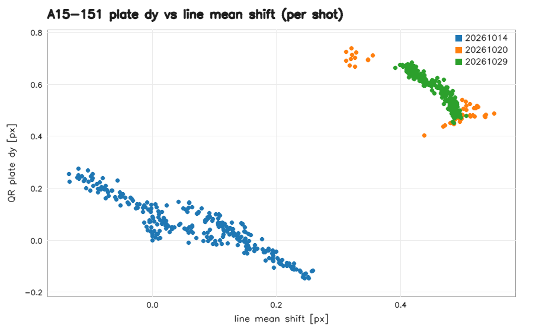
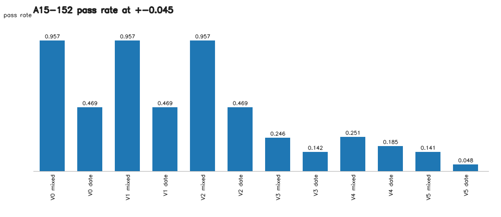

# A15 결과 — 뒷벽 가로선을 영점 기준으로 (ASM 방식)

`실험/src/main.cpp` 가 다시 쓴다. 해석은 [보고서](보고서.md).

근거: `01_주제_관련/원인분석/특허/06_US7248931_ASM_고정기준점_드리프트측정`

> 측정을 로봇 절대 위치가 아니라 **같은 영상 속 고정 기준 대비 상대 거리**로 하면 측정 기준 자체의 흔들림이 상쇄된다.

## 1. 진단 — 날짜가 바뀔 때 QR 과 선이 같이 움직이는가

| 비교 | QR dx | QR dy | 선 평균 이동 | 위 선 | 아래 선 | QR dy − 선 평균 | 판정 |
|---|---|---|---|---|---|---|---|
| 1020 기준위치 − 1014 center (둘 다 명령 0,0) | -0.2458 | 0.4423 | 0.4863 | 0.2248 | 0.7478 | -0.0440 | 선도 움직임 → 카메라 쪽 성분 있음 |
| 1020 Y+0.05 T+0.10 − 1029 내삽 | 0.0056 | -0.0007 | 0.0039 | 0.0013 | 0.0066 | -0.0047 | 선은 안 움직임 |

**선이 안 움직였는데 QR 만 움직였다면 판이 움직인 것이다.** 그 경우 선으로는 보정할 수 없다.

## 2. 세션 내 반복에서도 같은가

| 세트 | 묶음 수 | QR dy 반복 SD | 선 평균 반복 SD | 둘의 상관 |
|---|---|---|---|---|
| 20261020 | 20 | 0.01007 | 0.00606 | 0.336 |
| 20261029 | 77 | 0.00504 | 0.00385 | 0.396 |

## 3. 선 기준 특징으로 다시 평가

| 특징 | 분할 | 장수 | Y 평균 | Y 최대 | T 평균 | T 최대 | 통과 ±0.045 |
|---|---|---|---|---|---|---|---|
| V0 기준 QR+선 66d (A3 와 같음) | 혼합 4-fold | 562 | 0.0171 | 0.1927 | 0.0033 | 0.0427 | 0.9573 |
| V0 기준 QR+선 66d (A3 와 같음) | 날짜 3-fold | 563 | 0.1227 | 0.4479 | 0.0239 | 0.0713 | 0.4689 |
| V1 선 평균을 뺀 QR 세로 (66d) | 혼합 4-fold | 562 | 0.0171 | 0.1927 | 0.0033 | 0.0427 | 0.9573 |
| V1 선 평균을 뺀 QR 세로 (66d) | 날짜 3-fold | 563 | 0.1227 | 0.4479 | 0.0239 | 0.0713 | 0.4689 |
| V2 위·아래 선 평균을 뺀 QR 세로 (66d) | 혼합 4-fold | 562 | 0.0171 | 0.1927 | 0.0033 | 0.0427 | 0.9573 |
| V2 위·아래 선 평균을 뺀 QR 세로 (66d) | 날짜 3-fold | 563 | 0.1227 | 0.4479 | 0.0239 | 0.0713 | 0.4689 |
| V3 QR만 18d (선 안 씀) | 혼합 4-fold | 562 | 0.1248 | 0.5337 | 0.0224 | 0.0973 | 0.2456 |
| V3 QR만 18d (선 안 씀) | 날짜 3-fold | 563 | 0.7021 | 2.0559 | 0.1297 | 0.3624 | 0.1421 |
| V4 QR만 18d + 선 평균 세로 보정 | 혼합 4-fold | 562 | 0.1239 | 0.5093 | 0.0224 | 0.0944 | 0.2509 |
| V4 QR만 18d + 선 평균 세로 보정 | 날짜 3-fold | 563 | 0.2110 | 1.0134 | 0.0387 | 0.1894 | 0.1847 |
| V5 QR만 18d + 선 세로·가로 보정 | 혼합 4-fold | 562 | 0.1935 | 0.8998 | 0.0234 | 0.1468 | 0.1406 |
| V5 QR만 18d + 선 세로·가로 보정 | 날짜 3-fold | 563 | 0.6009 | 1.8292 | 0.0423 | 0.2523 | 0.0480 |

## 4. 날짜별

| 특징 | 빠진 날짜 | 장수 | Y 평균 | 통과 ±0.045 |
|---|---|---|---|---|
| V0 기준 QR+선 66d (A3 와 같음) | 1014 | 281 | 0.2232 | 0.0000 |
| V0 기준 QR+선 66d (A3 와 같음) | 1020 | 48 | 0.0349 | 0.8125 |
| V0 기준 QR+선 66d (A3 와 같음) | 1029 | 234 | 0.0200 | 0.9615 |
| V1 선 평균을 뺀 QR 세로 (66d) | 1014 | 281 | 0.2232 | 0.0000 |
| V1 선 평균을 뺀 QR 세로 (66d) | 1020 | 48 | 0.0349 | 0.8125 |
| V1 선 평균을 뺀 QR 세로 (66d) | 1029 | 234 | 0.0200 | 0.9615 |
| V2 위·아래 선 평균을 뺀 QR 세로 (66d) | 1014 | 281 | 0.2232 | 0.0000 |
| V2 위·아래 선 평균을 뺀 QR 세로 (66d) | 1020 | 48 | 0.0349 | 0.8125 |
| V2 위·아래 선 평균을 뺀 QR 세로 (66d) | 1029 | 234 | 0.0200 | 0.9615 |
| V3 QR만 18d (선 안 씀) | 1014 | 281 | 1.2864 | 0.0036 |
| V3 QR만 18d (선 안 씀) | 1020 | 48 | 0.0493 | 0.5625 |
| V3 QR만 18d (선 안 씀) | 1029 | 234 | 0.1344 | 0.2222 |
| V4 QR만 18d + 선 평균 세로 보정 | 1014 | 281 | 0.3023 | 0.0676 |
| V4 QR만 18d + 선 평균 세로 보정 | 1020 | 48 | 0.0476 | 0.5833 |
| V4 QR만 18d + 선 평균 세로 보정 | 1029 | 234 | 0.1349 | 0.2436 |
| V5 QR만 18d + 선 세로·가로 보정 | 1014 | 281 | 1.0036 | 0.0000 |
| V5 QR만 18d + 선 세로·가로 보정 | 1020 | 48 | 0.2436 | 0.1875 |
| V5 QR만 18d + 선 세로·가로 보정 | 1029 | 234 | 0.1906 | 0.0769 |

