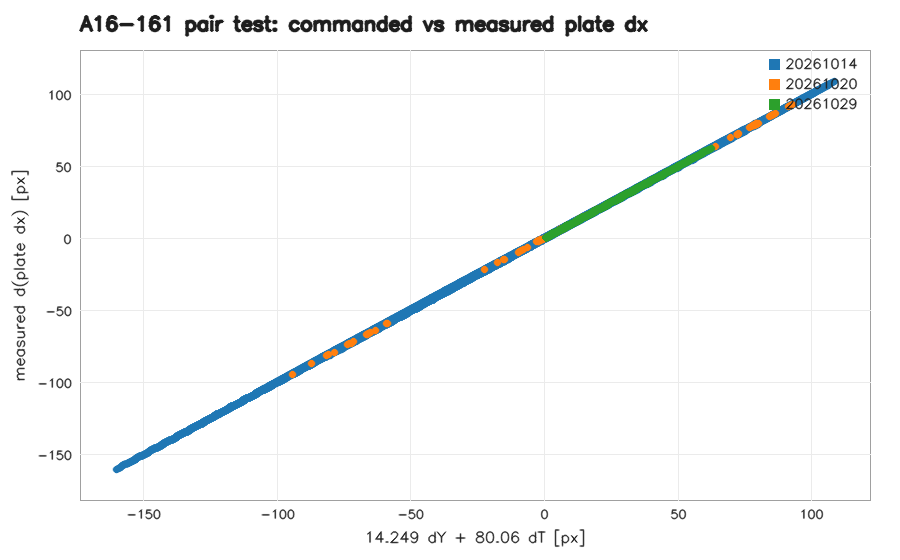
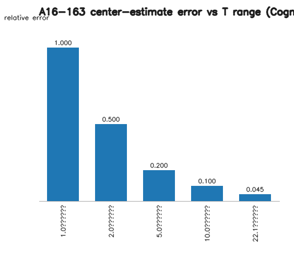
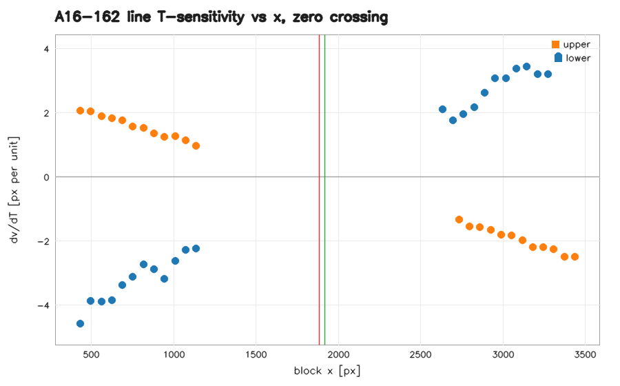

# A16 결과 — 원인분석 특허 두 건을 실제로 돌린다

`실험/src/main.cpp` 가 다시 쓴다. 해석은 [보고서](보고서.md).

## 1부. 보상 이동 영점 시험 (PT-01 Cognex)

세션 안의 조건 쌍 42463개를 썼다. 쌍을 쓰면 세션 영점 드리프트가 빠진다.

### 지렛대 (등가 회전 반경)

| 자료 | 쌍 수 | a (px per Y mm) | b (px per T) | 지렛대 b/a (mm per T) | 등가 반경 (mm) | 잔차 RMS px |
|---|---|---|---|---|---|---|
| 1014 (단일축만) | 39340 | 14.2489 | 80.0600 | 5.6187 | 316.0 | 0.3296 |
| 1020 (혼합 19조건) | 120 | 14.4244 | 80.4044 | 5.5742 | 313.5 | 0.2837 |
| 1029 (Y 고정) | 3003 | 0.0000 | 80.3219 |  |  | 0.0634 |
| 전체 | 42463 | 14.2491 | 80.0650 | 5.6189 | 316.0 | 0.3191 |

### 보상에 가장 가까운 쌍

| 자료 | dY | dT | 보상 예측 dY | 보상 어긋남 | 실측 판 dx | 설명되는가 |
|---|---|---|---|---|---|---|
| 20261014 | -0.450 | 0.080 | -0.4493 | -0.0007 | -0.2695 | -0.0072 |
| 20261014 | 0.450 | -0.080 | 0.4493 | 0.0007 | 0.3954 | 0.0072 |
| 20261014 | -0.900 | 0.160 | -0.8987 | -0.0013 | 0.3393 | -0.0145 |
| 20261014 | 0.900 | -0.160 | 0.8987 | 0.0013 | 0.3943 | 0.0145 |
| 20261014 | 1.350 | -0.240 | 1.3480 | 0.0020 | 0.5455 | 0.0218 |
| 20261014 | -1.350 | 0.240 | -1.3480 | -0.0020 | -0.2444 | -0.0218 |
| 20261014 | -1.800 | 0.320 | -1.7974 | -0.0026 | 0.2212 | -0.0290 |
| 20261014 | 1.800 | -0.320 | 1.7974 | 0.0026 | 0.4593 | 0.0290 |
| 20261014 | 1.850 | -0.330 | 1.8536 | -0.0036 | 0.5193 | -0.0591 |
| 20261014 | -1.850 | 0.330 | -1.8536 | 0.0036 | -0.2218 | 0.0591 |

### Cognex 의 1/tan(각/2) — T 범위를 넓히면

| T 범위 (명령단위) | 물리 각도 (deg) | 1/tan(각/2) | 현재 대비 중심 오차 |
|---|---|---|---|
| 1.0 | 1.019 | 112.5 | 1.000 |
| 2.0 | 2.037 | 56.2 | 0.500 |
| 5.0 | 5.093 | 22.5 | 0.200 |
| 10.0 | 10.187 | 11.2 | 0.100 |
| 22.1 | 22.513 | 5.0 | 0.045 |

## 2부. 대칭·극값으로 축 찾기 (PT-04 Kawasaki)

선 블록의 T 감도가 x 에 대해 직선이고 x0 에서 부호가 바뀐다. **모형 적합 없이** 영교차점만 찾는다.

| 줄 | 블록 수 | 기울기 (px/deg per px) | 절편 | 영교차 x0 | 적합 잔차 |
|---|---|---|---|---|---|
| 위 선 | 24 | -0.00152386 | 2.75359 | 1807.0 | 0.05057 |
| 아래 선 | 24 | 0.00274070 | -5.36466 | 1957.4 | 0.23770 |

| 값 | 대칭·극값 (PT-04, 적합 없음) | 최소제곱 (A13) | 차이 | 영상 중심 |
|---|---|---|---|---|
| 주점 x0 | 1882.2 | 1919.0 | -36.8 | 1920 |
| 주점 y0 | 1100.3 | 1097.0 | 3.3 | 1080 |
| 위 선 영교차 | 1807.0 | - | - | - |
| 아래 선 영교차 | 1957.4 | - | - | - |
| 두 줄 기울기 비 | -0.5560 | - | - | (y_up-y0)/(y_lo-y0) |

