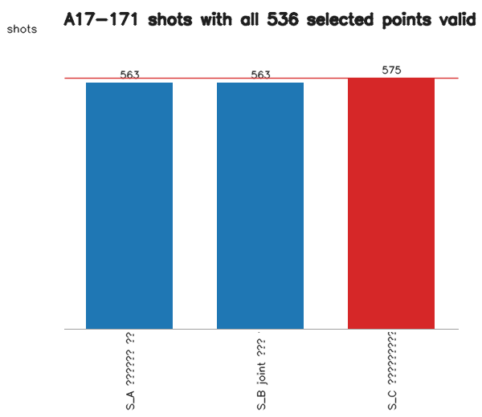
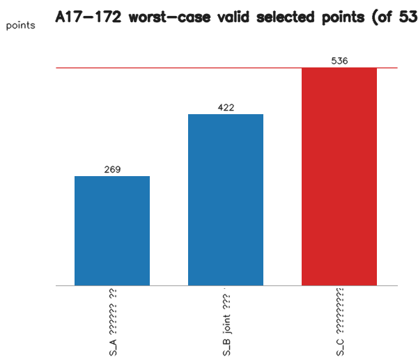
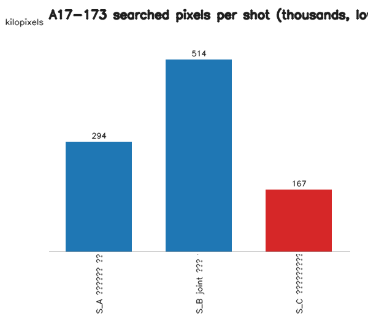

# A17 결과 - control 범위 밖 정수 이동 실패

`실험/src/main.cpp` 가 다시 쓴다. 해석은 [보고서](보고서.md). 계획은 [계획서](../계획서.md).

세 전략은 정수 이동 단계만 다르고 정밀화와 유효 판정은 같은 코드다. 참 정수 이동의 대리값은 `dx = 14.2491*Y + 80.0650*T` 다(A16).

## 1. 전략별 요약

| 전략 | 장수 | 선택점 536 전부 유효 | 최소 유효 | 평균 유효 | 게이트 거부 | 정수 이동 8 px 초과 | A0 과 같은 유효수 | 장당 평균 ms | 장당 탐색 화소 |
|---|---|---|---|---|---|---|---|---|---|
| S_A 현재 단일 창 110x22 | 575 | 563 | 269 | 530.5 | 12 | 12 | 575 | 293546 |
| S_B joint 식 단계 확장 110-260-512 | 575 | 563 | 422 | 533.6 | 12 | 12 | 563 | 514290 |
| S_C 피라미드 + 간격 게이트 | 575 | 575 | 536 | 536.0 | 0 | 0 | 563 | 166668 |

빨간 선은 각각 575장, 536점이다.

장당 평균 ms 는 세 전략을 한 프로세스에서 번갈아 돌린 값이라 캐시 효과가 섞여 있다. 전략 사이의 **상대 비교**로만 읽는다. 장당 탐색 화소는 matchTemplate 에 넘긴 탐색 영역 넓이의 합이며 캐시와 무관한 비용 대리값이다.

## 2. 범위 밖 12장 (T+2.00)

| 사진 | 예측 dx | 전략 | QR1 | QR2 | QR3 | 불일치 | 최소 NCC | 유효/536 | 게이트 |
|---|---|---|---|---|---|---|---|---|---|

전체 사진별 값은 [per_shot.csv](results/per_shot.csv), 게이트가 걸린 장은 [gate_events.csv](results/gate_events.csv) 에 있다.
