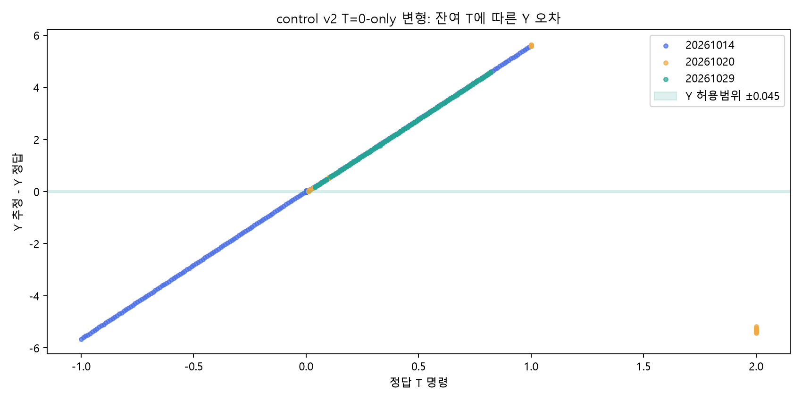
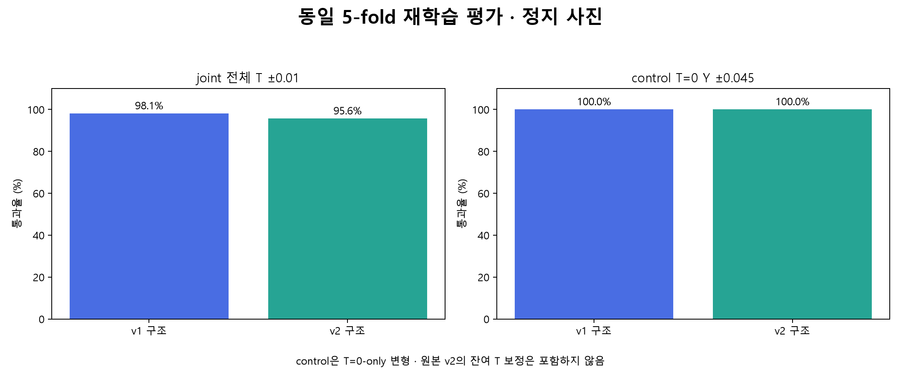

# final v2 평가 보고서

작성일: 2026-11-04. 실행 환경: Windows x64, Intel Core Ultra 9 185H, MSVC v141(19.16), OpenCV 3.4.15, Release, OpenCV 1스레드. 원본 BMP를 다시 읽어 영상 특징을 측정했다. v1/v2 구조 재학습에는 동일 seed20261104 그룹 분할을 사용해 외부 test에 해당하지 않는 train만으로 fold별 모델을 새로 학습했다. LSJ와 배포 모델은 별도로 원래 계수를 고정해 실행했다. center 4장은 이번 회귀 학습·평가에서 제외했다.

정답은 파일명 명령이다. 실제 자세를 독립 계측한 정답과 구분한다. Y 허용범위는 ±0.045, T는 ±0.01(T 1틱)이다. 통과율은 실패를 포함한 전체 배정 사진을 분모로 한다. MAE/p95/최대오차는 유효 예측 기준이며 유효 수를 함께 쓴다. p95는 오름차순 ceil(0.95N)번째다. v1/v2 재학습 표는 모든 사진이 한 번씩 test에 등장하는 OOF이며, LSJ와 원본 배포 모델은 고정 모델 개발 재생으로 별도 표시한다. 새 날짜·신규 독립 데이터 검증은 아니다.

시간은 이 PC에서 한 번 순회하며 측정한 개발 실행값이다. 카메라 촬영·장비 이동·정지 대기·네트워크·운영 GUI는 포함하지 않는다. 이미지 읽기+그레이스케일 디코딩은 별도다. 측정 도중 빌드 작업이 일부 겹쳤으므로 단독 실행 최적 성능이나 하드 실시간 상한으로 해석하지 않는다. joint v1/v2는 같은 영상 측정값을 공유하고 회귀 계산만 다르다. control T=0 변형은 공통 tracker+P12+mean 측정 파이프라인 시간이며 원본 공개 API 전체 시간과 동일하다고 주장하지 않는다.

1029 파일명 T=0.32 2장/T=0.33 4장 예외를 그대로 유지했다. 같은 파일명이 두 개지만 영상 해시가 다른 BMP를 서로 다른 경로로 보존했고 파일명 정답을 임의 수정하지 않았다. 이 사례는 촬영자 확인 전 라벨 정확성에 제한이 있다.

## 평가한 구현과 원본 차이

joint는 원본 v2의 QR 평균 가로 이동 s와 상·하단 바 기울기 차 d로 `[1,s,d]→(Y,T)` 최소제곱을 fold별 재학습했다. 기존 도구의 |T|≤1 필터는 사용하지 않고 전체 범위를 포함했다.

control v2 원본은 T≠0 자료로 잔여 T 회귀와 Y 보정계수를 학습한다. 사용자 요청 T=0-only에서는 그 계수를 식별할 수 없다. 따라서 T=0 train의 s→Y 직선만 재학습하고 잔여 T 보정은 끈 변형을 평가했다. 이것은 원본 v2의 보정 효과를 평가한 점수가 아니다. 원본 배포 v2의 보정 포함 출력은 아래 개발 재생 표에 별도로 싣는다.

## 평가 1A. joint 전체 test의 T 정확도

| 조건 | 전체 | 유효 | 통과 수/전체 | MAE | p95 | 최대오차 |
|---|---|---|---|---|---|---|
| 20261014 | 280 | 280 | 273/280 (97.5%) | 0.00385 | 0.00909 | 0.01187 |
| 20261020 | 57 | 57 | 40/57 (70.2%) | 0.00871 | 0.02945 | 0.04302 |
| 20261029 | 234 | 234 | 233/234 (99.6%) | 0.00297 | 0.00682 | 0.01632 |
| 전체 | 571 | 571 | 546/571 (95.6%) | 0.00398 | 0.00941 | 0.04302 |

### fold별 joint T 정확도

| 조건 | 전체 | 유효 | 통과 수/전체 | MAE | p95 | 최대오차 |
|---|---|---|---|---|---|---|
| fold 01 | 116 | 116 | 110/116 (94.8%) | 0.00377 | 0.01017 | 0.03605 |
| fold 02 | 116 | 116 | 114/116 (98.3%) | 0.00354 | 0.00790 | 0.01306 |
| fold 03 | 116 | 116 | 110/116 (94.8%) | 0.00399 | 0.01289 | 0.02783 |
| fold 04 | 113 | 113 | 107/113 (94.7%) | 0.00432 | 0.01187 | 0.04302 |
| fold 05 | 110 | 110 | 105/110 (95.5%) | 0.00429 | 0.00982 | 0.02945 |

## 평가 1B. control T=0 기본 Y 정확도

| 조건 | 전체 | 유효 | 통과 수/전체 | MAE | p95 | 최대오차 |
|---|---|---|---|---|---|---|
| T=0 / 1014 Y 80장 | 80 | 80 | 80/80 (100.0%) | 0.01234 | 0.02665 | 0.03072 |

각 fold T=0 train 64장만 사용했다. test는 16장씩 총 80장이다. 1020/1029에는 center 제외 T=0 자료가 없어 기본 성적을 계산할 수 없다. 각 자세 한 장이므로 T=0 반복정밀도는 추가 반복 촬영이 필요하다.

## 평가 1C. control 잔여 T 범위별 Y 정확도

T=0으로 학습한 모델을 고정하고 나머지 T≠0 사진에 적용했다. 정답 T로 나눈 사후 분석이며 추론에 T 정답을 알려주지 않는다.

| 조건 | 전체 | 유효 | 통과 수/전체 | MAE | p95 | 최대오차 |
|---|---|---|---|---|---|---|
| T=0 | 80 | 80 | 80/80 (100.0%) | 0.01234 | 0.02665 | 0.03072 |
| 0<\|T\|≤0.01 | 14 | 14 | 13/14 (92.9%) | 0.02022 | 0.05296 | 0.05296 |
| 0.01<\|T\|≤0.03 | 10 | 10 | 0/10 (0.0%) | 0.10404 | 0.16033 | 0.16033 |
| 0.03<\|T\|≤0.10 | 44 | 44 | 0/44 (0.0%) | 0.39090 | 0.54633 | 0.55307 |
| 0.10<\|T\|≤0.30 | 103 | 103 | 0/103 (0.0%) | 1.11567 | 1.63194 | 1.68739 |
| 0.30<\|T\|≤1 | 308 | 308 | 0/308 (0.0%) | 3.47678 | 5.54391 | 5.65915 |
| \|T\|>1 | 12 | 12 | 0/12 (0.0%) | 5.32040 | 5.43805 | 5.43805 |

### 날짜별 T≠0 성적

| 조건 | 전체 | 유효 | 통과 수/전체 | MAE | p95 | 최대오차 |
|---|---|---|---|---|---|---|
| 20261014 | 200 | 200 | 1/200 (0.5%) | 2.83185 | 5.37152 | 5.65915 |
| 20261020 | 57 | 57 | 12/57 (21.1%) | 2.48070 | 5.61456 | 5.63657 |
| 20261029 | 234 | 234 | 0/234 (0.0%) | 2.39469 | 4.39308 | 4.57765 |

**팀원용 해석:** T=0에서 잘 맞는다는 사실만으로 두 단계 복귀가 보장되지는 않는다. T가 1틱 이내로 조금 남은 14장에서는 Y 통과가 13장이다. 이 구간의 표본은 적고, 더 큰 잔여 T 구간에서는 Y 오차가 커진다. 실제 제어에서는 T 단계의 잔차와 control 적용 조건을 함께 확인해야 한다. 원본 v2의 잔여 T 보정 기능을 끈 시험이라는 점도 함께 읽어야 한다.

### 원본 배포 모델 개발 재생 (OOF 재학습과 구분)

학습 때 이미 사용한 사진이 포함되므로 아래 수치를 독립 검증이나 같은 5-fold OOF로 부르지 않는다. 원본 control은 T=0-only 학습 조건과 다르다.

| 조건 | 전체 | 유효 | 통과 수/전체 | MAE | p95 | 최대오차 |
|---|---|---|---|---|---|---|
| 원본 joint v2 / 전체 T | 571 | 571 | 549/571 (96.1%) | 0.00385 | 0.00934 | 0.04418 |
| 원본 control v2 / T=0 Y | 80 | 80 | 80/80 (100.0%) | 0.01185 | 0.02514 | 0.02863 |
| 원본 control v2 / T≠0 Y | 491 | 491 | 333/491 (67.8%) | 0.42445 | 0.10922 | 16.11548 |

원본 control의 잔여 T 구간별 개발 재생:

| 조건 | 전체 | 유효 | 통과 수/전체 | MAE | p95 | 최대오차 |
|---|---|---|---|---|---|---|
| T=0 | 80 | 80 | 80/80 (100.0%) | 0.01185 | 0.02514 | 0.02863 |
| 0<\|T\|≤0.01 | 14 | 14 | 13/14 (92.9%) | 0.01648 | 0.05176 | 0.05176 |
| 0.01<\|T\|≤0.03 | 10 | 10 | 8/10 (80.0%) | 0.03575 | 0.09707 | 0.09707 |
| 0.03<\|T\|≤0.10 | 44 | 44 | 32/44 (72.7%) | 0.04183 | 0.11407 | 0.14271 |
| 0.10<\|T\|≤0.30 | 103 | 103 | 70/103 (68.0%) | 0.03619 | 0.10012 | 0.11760 |
| 0.30<\|T\|≤1 | 308 | 308 | 210/308 (68.2%) | 0.03682 | 0.09258 | 0.19133 |
| \|T\|>1 | 12 | 12 | 0/12 (0.0%) | 15.90902 | 16.11548 | 16.11548 |

T≠0 전체에는 Y=0인 1014/T 200장도 포함되므로 혼합 자세만의 성능과 같지 않다. T=2의 12장은 외삽·정합 위험이 있는 큰 자세로 분리해 읽는다. 원본 v2의 보정 효과는 이 개발 재생에서 확인하되 T=0-only 재학습과 섞어 한 점수로 보고하지 않는다.

### 처리시간 (ms)

| 측정 파이프라인 | 측정+예측 중앙값 | 측정+예측 p95 | 읽기/디코딩 중앙값(별도) | 측정 유효 수 |
|---|---|---|---|---|
| joint v2 | 765.86450 | 1005.51220 | 175.49900 | 571 |
| control T=0 변형 (전수 적용) | 39.77210 | 56.15430 | 175.49900 | 571 |

OpenCV 스레드 1개, 동일 실행의 공통 측정 캐시를 사용했다. 추론 전 모델/기준 영상 초기화와 fold 학습 시간은 `results/environment.txt`, `results/fold_*.yml`에서 확인한다. 원본 control v2는 추가 바 측정이 있으므로 위 T=0 변형 시간을 원본 v2 시간으로 인용하면 안 된다.

### 원본 공개 API 별도 시간 측정

각 날짜 4장씩 사전에 정한 동일 12장을 사용했다. 초기화 후 첫 영상으로 joint/control을 한 번씩 워밍업하고, 원본 `joint()`·`control()` 공개 함수를 호출했다. 이미지 읽기·디코딩은 별도이며 학습 시간과 장비 이동은 포함하지 않는다. 이는 12장 표본 실행이므로 571장 전수 시간 분포와 구분한다.

| 공개 함수 | 표본 수 | 추론 중앙값 ms | 추론 p95 ms | 읽기/디코딩 중앙값 ms |
|---|---|---|---|---|
| 원본 v2 joint | 12 | 757.57490 | 889.68120 | 152.87985 |
| 원본 v2 control | 12 | 44.83080 | 78.38160 | 152.87985 |

[원본 API 시간·출력](results/benchmark_v2.tsv), [원본 API 측정 코드](src/bench.cpp)를 참조한다. 12장 표본에서 공개 함수와 기존 모델 재생의 joint Y/T 및 control Y 출력 차이는 모두 0이었다([대응 검사](results/public_api_parity.json)). 이는 원본 재생 경로 검사이며 새 학습기 전체의 동등성 증명과 구분한다.

### 성능 시각화

### 반복정밀도 상세

Y는 반복 평균 중심 최대편차 0.045, T는 0.01을 보고 기준으로 사용하며 전폭도 병기한다. 정확도 통과와 별개다.

joint T:

| 그룹 | 사진 수 | 유효 | 평균 중심 최대편차 | 전폭 | 반복 판정 |
|---|---|---|---|---|---|
| 20261020_Y+0.05_T+0.02 | 3 | 3 | 0.00177 | 0.00285 | 통과 |
| 20261020_Y+0.05_T+0.03 | 3 | 3 | 0.00211 | 0.00388 | 통과 |
| 20261020_Y+0.10_T+0.20 | 3 | 3 | 0.02166 | 0.04000 | 실패/측정불가 |
| 20261020_Y+0.50_T+1.00 | 3 | 3 | 0.02338 | 0.04023 | 실패/측정불가 |
| 20261029_Y+0.05_T+0.09 | 3 | 3 | 0.00196 | 0.00385 | 통과 |
| 20261029_Y+0.05_T+0.13 | 3 | 3 | 0.00188 | 0.00313 | 통과 |
| 20261029_Y+0.05_T+0.16 | 3 | 3 | 0.00111 | 0.00217 | 통과 |
| 20261029_Y+0.05_T+0.20 | 3 | 3 | 0.00070 | 0.00119 | 통과 |
| 20261029_Y+0.05_T+0.21 | 3 | 3 | 0.00312 | 0.00475 | 통과 |
| 20261029_Y+0.05_T+0.32 | 2 | 2 | 0.00226 | 0.00451 | 통과 |
| 20261029_Y+0.05_T+0.33 | 4 | 4 | 0.01105 | 0.01777 | 실패/측정불가 |
| 20261029_Y+0.05_T+0.48 | 3 | 3 | 0.00473 | 0.00799 | 통과 |
| 20261029_Y+0.05_T+0.54 | 3 | 3 | 0.00549 | 0.00846 | 통과 |
| 20261029_Y+0.05_T+0.55 | 3 | 3 | 0.00540 | 0.00843 | 통과 |
| 20261029_Y+0.05_T+0.58 | 3 | 3 | 0.00369 | 0.00728 | 통과 |
| 20261029_Y+0.05_T+0.59 | 3 | 3 | 0.00512 | 0.00956 | 통과 |
| 20261029_Y+0.05_T+0.69 | 3 | 3 | 0.00307 | 0.00474 | 통과 |
| 20261029_Y+0.05_T+0.70 | 3 | 3 | 0.00186 | 0.00320 | 통과 |
| 20261029_Y+0.05_T+0.71 | 3 | 3 | 0.00187 | 0.00303 | 통과 |
| 20261029_Y+0.05_T+0.81 | 3 | 3 | 0.00363 | 0.00646 | 통과 |
| 20261020_Y+0.05_T+0.01 | 3 | 3 | 0.00303 | 0.00478 | 통과 |
| 20261020_Y+0.05_T+2.00 | 3 | 3 | 0.00384 | 0.00722 | 통과 |
| 20261020_Y+0.10_T+0.10 | 3 | 3 | 0.00228 | 0.00379 | 통과 |
| 20261020_Y+0.50_T+0.01 | 3 | 3 | 0.00443 | 0.00824 | 통과 |
| 20261029_Y+0.05_T+0.08 | 3 | 3 | 0.00338 | 0.00667 | 통과 |
| 20261029_Y+0.05_T+0.11 | 3 | 3 | 0.00471 | 0.00738 | 통과 |
| 20261029_Y+0.05_T+0.14 | 3 | 3 | 0.00345 | 0.00568 | 통과 |
| 20261029_Y+0.05_T+0.18 | 3 | 3 | 0.00089 | 0.00149 | 통과 |
| 20261029_Y+0.05_T+0.22 | 3 | 3 | 0.00226 | 0.00406 | 통과 |
| 20261029_Y+0.05_T+0.27 | 3 | 3 | 0.00132 | 0.00217 | 통과 |
| 20261029_Y+0.05_T+0.42 | 3 | 3 | 0.00494 | 0.00805 | 통과 |
| 20261029_Y+0.05_T+0.43 | 3 | 3 | 0.00423 | 0.00817 | 통과 |
| 20261029_Y+0.05_T+0.49 | 3 | 3 | 0.00516 | 0.00920 | 통과 |
| 20261029_Y+0.05_T+0.50 | 3 | 3 | 0.00363 | 0.00612 | 통과 |
| 20261029_Y+0.05_T+0.52 | 3 | 3 | 0.00262 | 0.00426 | 통과 |
| 20261029_Y+0.05_T+0.56 | 3 | 3 | 0.00331 | 0.00555 | 통과 |
| 20261029_Y+0.05_T+0.57 | 3 | 3 | 0.00995 | 0.01648 | 통과 |
| 20261029_Y+0.05_T+0.65 | 3 | 3 | 0.00202 | 0.00342 | 통과 |
| 20261029_Y+0.05_T+0.68 | 3 | 3 | 0.00570 | 0.01014 | 통과 |
| 20261029_Y+0.05_T+0.72 | 3 | 3 | 0.00725 | 0.01127 | 통과 |
| 20261020_Y+0.05_T+1.00 | 3 | 3 | 0.00047 | 0.00079 | 통과 |
| 20261020_Y+0.10_T+2.00 | 3 | 3 | 0.02273 | 0.03629 | 실패/측정불가 |
| 20261020_Y+0.50_T+0.10 | 3 | 3 | 0.01538 | 0.02521 | 실패/측정불가 |
| 20261020_Y+0.50_T+2.00 | 3 | 3 | 0.01220 | 0.02410 | 실패/측정불가 |
| 20261029_Y+0.05_T+0.07 | 3 | 3 | 0.00064 | 0.00107 | 통과 |
| 20261029_Y+0.05_T+0.12 | 3 | 3 | 0.00339 | 0.00633 | 통과 |
| 20261029_Y+0.05_T+0.15 | 3 | 3 | 0.00336 | 0.00666 | 통과 |
| 20261029_Y+0.05_T+0.23 | 3 | 3 | 0.00325 | 0.00586 | 통과 |
| 20261029_Y+0.05_T+0.28 | 3 | 3 | 0.00199 | 0.00298 | 통과 |
| 20261029_Y+0.05_T+0.29 | 3 | 3 | 0.00309 | 0.00524 | 통과 |
| 20261029_Y+0.05_T+0.31 | 3 | 3 | 0.00559 | 0.00918 | 통과 |
| 20261029_Y+0.05_T+0.36 | 3 | 3 | 0.00212 | 0.00326 | 통과 |
| 20261029_Y+0.05_T+0.37 | 3 | 3 | 0.00139 | 0.00274 | 통과 |
| 20261029_Y+0.05_T+0.45 | 3 | 3 | 0.00669 | 0.01320 | 통과 |
| 20261029_Y+0.05_T+0.46 | 3 | 3 | 0.00326 | 0.00491 | 통과 |
| 20261029_Y+0.05_T+0.47 | 3 | 3 | 0.00068 | 0.00103 | 통과 |
| 20261029_Y+0.05_T+0.62 | 3 | 3 | 0.00306 | 0.00473 | 통과 |
| 20261029_Y+0.05_T+0.67 | 3 | 3 | 0.00447 | 0.00837 | 통과 |
| 20261029_Y+0.05_T+0.78 | 3 | 3 | 0.00346 | 0.00640 | 통과 |
| 20261029_Y+0.05_T+0.79 | 3 | 3 | 0.00381 | 0.00724 | 통과 |
| 20261020_Y+1.00_T+0.01 | 3 | 3 | 0.00130 | 0.00243 | 통과 |
| 20261020_Y+1.00_T+0.10 | 3 | 3 | 0.01323 | 0.02503 | 실패/측정불가 |
| 20261020_Y+1.00_T+1.00 | 3 | 3 | 0.02432 | 0.03860 | 실패/측정불가 |
| 20261020_Y+1.00_T+2.00 | 3 | 3 | 0.03219 | 0.05296 | 실패/측정불가 |
| 20261029_Y+0.05_T+0.04 | 3 | 3 | 0.00074 | 0.00128 | 통과 |
| 20261029_Y+0.05_T+0.05 | 3 | 3 | 0.00050 | 0.00083 | 통과 |
| 20261029_Y+0.05_T+0.06 | 3 | 3 | 0.00239 | 0.00397 | 통과 |
| 20261029_Y+0.05_T+0.30 | 3 | 3 | 0.00282 | 0.00482 | 통과 |
| 20261029_Y+0.05_T+0.38 | 3 | 3 | 0.00365 | 0.00674 | 통과 |
| 20261029_Y+0.05_T+0.39 | 3 | 3 | 0.00062 | 0.00096 | 통과 |
| 20261029_Y+0.05_T+0.40 | 3 | 3 | 0.00359 | 0.00558 | 통과 |
| 20261029_Y+0.05_T+0.44 | 3 | 3 | 0.00370 | 0.00739 | 통과 |
| 20261029_Y+0.05_T+0.60 | 3 | 3 | 0.00586 | 0.01125 | 통과 |
| 20261029_Y+0.05_T+0.61 | 3 | 3 | 0.00482 | 0.00962 | 통과 |
| 20261029_Y+0.05_T+0.64 | 3 | 3 | 0.00165 | 0.00297 | 통과 |
| 20261029_Y+0.05_T+0.75 | 3 | 3 | 0.00393 | 0.00710 | 통과 |
| 20261029_Y+0.05_T+0.76 | 3 | 3 | 0.00485 | 0.00875 | 통과 |
| 20261029_Y+0.05_T+0.77 | 3 | 3 | 0.00558 | 0.00977 | 통과 |
| 20261029_Y+0.05_T+0.80 | 3 | 3 | 0.00154 | 0.00303 | 통과 |
| 20261020_Y+0.05_T+0.10 | 3 | 3 | 0.00071 | 0.00138 | 통과 |
| 20261020_Y+0.10_T+0.01 | 3 | 3 | 0.00384 | 0.00714 | 통과 |
| 20261020_Y+0.10_T+1.00 | 3 | 3 | 0.01775 | 0.02931 | 실패/측정불가 |
| 20261029_Y+0.05_T+0.17 | 3 | 3 | 0.00202 | 0.00400 | 통과 |
| 20261029_Y+0.05_T+0.19 | 3 | 3 | 0.00451 | 0.00747 | 통과 |
| 20261029_Y+0.05_T+0.24 | 3 | 3 | 0.00293 | 0.00567 | 통과 |
| 20261029_Y+0.05_T+0.25 | 3 | 3 | 0.00542 | 0.01005 | 통과 |
| 20261029_Y+0.05_T+0.26 | 3 | 3 | 0.00092 | 0.00182 | 통과 |
| 20261029_Y+0.05_T+0.34 | 3 | 3 | 0.00494 | 0.00936 | 통과 |
| 20261029_Y+0.05_T+0.35 | 3 | 3 | 0.00456 | 0.00809 | 통과 |
| 20261029_Y+0.05_T+0.41 | 3 | 3 | 0.00077 | 0.00141 | 통과 |
| 20261029_Y+0.05_T+0.51 | 3 | 3 | 0.00360 | 0.00701 | 통과 |
| 20261029_Y+0.05_T+0.53 | 3 | 3 | 0.00652 | 0.01024 | 통과 |
| 20261029_Y+0.05_T+0.63 | 3 | 3 | 0.00433 | 0.00717 | 통과 |
| 20261029_Y+0.05_T+0.66 | 3 | 3 | 0.00743 | 0.01381 | 통과 |
| 20261029_Y+0.05_T+0.73 | 3 | 3 | 0.00509 | 0.00874 | 통과 |
| 20261029_Y+0.05_T+0.74 | 3 | 3 | 0.00601 | 0.00985 | 통과 |
| 20261029_Y+0.05_T+0.82 | 3 | 3 | 0.00585 | 0.00926 | 통과 |

control Y (T≠0 참고 조건):

| 그룹 | 사진 수 | 유효 | 평균 중심 최대편차 | 전폭 | 반복 판정 |
|---|---|---|---|---|---|
| 20261020_Y+0.05_T+0.02 | 3 | 3 | 0.00021 | 0.00034 | 통과 |
| 20261020_Y+0.05_T+0.03 | 3 | 3 | 0.00076 | 0.00131 | 통과 |
| 20261020_Y+0.10_T+0.20 | 3 | 3 | 0.01198 | 0.02192 | 통과 |
| 20261020_Y+0.50_T+1.00 | 3 | 3 | 0.01525 | 0.02499 | 통과 |
| 20261029_Y+0.05_T+0.09 | 3 | 3 | 0.00802 | 0.01407 | 통과 |
| 20261029_Y+0.05_T+0.13 | 3 | 3 | 0.00722 | 0.01322 | 통과 |
| 20261029_Y+0.05_T+0.16 | 3 | 3 | 0.00714 | 0.01292 | 통과 |
| 20261029_Y+0.05_T+0.20 | 3 | 3 | 0.00722 | 0.01426 | 통과 |
| 20261029_Y+0.05_T+0.21 | 3 | 3 | 0.00700 | 0.01273 | 통과 |
| 20261029_Y+0.05_T+0.32 | 2 | 2 | 0.00410 | 0.00820 | 통과 |
| 20261029_Y+0.05_T+0.33 | 4 | 4 | 0.04063 | 0.05830 | 통과 |
| 20261029_Y+0.05_T+0.48 | 3 | 3 | 0.00720 | 0.01420 | 통과 |
| 20261029_Y+0.05_T+0.54 | 3 | 3 | 0.00594 | 0.01129 | 통과 |
| 20261029_Y+0.05_T+0.55 | 3 | 3 | 0.00628 | 0.01178 | 통과 |
| 20261029_Y+0.05_T+0.58 | 3 | 3 | 0.00598 | 0.01022 | 통과 |
| 20261029_Y+0.05_T+0.59 | 3 | 3 | 0.00622 | 0.01130 | 통과 |
| 20261029_Y+0.05_T+0.69 | 3 | 3 | 0.00584 | 0.01127 | 통과 |
| 20261029_Y+0.05_T+0.70 | 3 | 3 | 0.00561 | 0.01063 | 통과 |
| 20261029_Y+0.05_T+0.71 | 3 | 3 | 0.00659 | 0.01282 | 통과 |
| 20261029_Y+0.05_T+0.81 | 3 | 3 | 0.00634 | 0.01245 | 통과 |
| 20261020_Y+0.05_T+0.01 | 3 | 3 | 0.00065 | 0.00118 | 통과 |
| 20261020_Y+0.05_T+2.00 | 3 | 3 | 0.04800 | 0.09472 | 실패/측정불가 |
| 20261020_Y+0.10_T+0.10 | 3 | 3 | 0.02717 | 0.04125 | 통과 |
| 20261020_Y+0.50_T+0.01 | 3 | 3 | 0.00731 | 0.01397 | 통과 |
| 20261029_Y+0.05_T+0.08 | 3 | 3 | 0.00125 | 0.00245 | 통과 |
| 20261029_Y+0.05_T+0.11 | 3 | 3 | 0.00699 | 0.01332 | 통과 |
| 20261029_Y+0.05_T+0.14 | 3 | 3 | 0.00590 | 0.01168 | 통과 |
| 20261029_Y+0.05_T+0.18 | 3 | 3 | 0.00688 | 0.01253 | 통과 |
| 20261029_Y+0.05_T+0.22 | 3 | 3 | 0.00706 | 0.01289 | 통과 |
| 20261029_Y+0.05_T+0.27 | 3 | 3 | 0.00538 | 0.00979 | 통과 |
| 20261029_Y+0.05_T+0.42 | 3 | 3 | 0.00584 | 0.01001 | 통과 |
| 20261029_Y+0.05_T+0.43 | 3 | 3 | 0.00651 | 0.01281 | 통과 |
| 20261029_Y+0.05_T+0.49 | 3 | 3 | 0.00548 | 0.01093 | 통과 |
| 20261029_Y+0.05_T+0.50 | 3 | 3 | 0.00651 | 0.01301 | 통과 |
| 20261029_Y+0.05_T+0.52 | 3 | 3 | 0.00563 | 0.01070 | 통과 |
| 20261029_Y+0.05_T+0.56 | 3 | 3 | 0.00723 | 0.01278 | 통과 |
| 20261029_Y+0.05_T+0.57 | 3 | 3 | 0.00486 | 0.00898 | 통과 |
| 20261029_Y+0.05_T+0.65 | 3 | 3 | 0.00601 | 0.01133 | 통과 |
| 20261029_Y+0.05_T+0.68 | 3 | 3 | 0.00589 | 0.01130 | 통과 |
| 20261029_Y+0.05_T+0.72 | 3 | 3 | 0.00554 | 0.01026 | 통과 |
| 20261020_Y+0.05_T+1.00 | 3 | 3 | 0.01566 | 0.02372 | 통과 |
| 20261020_Y+0.10_T+2.00 | 3 | 3 | 0.09453 | 0.16286 | 실패/측정불가 |
| 20261020_Y+0.50_T+0.10 | 3 | 3 | 0.01245 | 0.02335 | 통과 |
| 20261020_Y+0.50_T+2.00 | 3 | 3 | 0.08161 | 0.13958 | 실패/측정불가 |
| 20261029_Y+0.05_T+0.07 | 3 | 3 | 0.00813 | 0.01475 | 통과 |
| 20261029_Y+0.05_T+0.12 | 3 | 3 | 0.00588 | 0.01142 | 통과 |
| 20261029_Y+0.05_T+0.15 | 3 | 3 | 0.00647 | 0.01247 | 통과 |
| 20261029_Y+0.05_T+0.23 | 3 | 3 | 0.00748 | 0.01418 | 통과 |
| 20261029_Y+0.05_T+0.28 | 3 | 3 | 0.00606 | 0.00980 | 통과 |
| 20261029_Y+0.05_T+0.29 | 3 | 3 | 0.00668 | 0.01144 | 통과 |
| 20261029_Y+0.05_T+0.31 | 3 | 3 | 0.00817 | 0.01408 | 통과 |
| 20261029_Y+0.05_T+0.36 | 3 | 3 | 0.00681 | 0.01040 | 통과 |
| 20261029_Y+0.05_T+0.37 | 3 | 3 | 0.00652 | 0.01241 | 통과 |
| 20261029_Y+0.05_T+0.45 | 3 | 3 | 0.00699 | 0.01383 | 통과 |
| 20261029_Y+0.05_T+0.46 | 3 | 3 | 0.00766 | 0.01324 | 통과 |
| 20261029_Y+0.05_T+0.47 | 3 | 3 | 0.00710 | 0.01333 | 통과 |
| 20261029_Y+0.05_T+0.62 | 3 | 3 | 0.00552 | 0.01099 | 통과 |
| 20261029_Y+0.05_T+0.67 | 3 | 3 | 0.00543 | 0.01034 | 통과 |
| 20261029_Y+0.05_T+0.78 | 3 | 3 | 0.00638 | 0.01210 | 통과 |
| 20261029_Y+0.05_T+0.79 | 3 | 3 | 0.00536 | 0.01046 | 통과 |
| 20261020_Y+1.00_T+0.01 | 3 | 3 | 0.00689 | 0.01264 | 통과 |
| 20261020_Y+1.00_T+0.10 | 3 | 3 | 0.01265 | 0.02221 | 통과 |
| 20261020_Y+1.00_T+1.00 | 3 | 3 | 0.01502 | 0.02307 | 통과 |
| 20261020_Y+1.00_T+2.00 | 3 | 3 | 0.03834 | 0.06918 | 통과 |
| 20261029_Y+0.05_T+0.04 | 3 | 3 | 0.00125 | 0.00239 | 통과 |
| 20261029_Y+0.05_T+0.05 | 3 | 3 | 0.00110 | 0.00181 | 통과 |
| 20261029_Y+0.05_T+0.06 | 3 | 3 | 0.00052 | 0.00102 | 통과 |
| 20261029_Y+0.05_T+0.30 | 3 | 3 | 0.00663 | 0.01168 | 통과 |
| 20261029_Y+0.05_T+0.38 | 3 | 3 | 0.00490 | 0.00946 | 통과 |
| 20261029_Y+0.05_T+0.39 | 3 | 3 | 0.00739 | 0.01335 | 통과 |
| 20261029_Y+0.05_T+0.40 | 3 | 3 | 0.00682 | 0.01349 | 통과 |
| 20261029_Y+0.05_T+0.44 | 3 | 3 | 0.00582 | 0.01038 | 통과 |
| 20261029_Y+0.05_T+0.60 | 3 | 3 | 0.00594 | 0.01139 | 통과 |
| 20261029_Y+0.05_T+0.61 | 3 | 3 | 0.00556 | 0.00984 | 통과 |
| 20261029_Y+0.05_T+0.64 | 3 | 3 | 0.00645 | 0.01132 | 통과 |
| 20261029_Y+0.05_T+0.75 | 3 | 3 | 0.00571 | 0.01052 | 통과 |
| 20261029_Y+0.05_T+0.76 | 3 | 3 | 0.00768 | 0.01302 | 통과 |
| 20261029_Y+0.05_T+0.77 | 3 | 3 | 0.00658 | 0.01228 | 통과 |
| 20261029_Y+0.05_T+0.80 | 3 | 3 | 0.00406 | 0.00779 | 통과 |
| 20261020_Y+0.05_T+0.10 | 3 | 3 | 0.00624 | 0.01203 | 통과 |
| 20261020_Y+0.10_T+0.01 | 3 | 3 | 0.00450 | 0.00786 | 통과 |
| 20261020_Y+0.10_T+1.00 | 3 | 3 | 0.01545 | 0.02400 | 통과 |
| 20261029_Y+0.05_T+0.17 | 3 | 3 | 0.00687 | 0.01273 | 통과 |
| 20261029_Y+0.05_T+0.19 | 3 | 3 | 0.00789 | 0.01384 | 통과 |
| 20261029_Y+0.05_T+0.24 | 3 | 3 | 0.00682 | 0.01324 | 통과 |
| 20261029_Y+0.05_T+0.25 | 3 | 3 | 0.00548 | 0.01069 | 통과 |
| 20261029_Y+0.05_T+0.26 | 3 | 3 | 0.00567 | 0.01117 | 통과 |
| 20261029_Y+0.05_T+0.34 | 3 | 3 | 0.00472 | 0.00925 | 통과 |
| 20261029_Y+0.05_T+0.35 | 3 | 3 | 0.00522 | 0.00996 | 통과 |
| 20261029_Y+0.05_T+0.41 | 3 | 3 | 0.00554 | 0.01055 | 통과 |
| 20261029_Y+0.05_T+0.51 | 3 | 3 | 0.00451 | 0.00899 | 통과 |
| 20261029_Y+0.05_T+0.53 | 3 | 3 | 0.00502 | 0.00873 | 통과 |
| 20261029_Y+0.05_T+0.63 | 3 | 3 | 0.00611 | 0.01203 | 통과 |
| 20261029_Y+0.05_T+0.66 | 3 | 3 | 0.00631 | 0.01138 | 통과 |
| 20261029_Y+0.05_T+0.73 | 3 | 3 | 0.00561 | 0.01105 | 통과 |
| 20261029_Y+0.05_T+0.74 | 3 | 3 | 0.00741 | 0.01346 | 통과 |
| 20261029_Y+0.05_T+0.82 | 3 | 3 | 0.00445 | 0.00690 | 통과 |

## 평가 2. 실제 두 단계 센터 복귀

| 항목 | 이번 결과 | 이유 |
|---|---|---|
| 실제 센터 복귀 성공률 | 미측정 | 로봇 이동·카메라 재촬영·독립 위치 계측 세션 없음 |
| 도착까지 step 수 | 미측정 | 실제 이동 이력 없음 |
| 도착까지 총 시간 | 미측정 | 이동·정지·촬영 시간이 없음 |
| 최종 Y/T 실제 잔차 | 미측정 | 이동 후 실제 사진/독립 계측 없음 |

계산상 두 번의 명령이 필요하다고 실제 2-step 성공이라고 쓰지 않는다. 현재 정지 사진 571장은 각 사진에서 추정이 얼마나 맞는지는 보여주지만 그 명령으로 움직인 뒤 어떤 영상이 찍힐지는 제공하지 않는다. 오차를 수식으로 빼서 만든 잔차도 물리 복귀 실측이 아니다.

실기 시험은 `촬영 → joint T 추정 → T 이동 → 정지/재촬영 → T 조건 확인 → control Y 추정 → Y 이동 → 정지/재촬영 → Y/T 동시 검증` 순서다. 보정 이동 1회를 1 step으로 세며, 재시도까지 최대 20 step을 사용한다. 시작 촬영부터 최종 판정까지의 벽시계 시간을 총 시간으로 기록한다. Y ±0.045와 T ±0.01을 동시에 만족해야 성공이다. 실패·보류·20회 초과도 전체 시행 분모에 포함한다. 같은 시작 자세에서 반복 복귀해 평균 편향, 평균 중심 최대편차, 전폭을 따로 보고한다.

실제 위치 판정에는 가능한 한 모델과 독립된 기준기를 사용한다. 자기 추정값만 0이면 `영상 자기 점검`이며 실제 위치 정확도 확정과 구분한다. 장비 명령의 부호·단위를 확인하고 촬영 대기시간·속도·시작 자세·반복 횟수를 실행 전에 고정한다. [실기 기록 양식](return_trials_template.csv)에 실제 실행값을 채운 후 이 표를 갱신한다.

## 산출물과 재현

[사진별 예측](results/predictions.tsv), [원본 배포 모델 예측](results/frozen_predictions.tsv), [측정·시간·실패](results/measurements.tsv), [학습/평가 소스](src/eval.cpp), [원본 모델 재생 소스](src/frozen.cpp), [입력 라벨·분할](input.tsv), [실행 안내](README.md)를 함께 확인한다. 기존 assets와 활성 모듈 선택은 변경하지 않았다.

## 모델별·fold별 전체 상세

[전체 모델·fold 표](모델별_fold별_전체결과.md)

- [fold 01: 날짜별·T 조건별·실패 사진·시간](fold별_상세/final_v2_fold_01.md)
- [fold 02: 날짜별·T 조건별·실패 사진·시간](fold별_상세/final_v2_fold_02.md)
- [fold 03: 날짜별·T 조건별·실패 사진·시간](fold별_상세/final_v2_fold_03.md)
- [fold 04: 날짜별·T 조건별·실패 사진·시간](fold별_상세/final_v2_fold_04.md)
- [fold 05: 날짜별·T 조건별·실패 사진·시간](fold별_상세/final_v2_fold_05.md)
