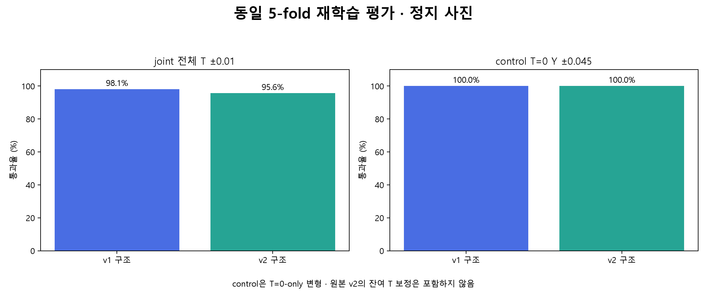

# 성능 비교 요약

| 조건 | 전체 | 유효 | 통과 수/전체 | MAE | p95 | 최대오차 |
|---|---|---|---|---|---|---|
| v1 joint / 전체 T | 571 | 571 | 560/571 (98.1%) | 0.00290 | 0.00794 | 0.03204 |
| v1 control T0변형 / T=0 Y | 80 | 80 | 80/80 (100.0%) | 0.00178 | 0.00455 | 0.03656 |
| v2 joint / 전체 T | 571 | 571 | 546/571 (95.6%) | 0.00398 | 0.00941 | 0.04302 |
| v2 control T0변형 / T=0 Y | 80 | 80 | 80/80 (100.0%) | 0.01234 | 0.02665 | 0.03072 |
| LSJ 고정 / 전체 T | 571 | 571 | 273/571 (47.8%) | 0.01291 | 0.02994 | 0.05001 |
| LSJ 고정 / 내부 Y | 571 | 571 | 21/571 (3.7%) | 0.84919 | 2.06927 | 4.26035 |

control은 T=0-only 재학습 변형이고 LSJ는 고정 계수 개발 재생이다. 동일 알고리즘·동일 학습 노출 조건으로 오해하지 않는다. 실제 복귀 step·총 시간·최종 실측 정확도는 세 보고서 모두 미측정이다.

- [final v1 보고서](보고서_final_v1.md)
- [final v2 보고서](보고서_final_v2.md)
- [LSJ 보고서](보고서_LSJ.md)

## 처리시간 (영상 읽기/디코딩·장비 이동 제외)

| 측정 대상 | 사진 수 | 중앙값 ms | p95 ms |
|---|---|---|---|
| 원본 v1 joint | 12 | 696.57145 | 751.35840 |
| 원본 v1 control | 12 | 39.83515 | 70.27040 |
| 원본 v2 joint | 12 | 757.57490 | 889.68120 |
| 원본 v2 control | 12 | 44.83080 | 78.38160 |
| LSJ 최신 내부 Y/T 해석 | 571 | 26.30340 | 35.75890 |

v1/v2 원본 공개 API는 동일 12장 표본, LSJ는 571장 순회다. 시간 표의 원본 control과 위 정확도 표의 T=0 전용 변형을 구분한다. 원본 모델의 정확도는 각 보고서의 개발 재생 표에 따로 실었다.
