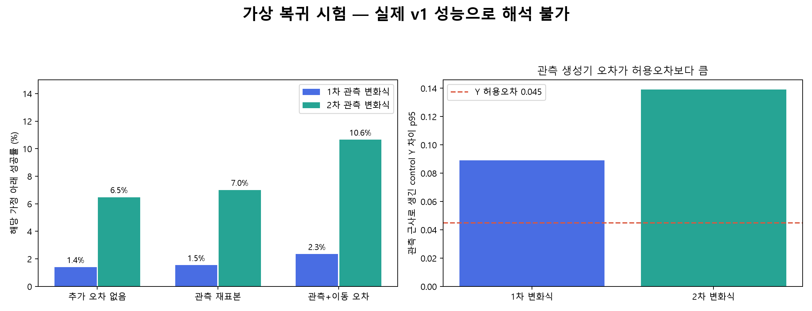

# v1 센터 복귀 시뮬레이션: 실행 결과와 적용 한계

**결론: 시뮬레이션 계산은 완료했지만 이동 후 관측을 만드는 근사모델의 검증 오차가 커, 아래 복귀율을 실제 v1의 예상 성능으로 채택할 수 없다.** 이 수치는 v1 알고리즘이 실제 장비에서 실패한다는 증거도 아니다. 정지 사진에서 검증한 추정기와, 이번에 새로 만든 이동 후 관측 생성기를 구분해야 한다.

최대 20회 이동, 시작 사진 571장 × 같은 시작 사진당 가상 복귀 5회 × 오차 조건 3개 × 관측 변화 모델 2개 = **17,130회 가상 시행**을 실행했다. 실제 장비는 구동하지 않았다.

## 1. 무엇을 실행했나?

1. 기존 v1 구조의 fold별 joint와 T=0-only control 학습 모델을 그대로 불러왔다. 원본 배포 v1 그대로의 재학습이 아니라 이전 보고서와 같은 control Y 4가지 변형이다. 제어기·자료를 새 성적에 맞춰 변경하지 않았다.
2. 각 test 원본 사진의 실제 관측 특징과 파일명 자세에서 출발했다. 첫 사진의 추정은 기존 평가와 같다.
3. 이동 후 새 사진이 없으므로, 해당 fold의 **train만** 이용해 `(Y,T)→영상 관측 특징`의 1차 및 2차 변화식을 각각 적합했다. 이것은 시뮬레이터 환경 모델이며 controller에 정답 Y/T를 주는 것이 아니다.
4. 이후 관측은 `출발 사진 특징 + F(새 자세)-F(출발 자세)`로 만들었다. joint 원관측 102개는 다시 기존 204차원 특징으로 변환했다. control은 P12 관측을 생성했다.
5. 각 모델의 추정으로 T 또는 Y 이동을 한 번 실행한 것으로 계산한 뒤 새 관측을 생성했다. 정답을 보고 이동 방향이나 정지 시점을 고르지 않았다.
6. 추정값으로 정지한 후에만 시뮬레이터의 실제 상태를 채점했다. Y ±0.045와 T ±0.01을 모두 만족해야 성공이다. 추정값만 0 근처면 성공이라고 하지 않았다.

## 2. 제어 규칙·시간·오차 가정

| 항목 | 고정한 설정 |
|---|---|
| T 단계 전환 | 추정 abs(T)≤0.005이면 Y 단계 확인; T 명령은 0.01 단위 반올림 |
| Y 정지 조건 | 추정 abs(Y)≤0.025이면 정지 후보; Y 명령은 0.05 단위 반올림 |
| 이동량 제한 | 1회 T 최대 1.0, Y 최대 0.5 (시뮬레이션 설정) |
| 이동 순서 | T 추정이 범위 밖이면 T 우선, 아니면 Y 보정; 이동마다 새 관측, Y 이동 후 T도 다시 검사 |
| 이동 횟수 | 최대 20회; 이동 명령 1회=1 step; 촬영은 별도 횟수 |
| 계산 시간 | 이전 실제 측정의 fold별 joint/control 중앙값을 관측 횟수만큼 합산 |
| 읽기/디코딩 | 이전 실제 측정의 fold별 중앙값을 관측 횟수만큼 합산 |
| 추가 시간 가정 | 매 촬영 100ms, 매 이동 명령 50ms, 정지 대기 200ms, 축 속도 각각 명령 1단위/s |
| 조건 2 이동 오차 | 매 이동 Y 표준편차 0.005, T 표준편차 0.002인 독립 정규오차; 0 명령 축에도 추가 |
| 실행 환경 | C++17, MSVC v141, OpenCV 3.4.15, Windows x64; seed 20261104 기반 |

위 이동 단위·속도·오차는 장비 사양을 확인한 값이 아닌 예시 설정이다. 전체 시간은 **가정한 시간 예산**이며 실제 측정된 이동 시간이나 이 시뮬레이션 프로그램 실행 시간과 다르다.

관측 오차 조건은 train의 동일 날짜·같은 자세 반복 사진에서 그룹 평균을 뺀 joint/control 쌍을 같이 추출한다. 같은 날짜에서 현재 자세와 가까운 최대 20개 잔차 중 하나를 뽑고, 반복 자료가 없는 1014는 다른 날짜의 반복 잔차를 대신 사용한다. 실제 구동계 반복 차이도 섞여 있어 순수 센서 잡음은 아니다. 초기 사진은 다섯 시행에서 같고 이후만 재표본하므로 초기 재촬영의 변동은 포함하지 않는다. 시간에 따른 상관·드리프트·실제 이동 축간 간섭도 확인되지 않았다.

## 3. 이동 후 관측 모델 자체의 검증

각 held-out 사진을 가까운 같은 날짜 train 사진에서 변화식을 적용해 재구성하고, 그 합성 특징으로 낸 추정과 실제 held-out 특징으로 낸 추정의 차이를 검사했다. 이는 첫 입력을 그대로 재생한 자명한 일치 검사가 아니다. 단, 실제 이동 후 연속 영상에 대한 검증은 여전히 아니다.

| 관측 변화 모델 | 비교 출력 | 차이 중앙값 | 차이 p95 | 차이 최댓값 | 목표 허용오차 |
|---|---|---|---|---|---|
| 1차 변화식 | control Y | 0.026 | 0.089 | 0.270 | 0.045 |
| 1차 변화식 | joint T | 0.003 | 0.009 | 0.034 | 0.01 |
| 2차 변화식 | control Y | 0.040 | 0.139 | 2.914 | 0.045 |
| 2차 변화식 | joint T | 0.003 | 0.009 | 0.027 | 0.01 |

**control Y 근사 차이 p95가 허용오차보다 크다.** 이 오차는 controller가 원래 갖는 정지 사진 추정 오차에 더해지는 환경 모형 오차다. 따라서 실제 복귀를 예측할 수준의 관측 생성기로 검증되지 않았다. 평균적인 특징 변화식은 촬영 구간별 영점, 큰 T의 control 정합 오류, 고차원 특징 변화를 충분히 재현하지 못할 수 있다. 수치가 낮다는 이유로 controller를 폐기하거나, 잡음을 넣어 성공률이 올라간다는 이유로 잡음을 추가하면 좋다고 판단하면 안 된다.



## 4. 전체 가상 시행 결과 (실제 성능으로 인용 금지)

| 관측 변화식/조건 | 시행 수 | 상태 기준 성공 | 잘못 정지 | 성공 step 중앙 | 성공 step p95 | 성공 step 최대 | 성공 가정시간 중앙(s) | 성공 가정시간 p95(s) |
|---|---|---|---|---|---|---|---|---|
| 1차 / 추가 관측·이동 오차 없음 | 2855 | 40/2855 (1.40%) | 2645 | 2.000 | 2.000 | 2 | 3.754 | 3.827 |
| 1차 / 학습 반복의 관측 차이 재표본 | 2855 | 44/2855 (1.54%) | 2489 | 2.000 | 7.000 | 20 | 3.827 | 10.630 |
| 1차 / 관측 차이 + 가정한 이동 오차 | 2855 | 67/2855 (2.35%) | 2487 | 3.000 | 9.000 | 12 | 5.190 | 12.918 |

| 관측 변화식/조건 | 시행 수 | 상태 기준 성공 | 잘못 정지 | 성공 step 중앙 | 성공 step p95 | 성공 step 최대 | 성공 가정시간 중앙(s) | 성공 가정시간 p95(s) |
|---|---|---|---|---|---|---|---|---|
| 2차 / 추가 관측·이동 오차 없음 | 2855 | 185/2855 (6.48%) | 1520 | 2.000 | 3.000 | 3 | 3.759 | 5.470 |
| 2차 / 학습 반복의 관측 차이 재표본 | 2855 | 200/2855 (7.01%) | 1818 | 2.000 | 7.000 | 19 | 3.824 | 10.708 |
| 2차 / 관측 차이 + 가정한 이동 오차 | 2855 | 304/2855 (10.65%) | 2020 | 2.000 | 8.000 | 18 | 3.912 | 12.020 |

잘못 정지: 제어기는 멈췄다고 판단했으나 시뮬레이터 상태가 Y/T 허용범위를 벗어난 시행 수. 최대 step 초과는 이 수와 별개이며 실패 분모에 포함한다. 성공 step·시간은 성공한 일부 시행에 대한 조건부 통계이므로 전체 시행이 그 시간 안에 도착했다는 의미가 아니다. 무오차 조건의 5회는 결정론적으로 동일해 독립 표본 5개가 아니다.

## 5. fold별 상세

### 1차 변화식 / 추가 관측·이동 오차 없음

| 관측 변화식/조건 | 시행 수 | 상태 기준 성공 | 잘못 정지 | 성공 step 중앙 | 성공 step p95 | 성공 step 최대 | 성공 가정시간 중앙(s) | 성공 가정시간 p95(s) |
|---|---|---|---|---|---|---|---|---|
| fold 01 | 580 | 25/580 (4.31%) | 545 | 2.000 | 2.000 | 2 | 3.754 | 3.754 |
| fold 02 | 580 | 10/580 (1.72%) | 545 | 2.000 | 2.000 | 2 | 3.827 | 3.827 |
| fold 03 | 580 | 0/580 (0.00%) | 535 | 성공 없음 | 해당 없음 | — | 성공 없음 | 해당 없음 |
| fold 04 | 565 | 5/565 (0.88%) | 480 | 1.000 | 1.000 | 1 | 2.456 | 2.456 |
| fold 05 | 550 | 0/550 (0.00%) | 540 | 성공 없음 | 해당 없음 | — | 성공 없음 | 해당 없음 |

### 1차 변화식 / 학습 반복의 관측 차이 재표본

| 관측 변화식/조건 | 시행 수 | 상태 기준 성공 | 잘못 정지 | 성공 step 중앙 | 성공 step p95 | 성공 step 최대 | 성공 가정시간 중앙(s) | 성공 가정시간 p95(s) |
|---|---|---|---|---|---|---|---|---|
| fold 01 | 580 | 29/580 (5.00%) | 512 | 2.000 | 6.000 | 6 | 3.754 | 8.934 |
| fold 02 | 580 | 7/580 (1.21%) | 496 | 4.000 | 5.000 | 5 | 6.471 | 7.804 |
| fold 03 | 580 | 0/580 (0.00%) | 539 | 성공 없음 | 해당 없음 | — | 성공 없음 | 해당 없음 |
| fold 04 | 565 | 2/565 (0.35%) | 498 | 1.000 | 1.000 | 1 | 2.456 | 2.456 |
| fold 05 | 550 | 6/550 (1.09%) | 444 | 5.500 | 20.000 | 20 | 8.585 | 27.961 |

### 1차 변화식 / 관측 차이 + 가정한 이동 오차

| 관측 변화식/조건 | 시행 수 | 상태 기준 성공 | 잘못 정지 | 성공 step 중앙 | 성공 step p95 | 성공 step 최대 | 성공 가정시간 중앙(s) | 성공 가정시간 p95(s) |
|---|---|---|---|---|---|---|---|---|
| fold 01 | 580 | 31/580 (5.34%) | 518 | 3.000 | 9.000 | 9 | 5.049 | 12.908 |
| fold 02 | 580 | 8/580 (1.38%) | 493 | 3.500 | 6.000 | 6 | 5.770 | 9.116 |
| fold 03 | 580 | 3/580 (0.52%) | 541 | 5.000 | 9.000 | 9 | 7.929 | 12.918 |
| fold 04 | 565 | 10/565 (1.77%) | 498 | 2.000 | 12.000 | 12 | 3.755 | 17.429 |
| fold 05 | 550 | 15/550 (2.73%) | 437 | 4.000 | 10.000 | 10 | 6.520 | 14.531 |

### 2차 변화식 / 추가 관측·이동 오차 없음

| 관측 변화식/조건 | 시행 수 | 상태 기준 성공 | 잘못 정지 | 성공 step 중앙 | 성공 step p95 | 성공 step 최대 | 성공 가정시간 중앙(s) | 성공 가정시간 p95(s) |
|---|---|---|---|---|---|---|---|---|
| fold 01 | 580 | 30/580 (5.17%) | 365 | 2.000 | 2.000 | 2 | 3.844 | 3.864 |
| fold 02 | 580 | 40/580 (6.90%) | 330 | 2.000 | 3.000 | 3 | 3.912 | 5.599 |
| fold 03 | 580 | 50/580 (8.62%) | 300 | 1.500 | 2.000 | 2 | 3.215 | 3.809 |
| fold 04 | 565 | 15/565 (2.65%) | 295 | 1.000 | 1.000 | 1 | 2.447 | 2.456 |
| fold 05 | 550 | 50/550 (9.09%) | 230 | 1.000 | 3.000 | 3 | 2.575 | 5.470 |

### 2차 변화식 / 학습 반복의 관측 차이 재표본

| 관측 변화식/조건 | 시행 수 | 상태 기준 성공 | 잘못 정지 | 성공 step 중앙 | 성공 step p95 | 성공 step 최대 | 성공 가정시간 중앙(s) | 성공 가정시간 p95(s) |
|---|---|---|---|---|---|---|---|---|
| fold 01 | 580 | 33/580 (5.69%) | 415 | 2.000 | 4.000 | 5 | 3.864 | 6.573 |
| fold 02 | 580 | 49/580 (8.45%) | 412 | 2.000 | 14.000 | 17 | 3.967 | 19.964 |
| fold 03 | 580 | 48/580 (8.28%) | 360 | 2.000 | 6.000 | 7 | 3.784 | 9.038 |
| fold 04 | 565 | 20/565 (3.54%) | 348 | 1.000 | 3.000 | 5 | 2.447 | 5.204 |
| fold 05 | 550 | 50/550 (9.09%) | 283 | 1.000 | 12.000 | 19 | 2.600 | 17.640 |

### 2차 변화식 / 관측 차이 + 가정한 이동 오차

| 관측 변화식/조건 | 시행 수 | 상태 기준 성공 | 잘못 정지 | 성공 step 중앙 | 성공 step p95 | 성공 step 최대 | 성공 가정시간 중앙(s) | 성공 가정시간 p95(s) |
|---|---|---|---|---|---|---|---|---|
| fold 01 | 580 | 54/580 (9.31%) | 461 | 2.000 | 7.000 | 7 | 3.864 | 10.348 |
| fold 02 | 580 | 86/580 (14.83%) | 415 | 2.500 | 11.000 | 18 | 4.558 | 16.167 |
| fold 03 | 580 | 62/580 (10.69%) | 421 | 2.000 | 6.000 | 16 | 3.809 | 9.088 |
| fold 04 | 565 | 42/565 (7.43%) | 395 | 2.000 | 7.000 | 9 | 3.726 | 10.220 |
| fold 05 | 550 | 60/550 (10.91%) | 328 | 2.000 | 7.000 | 13 | 3.910 | 10.760 |

## 6. 같은 시작 사진에서 가상 복귀 5회의 반복정밀도

정의: 5개 최종 Y의 평균 중심 최대편차≤0.045, 최종 T의 평균 중심 최대편차≤0.01. 실패/최대 step 초과로 유효 정지가 없는 시행이 있으면 5회 충족으로 인정하지 않는다. 또한 5회 모두 실제 상태가 센터 허용범위에 들어온 묶음도 따로 센다. 평균 위치가 센터에서 멀어도 반복편차만 작을 수 있기 때문이다.

| 변화식 차수 | 조건 | fold | 시작 사진 수 | Y 반복 충족 | T 반복 충족 | Y/T 반복 동시 충족 | 5회 모두 센터 성공 | 최대 Y 반복편차 | 최대 T 반복편차 |
|---|---|---|---|---|---|---|---|---|---|
| 1 | 추가 관측·이동 오차 없음 | 1 | 116 | 114 | 114 | 114 | 5 | 0.000 | 0.000 |
| 1 | 추가 관측·이동 오차 없음 | 2 | 116 | 111 | 111 | 111 | 2 | 0.000 | 0.000 |
| 1 | 추가 관측·이동 오차 없음 | 3 | 116 | 107 | 107 | 107 | 0 | 0.000 | 0.000 |
| 1 | 추가 관측·이동 오차 없음 | 4 | 113 | 97 | 97 | 97 | 1 | 0.000 | 0.000 |
| 1 | 추가 관측·이동 오차 없음 | 5 | 110 | 108 | 108 | 108 | 0 | 0.000 | 0.000 |
| 1 | 학습 반복의 관측 차이 재표본 | 1 | 116 | 97 | 98 | 97 | 4 | 1.300 | 0.018 |
| 1 | 학습 반복의 관측 차이 재표본 | 2 | 116 | 90 | 90 | 90 | 0 | 2.310 | 0.018 |
| 1 | 학습 반복의 관측 차이 재표본 | 3 | 116 | 102 | 104 | 102 | 0 | 2.200 | 0.020 |
| 1 | 학습 반복의 관측 차이 재표본 | 4 | 113 | 85 | 87 | 85 | 0 | 2.200 | 0.018 |
| 1 | 학습 반복의 관측 차이 재표본 | 5 | 110 | 68 | 72 | 68 | 0 | 2.600 | 0.020 |
| 1 | 관측 차이 + 가정한 이동 오차 | 1 | 116 | 101 | 103 | 101 | 3 | 1.691 | 0.022 |
| 1 | 관측 차이 + 가정한 이동 오차 | 2 | 116 | 85 | 92 | 85 | 0 | 1.882 | 0.024 |
| 1 | 관측 차이 + 가정한 이동 오차 | 3 | 116 | 96 | 104 | 96 | 0 | 1.513 | 0.017 |
| 1 | 관측 차이 + 가정한 이동 오차 | 4 | 113 | 87 | 88 | 87 | 1 | 1.723 | 0.014 |
| 1 | 관측 차이 + 가정한 이동 오차 | 5 | 110 | 68 | 70 | 67 | 2 | 1.507 | 0.023 |
| 2 | 추가 관측·이동 오차 없음 | 1 | 116 | 79 | 79 | 79 | 6 | 0.000 | 0.000 |
| 2 | 추가 관측·이동 오차 없음 | 2 | 116 | 74 | 74 | 74 | 8 | 0.000 | 0.000 |
| 2 | 추가 관측·이동 오차 없음 | 3 | 116 | 70 | 70 | 70 | 10 | 0.000 | 0.000 |
| 2 | 추가 관측·이동 오차 없음 | 4 | 113 | 62 | 62 | 62 | 3 | 0.000 | 0.000 |
| 2 | 추가 관측·이동 오차 없음 | 5 | 110 | 56 | 56 | 56 | 10 | 0.000 | 0.000 |
| 2 | 학습 반복의 관측 차이 재표본 | 1 | 116 | 79 | 79 | 79 | 5 | 0.400 | 0.012 |
| 2 | 학습 반복의 관측 차이 재표본 | 2 | 116 | 79 | 79 | 79 | 6 | 1.400 | 0.016 |
| 2 | 학습 반복의 관측 차이 재표본 | 3 | 116 | 73 | 73 | 73 | 9 | 1.900 | 0.042 |
| 2 | 학습 반복의 관측 차이 재표본 | 4 | 113 | 66 | 68 | 66 | 2 | 1.280 | 0.014 |
| 2 | 학습 반복의 관측 차이 재표본 | 5 | 110 | 59 | 59 | 59 | 8 | 0.400 | 0.008 |
| 2 | 관측 차이 + 가정한 이동 오차 | 1 | 116 | 89 | 91 | 89 | 6 | 0.380 | 0.007 |
| 2 | 관측 차이 + 가정한 이동 오차 | 2 | 116 | 89 | 91 | 89 | 7 | 2.075 | 0.033 |
| 2 | 관측 차이 + 가정한 이동 오차 | 3 | 116 | 85 | 86 | 85 | 9 | 1.808 | 0.030 |
| 2 | 관측 차이 + 가정한 이동 오차 | 4 | 113 | 67 | 69 | 67 | 4 | 0.504 | 0.023 |
| 2 | 관측 차이 + 가정한 이동 오차 | 5 | 110 | 69 | 69 | 69 | 7 | 0.403 | 0.010 |

이는 합성 관측과 예시 이동 오차 아래의 **조건부 반복 시뮬레이션**이며 실제 5회 복귀 반복정밀도 성적이 아니다.

## 7. 결론과 다음 확인

- 계산값만으로 여러 step의 보정 루프·잘못된 정지·턴 초과를 실행해 볼 수는 있다.
- 그러나 현재 사진만으로 적합한 이동 후 관측 변화식은 control 허용오차 수준을 충족하지 못했다. 따라서 실제 v1 복귀율·step·시간을 믿을 만하게 예측한 보고서가 아니다.
- 다음 최소 확인은 T 보정 전/후 영상 쌍과 Y 보정 전/후 영상 쌍, 실제 명령·잔차·시간을 확보해 관측 변화 모델을 검증하는 것이다. 특히 T≈0에서 Y 이동 반응과 촬영 구간별 영점을 확인해야 한다.
- 기존 joint/control 정지 사진 성적은 별도 유효한 결과로 보존하며, 이번 불확실한 시뮬레이터 결과로 덮어쓰지 않는다.

## 코드·원시 결과·재현

- [C++ 시뮬레이터](src/main.cpp)
- [시행별 결과](results/trials.tsv)
- [관측·명령·상태 전체 추적](results/trace.tsv)
- [관측 생성기 검증](results/surrogate_validation.tsv)
- [학습 잔차](results/world_fit.tsv)
- [실행 설정](config.json)
- [기존 v1/v2 평가](../20261104_123000_v1v2_LSJ_5fold평가/README.md)

```powershell
cmake -S experiments/hye/20261104_140000_v1_센터복귀_시뮬레이션 -B C:/Temp/hye_sim_build -G "Visual Studio 18 2026" -A x64 -T v141 -DOpenCV_DIR=C:/opencv/build
cmake --build C:/Temp/hye_sim_build --config Release
# 실행 파일 옆에 opencv_world3415.dll 배치
C:/Temp/hye_sim_build/Release/return_sim.exe C:/Temp/hye_eval_input.tsv C:/Temp/hye_eval_results_20261104 C:/Temp/NEW_SIM_RESULTS
# 결과를 results에 보관 후 python report.py
```

실제 장비 이동, 기존 데이터 수정, 모델 교체, 커밋·push는 하지 않았다. trace의 명령은 제안된 명령이며 20회 제한에서 마지막 제안은 실행하지 않은 채 종료할 수 있다.