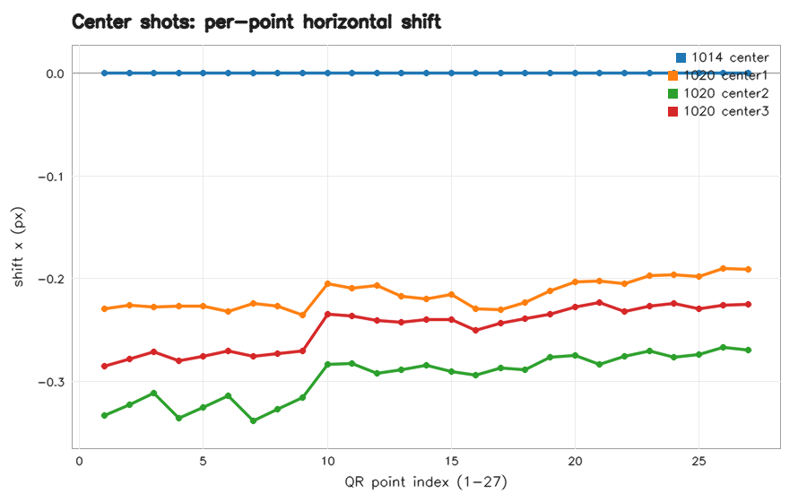
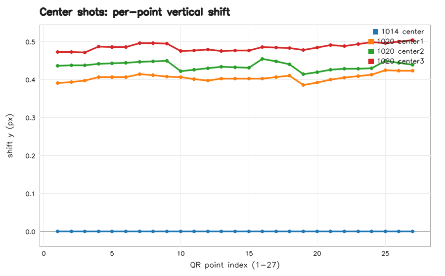
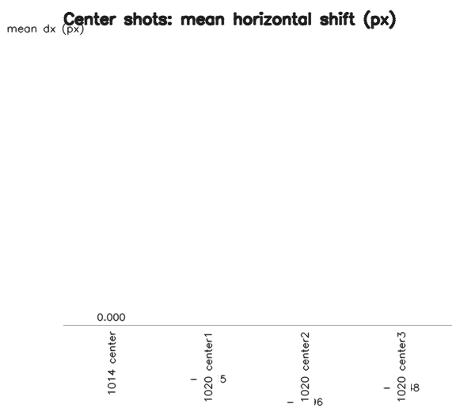
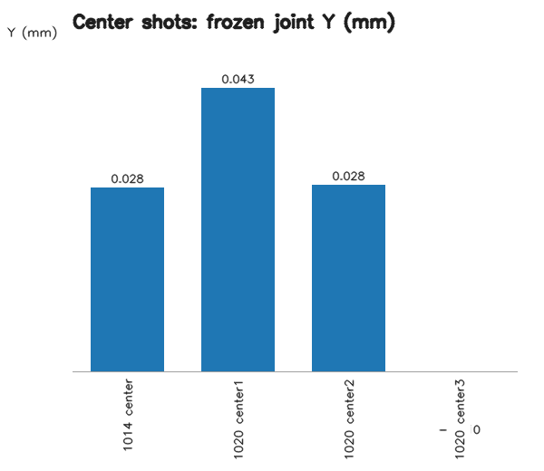

# 결과 - 센터 사진 4장의 영점 흔들림

입력: `data/clean/clean_20261014/center.bmp`, `data/clean/clean_20261020/기준 위치/center1~3.bmp` (명령값 Y=0, T=0).
관측: joint 102개 중 QR 27점의 가로·세로 이동과 위·아래 가로선 48블록 이동. 기준틀은 `assets/center.bmp`(= 1014 center.bmp)이므로 1014 는 정의상 0 이다.
한 틱 환산은 Y 0.05 mm = 0.7124 px, T 0.01 deg = 0.8006 px 를 썼다.

## 1. 사진별 측정값

| 사진 | QR 평균 가로 (px) | QR 평균 세로 (px) | 평균 뺀 점별 변형 RMS (px) | 가로선 평균 이동 (px) | 고정 joint Y (mm) | 고정 joint T (deg) |
|---|---|---|---|---|---|---|
| 1014 center | 0.0000 | +0.0000 | 0.0000 | 0.0000 | +0.0279 | -0.0005 |
| 1020 center1 | -0.2154 | +0.4053 | 0.0117 | +0.4386 | +0.0431 | -0.0026 |
| 1020 center2 | -0.2960 | +0.4364 | 0.0174 | +0.4689 | +0.0284 | -0.0008 |
| 1020 center3 | -0.2483 | +0.4856 | 0.0160 | +0.5513 | -0.0102 | +0.0080 |

## 2. 1020 같은 세션 반복 3장

| 관측량 | 1020 반복 3장 평균 | 표준편차(표본) | 최댓값 - 최솟값 | Y 한 틱 대비 | T 한 틱 대비 |
|---|---|---|---|---|---|
| QR 평균 가로 (px) | -0.2532 | 0.0405 | 0.0806 | 0.113 | 0.101 |
| QR 평균 세로 (px) | +0.4424 | 0.0405 | 0.0803 | 0.113 | 0.100 |
| 가로선 평균 이동 (px) | +0.4863 | 0.0583 | 0.1128 | 0.158 | 0.141 |
| 고정 joint Y (mm) | +0.0205 | 0.0275 | 0.0533 |  |  |
| 고정 joint T (deg) | +0.0015 | 0.0057 | 0.0107 |  |  |

## 3. 세션 사이 (1014 대비 1020)

| 관측량 | 1014 center | 1020 평균(3장) | 차이 (1020 - 1014) | Y 한 틱 대비 | T 한 틱 대비 |
|---|---|---|---|---|---|
| QR 평균 가로 (px) | 0.0000 | -0.2532 | -0.2532 | 0.355 | 0.316 |
| QR 평균 세로 (px) | +0.0000 | +0.4424 | +0.4424 | 0.621 | 0.553 |
| 가로선 평균 이동 (px) | 0.0000 | +0.4863 | +0.4863 | 0.683 | 0.607 |
| 고정 joint Y (mm) | +0.0279 | +0.0205 | -0.0075 |  |  |
| 고정 joint T (deg) | -0.0005 | +0.0015 | +0.0020 |  |  |

## 4. 점별 원자료

`center_points.csv` (4장 x 27점).

## 5. 그림

