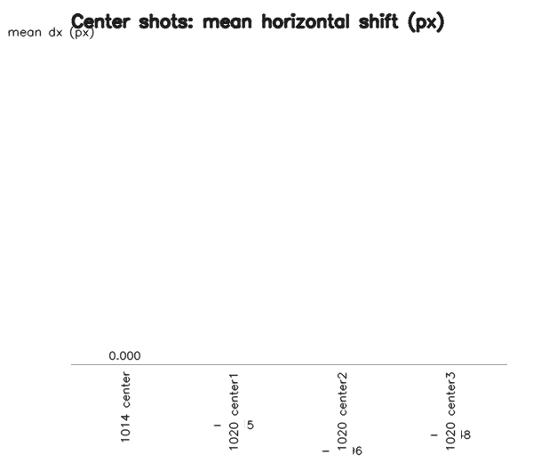
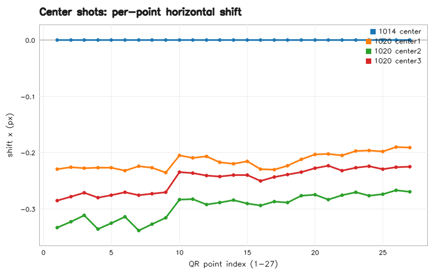

# 보고서 - 센터 영점 흔들림

- 문제: 명령값이 같은 센터 사진끼리도 영점이 흔들리는지, 흔들린다면 한 틱에 견줘 얼마나 큰지 몰랐다.
- 해결: 센터 4장을 원본에서 다시 측정해 QR 27점 평균 이동과 고정 joint (Y, T) 를 뽑고, 같은 세션 반복과 세션 사이를 나눠 봤다.
- 결과: 같은 세션 반복 3장의 가로 평균은 0.0806 px 폭(Y 한 틱의 0.11배) 안에 들어오고, 1014 대비 1020 세션은 -0.2532 px 어긋난다(Y 한 틱의 0.36배).

## 대표값

| 관측량 | 1020 반복 3장 평균 | 표준편차(표본) | 최댓값 - 최솟값 | Y 한 틱 대비 | T 한 틱 대비 |
|---|---|---|---|---|---|
| QR 평균 가로 (px) | -0.2532 | 0.0405 | 0.0806 | 0.113 | 0.101 |
| QR 평균 세로 (px) | +0.4424 | 0.0405 | 0.0803 | 0.113 | 0.100 |
| 가로선 평균 이동 (px) | +0.4863 | 0.0583 | 0.1128 | 0.158 | 0.141 |
| 고정 joint Y (mm) | +0.0205 | 0.0275 | 0.0533 |  |  |
| 고정 joint T (deg) | +0.0015 | 0.0057 | 0.0107 |  |  |

| 관측량 | 1014 center | 1020 평균(3장) | 차이 (1020 - 1014) | Y 한 틱 대비 | T 한 틱 대비 |
|---|---|---|---|---|---|
| QR 평균 가로 (px) | 0.0000 | -0.2532 | -0.2532 | 0.355 | 0.316 |
| QR 평균 세로 (px) | +0.0000 | +0.4424 | +0.4424 | 0.621 | 0.553 |
| 가로선 평균 이동 (px) | 0.0000 | +0.4863 | +0.4863 | 0.683 | 0.607 |
| 고정 joint Y (mm) | +0.0279 | +0.0205 | -0.0075 |  |  |
| 고정 joint T (deg) | -0.0005 | +0.0015 | +0.0020 |  |  |

## 사진별

| 사진 | QR 평균 가로 (px) | QR 평균 세로 (px) | 평균 뺀 점별 변형 RMS (px) | 가로선 평균 이동 (px) | 고정 joint Y (mm) | 고정 joint T (deg) |
|---|---|---|---|---|---|---|
| 1014 center | 0.0000 | +0.0000 | 0.0000 | 0.0000 | +0.0279 | -0.0005 |
| 1020 center1 | -0.2154 | +0.4053 | 0.0117 | +0.4386 | +0.0431 | -0.0026 |
| 1020 center2 | -0.2960 | +0.4364 | 0.0174 | +0.4689 | +0.0284 | -0.0008 |
| 1020 center3 | -0.2483 | +0.4856 | 0.0160 | +0.5513 | -0.0102 | +0.0080 |

## 한줄평

QR 27점을 ECC 로 맞춰 평균을 내는 측정이라 사진 한 장 안의 잡음은 평균으로 지워지고, 남는 것은 사진끼리의 실제 자세 차이다. 그래서 같은 세션 반복에서 남는 폭은 구동계 복귀와 촬영 조건의 흔들림으로, 세션 사이 차이는 그날의 영점 자체가 옮겨간 것으로 읽는다. 고정 joint 로 환산하면 반복 3장의 Y 폭은 0.0533 mm, T 폭은 0.0107 deg 다.

## 그림

