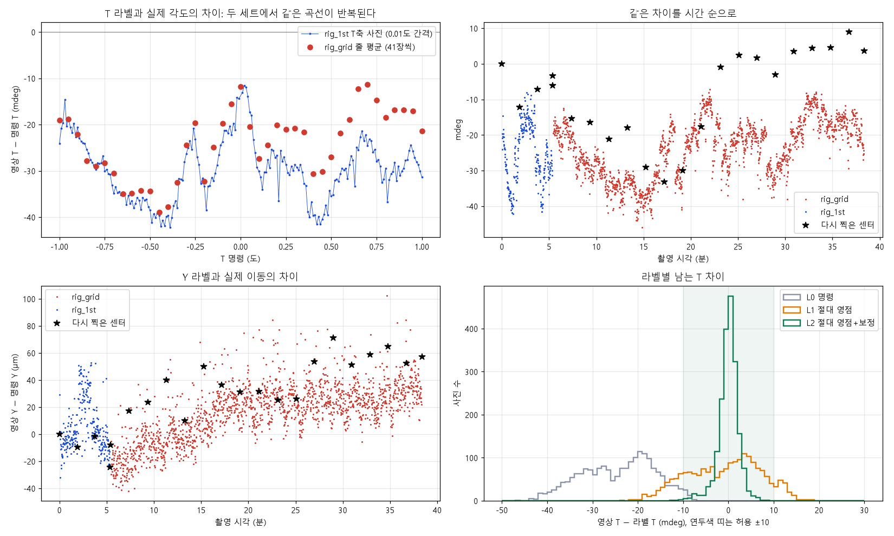

# 결과: 우리 장비 사진에 값 7개 알고리즘 적용, 절대 영점과 라벨 보정 (11-13)

## 문제

`data/raw/rig_1st.zip`(축 사진 280장), `rig_grid.zip`(격자 사진 1680장)은 우리 장비에서 찍었다. 최신 1차 모듈 `experiments/hye/00000_final_Y_T`(값 7개, 절대 영점)가 이 사진에도 통하는지, 파일 이름의 명령값과 실제로 움직인 양이 얼마나 다른지, 그 차이를 보정할 수 있는지 확인했다.

## 한 일

| 단계 | 내용 | 파일 |
|---|---|---|
| 1 | SEMES 자료 그대로 시험 10장 측정 | (기록만) |
| 2 | 장비 센터 사진에 맞는 기준 자료 생성 | `실험/make_rig_assets.py` → `실험/assets_rig/` |
| 3 | 모듈 복사본이 화면 위치를 `site.json` 에서 읽게 함 | `experiments/hye/00000_final_Y_T_ssafy/` (2026-11-13 `실험/module` 에서 옮김) |
| 4 | 1982장에서 값 7개 측정 | `실험/prepare_rig_inputs.py`, `final00_tool measure` → `결과/features7.tsv` |
| 5 | 절대 영점, 라벨과 실제 이동의 차이, 라벨 보정 | `실험/label_correction.py` → `결과/라벨보정.tsv`, `결과/보정요약.txt` |
| 6 | 라벨 세 가지로 학습·평가(고정 검증) | `final00_tool eval` → `결과/eval_L0`, `eval_L1`, `eval_L2` |
| 7 | 장비 모델로 공개 API 예측 | `final00_tool predict` → `결과/predict_L2` |
| 8 | 3D 화면 | `apps/distribution/rig/` |

원본 모듈 `00000_final_Y_T` 는 고치지 않았다.

## 결과 1. SEMES 자료 그대로는 적용되지 않는다

- 시험 10장이 모두 거부됐다(QR 고정 536점 중 유효 11~47점).
- 원인: 장비 화면에서 QR 이 SEMES 센터보다 가로 +4~+6 px, 세로 +62 px 자리에 있다. 나사 4개와 위·아래 바의 자리도 다르다. 모듈은 센터 사진 해시, QR 상자, 나사 중심을 SEMES 값으로 코드에 적어 두었다.
- SEMES 계수(`model7.tsv`)도 그대로 쓸 수 없다. 장비 기준 자료로 잰 값에 SEMES 계수를 부호만 뒤집어 넣으면 86/1959장만 통과한다(Y 기울기 1.156, T 기울기 1.005). 장비 사진으로 다시 학습해야 한다.

## 결과 2. 장비 기준 자료를 만들면 측정은 된다

- 기준 자료: 센터 사진은 `rig_1st/center.bmp`. QR 상자는 SEMES 상자를 NCC 로 찾은 만큼 옮겼다. QR 구조 모서리 630점(그중 536점)은 QR 마다 homography(ECC 상관 0.944~0.952)로 옮겼다. 나사 중심과 바의 기준 행은 장비 센터에서 다시 잡았다. 바의 가로 범위는 SEMES 와 같다.
- 한 가지를 넓혔다: 536점 추적의 QR 정수 이동 탐색 반폭 110 → 125 px. 장비는 Y+2, T+1 에서 QR 이 114 px 움직인다. QR 간격 257 px 의 절반보다 작게 두었다.
- 1982장(사진 1960 + 센터 2 + 다시 찍은 센터 20) 중 1981장을 쟀고 모두 536점이 유효했다(QR 상관 최소 0.9992, 바 상관 최소 0.9916).
- 실패 1장: `rig_grid/Grid/Y+0.00 T+0.80 (1).bmp`, 바 측정 칸 15번이 맞지 않았다. 학습과 평가에서 뺐다.
- 복사본 검증: 복사본 도구에 SEMES 자료를 주고 SEMES 사진 8장을 재면 원본 도구와 출력 파일이 바이트까지 같다.

명령 1단위당 값의 이동(rig_1st 축 사진):

| 값 | Y 1 mm | T 1 도 |
|---|---:|---:|
| QR 536점 가로 평균 (px) | −14.62 | −85.31 |
| 나사 4개 가로 (px) | −10.97 ~ −11.10 | −84.96 ~ −85.71 |
| 위 바 기울기, 아래 바 기울기 (px / 1000 px) | −0.09, −0.02 | +1.42, −2.15 |

SEMES 와 같은 구조다. T 는 QR 과 나사를 똑같이 움직이고, Y 는 QR 을 나사보다 더 움직인다. 그래서 값 7개로 Y 와 T 를 가를 수 있다. 부호는 SEMES 와 반대다.

## 결과 3. 라벨(명령)과 실제 이동의 차이

영상으로 잰 자세(QR 가로 평균과 나사 4개 가로 이동을 Y, T 로 푼 값, 영점 = 센터 사진)에서 명령을 뺀 값이다. T 는 mdeg(0.001도), Y 는 µm.

| 자료 | T 차이 중앙 | T 표준편차 | T 범위 | Y 차이 중앙 | Y 표준편차 | Y 범위 |
|---|---:|---:|---:|---:|---:|---:|
| rig_1st T축 200장 | −29.6 | 6.6 | −42.2 ~ −11.6 | −3.9 | 11.3 | −31.9 ~ +52.5 |
| rig_1st Y축 80장 | −17.0 | 3.0 | −21.1 ~ −8.1 | +30.1 | 15.5 | −16.0 ~ +52.8 |
| rig_grid 1679장 | −22.8 | 7.8 | −46.0 ~ −7.2 | +19.3 | 20.8 | −42.0 ~ +102.5 |

- T 허용오차는 10 mdeg 다. 명령 라벨은 1959장 중 1920장이 영상 자세와 10 mdeg 넘게 다르다. 대부분은 영점 차이(센터 사진의 자세가 명령 0 이 아님)이고, 영점 상수를 빼도 471장이 남는다.
- 영상 자세의 잡음은 이보다 작다. rig_grid 의 한 줄(같은 T 명령 41장) 안 흩어짐이 T 2.6 mdeg, Y 12.4 µm 다(중앙값, 잡음의 상한).



### 직선(선형) 성분이 있는가

| 성분 | 크기 | 직선으로 설명되는 비율 |
|---|---|---|
| Y 차이가 시간에 따라 늘어남 (rig_grid) | +1.50 µm/분. 다시 찍은 센터 17장도 +1.56 µm/분 | R² 0.47 (센터 0.62) |
| T 차이가 시간에 따라 늘어남 (rig_grid) | +0.40 mdeg/분 | R² 0.24 |
| T 차이가 T 명령에 비례 (배율 오차) | +6.5 mdeg/도 (0.65%) | R² 0.24 |
| Y 차이가 Y 명령에 비례 (배율 오차) | −3.2 µm/mm (0.3%) | R² 0.03 |

- Y 에는 시간에 따라 늘어나는 성분이 있다. 다만 일정한 직선은 아니다. 처음 12분은 +3.3 µm/분, 그 뒤 22분은 +0.4 µm/분이다. rig_grid 에서는 시간과 T 명령이 같이 늘어나므로 둘을 가를 수 없지만, 명령이 늘 (0, 0) 인 다시 찍은 센터도 같은 속도로 늘어나므로 시간 쪽이다.
- T 차이의 주된 모양은 직선이 아니다. T 명령에 따라 −10 ~ −40 mdeg 사이를 오르내리는 곡선이고, rig_1st T축 사진(5분)과 rig_grid 줄 평균(33분)에서 같은 모양이 나온다(같은 T 명령 40개에서 상관 0.75, T ≤ +0.5 에서 0.83). 시간이 아니라 Θ 스테이지의 위치에 따른 오차로 본다.
- 다시 찍은 센터는 명령이 같아도 T −33 ~ +9 mdeg, Y −25 ~ +71 µm 로 흩어진다. 센터로 돌아오기 직전에 있던 T 줄의 차이를 따라간다. 그래서 "가까운 시각의 센터 사진을 기준으로 쓰는" 보정은 쓰지 않았다.

## 결과 4. 라벨 보정 명세와 적용

| 라벨 | 정의 |
|---|---|
| L0 명령 | 파일 이름(= `manifest.csv` 의 command)의 값 그대로 |
| L1 절대 영점 | 센터 사진과 화면이 같은 자세가 (0, 0). 세트마다 상수 하나를 명령에 더한다. SEMES 702장에 쓴 방식과 같다 |
| L2 절대 영점 + 보정 | 명령 + 같은 조건에서 찍은 다른 사진들의 차이로 구한 보정값 |

L1 상수: rig_1st Y +0.7 µm, T −26.6 mdeg. rig_grid Y +19.3 µm, T −22.8 mdeg.

L2 보정값을 구하는 방법:

- 영상 자세: rig_1st 축 사진에서 QR 과 나사 4개의 명령 1단위당 가로 이동(5×2)을 구하고, 사진마다 값 5개를 Y, T 로 최소제곱으로 푼다. 바 기울기는 자세와 무관하게 변하는 성분이 있어 쓰지 않았다.
- rig_grid: 차이 = 줄(같은 T 명령) 효과 + 칸(같은 Y 명령, Y 스캔 방향별) 효과. 그 사진을 뺀 나머지로 맞춘 값을 쓴다.
- rig_1st: 촬영 순서로 앞뒤 5장씩(자기 제외 10장)의 차이 중앙값. T축 앞 절반, Y축, T축 뒤 절반을 따로 한다.
- 자기 사진의 영상 자세는 자기 라벨에 쓰지 않는다. 그래서 한 장만 튄 사진은 고쳐지지 않고 남는다.
- 보정 크기: T −45.1 ~ −8.6 mdeg, Y −36.0 ~ +52.5 µm.

보정 뒤 영상 자세와 라벨의 차이:

| 라벨 | T 표준편차 | Y 표준편차 | T 차이 10 mdeg 초과 | Y 차이 45 µm 초과 |
|---|---:|---:|---:|---:|
| L0 | 7.95 mdeg | 20.9 µm | 1920 / 1959 | 104 |
| L1 | 7.95 mdeg | 20.8 µm | 471 | 85 |
| L2 | 2.21 mdeg | 12.1 µm | 4 | 21 |

보정이 사진 한 장의 잡음을 따라간 것이 아님을 확인하는 근거: rig_1st T축 곡선(다른 사진, 다른 시각)을 rig_grid 줄 평균에서 빼면 줄 평균의 흩어짐이 7.1 → 4.7 mdeg 로 준다(T ≤ +0.5 구간은 3.7 mdeg). 곡선의 절반 정도는 두 세트에 공통이고 나머지는 세트 사이에 달라진 부분이다.

## 결과 5. 값 7개 모델의 성적 (우리 장비 1959장, 정지 사진 평가)

SEMES 702장과 같은 고정 검증 방식이다. 자세 묶음 단위로 20% 를 마지막 확인으로 떼고, 나머지 1567장에서 섞은 80/20 10회(주), 세트별 절반 10회(보조), 세트 통째로 빼기(참고). 통과는 |eY| ≤ 0.045 mm 이고 |eT| ≤ 0.01 도. C++ 도구(`final00_tool eval`)로 냈다.

| 라벨 | 주 검증 탈락 (1567장 중, 10회 평균) | 보조 | 세트 통째로 빼기 | 마지막 확인 392장 | 전체 학습 후 다시 넣기 |
|---|---:|---:|---:|---:|---:|
| L0 명령 | 249.8 | 253.1 | 33.4% (1st 59.4, grid 29.0) | 탈락 61 | 탈락 299 / 1959 |
| L1 절대 영점 | 262.6 | 263.6 | 40.4% (1st 58.5, grid 37.4) | 탈락 54 | 탈락 308 |
| L2 절대 영점 + 보정 | 9.9 | 9.7 | 99.6% (1st 99.6, grid 99.6) | 탈락 6 (최대 \|eY\| 0.058, \|eT\| 0.0112) | 탈락 14 |

- L2 에서 값 5개(바 기울기 제외)는 주 검증 탈락 8.6, QR 1 + 나사 평균 1 은 13.9 다(Python 분석). 바 기울기는 이 장비에서 도움이 되지 않는다.
- 공개 API 확인: 장비 기준 자료에 L2 로 전체 학습한 계수를 넣고 `initialize_joint`, `joint` 로 1959장을 한 장씩 예측했다. 1959장 모두 측정이 성립했고 1945장이 통과했다(최대 |eY| 0.064, |eT| 0.0117). 탈락 14장은 위 표의 "전체 학습 후 다시 넣기"와 같은 수다. 학습에 쓴 사진을 다시 넣은 것이라 성능이 아니라 함수 경로가 도는지 본 것이다(`predict_L2/predict.txt`).

## 해석

- 값 7개 알고리즘은 우리 장비에도 구조가 통한다. 다만 기준 자료(센터 사진, QR·나사·바의 자리)와 계수를 장비에 맞춰 다시 만들어야 한다.
- 파일 이름 라벨은 T 가 실제와 크게 다르다. 영점이 −23 ~ −27 mdeg 어긋나 있고, 그 위에 스테이지 위치에 따른 ±15 mdeg 의 곡선이 있다. 허용오차 10 mdeg 로 채점하면 라벨 오차 때문에 16% 가 탈락한다.
- 보정은 가능하다. 영상이 재는 자세의 흩어짐(T 2.6 mdeg)이 라벨 오차보다 3배 작다.

## 한계

- **L2 라벨은 영상 값에서 나왔다.** L2 성적은 독립된 정답과의 비교가 아니다. 같은 영상 값(QR 과 나사의 가로 이동)으로 만든 라벨과 모델이 서로 맞는 정도이고, 모델의 반복 정밀도에 가깝다. 판의 실제 자세를 따로 잰 값은 없다(STATUS 는 모터 쪽 값이라 명령과 1 mdeg 안에서 같다).
- 배율(1 mm, 1 도의 크기)은 rig_1st 축 사진의 명령을 직선으로 맞춘 값이다. 명령 오차가 곡선이라 배율에 1% 안팎의 불확실성이 있다.
- 한 날, 두 세트다. 날 차이는 보지 못했다.
- Python 분석(`label_correction.py`, `make_rig_assets.py`)이며 팀 전달 C++ 도구가 아니다. 측정과 학습·평가는 C++ 도구로 했다.
- `실험/assets_rig` 의 계수는 실험용이다. 전달 모듈이 아니다. 정지 사진 평가이고 실제 복귀 검증은 하지 않았다.
- 바 측정 칸은 장비 센터에서 가장 뚜렷한 가장자리로 잡았다. 장비의 바 가장자리는 SEMES 보다 흐리다(밝기 변화 1~2 대 8).

## 다시 실행

저장소 루트에서. 사진은 `data/raw/rig_1st.zip`, `rig_grid.zip` 을 `data/clean/rig_20261112/` 에 푼 것이다.

```
python "experiments/hye/20261113_0950_우리장비사진거부_장비기준자료와라벨보정/실험/make_rig_assets.py"
cmake -S "experiments/hye/00000_final_Y_T_ssafy/tool/standalone" -B .batch_build/rig00 -G "Visual Studio 18 2026" -A x64 -T v141 -DOpenCV_DIR="C:/opencv/build"
cmake --build .batch_build/rig00 --config Release
python "experiments/hye/20261113_0950_우리장비사진거부_장비기준자료와라벨보정/실험/prepare_rig_inputs.py" .batch_build/rig00/run1
```

도구의 인자 경로는 ASCII 여야 하므로 `실험/assets_rig` 를 `.batch_build/rig00/assets_rig` 로 복사해 쓴다.

```
.batch_build/rig00/joint/Release/final00_tool.exe measure .batch_build/rig00/assets_rig .batch_build/rig00/run1/photos.tsv .batch_build/rig00/run1/out
python "experiments/hye/20261113_0950_우리장비사진거부_장비기준자료와라벨보정/실험/label_correction.py"
python apps/distribution/rig/make_page.py
```

`measure` 의 `features7.tsv` 를 `결과/` 에 복사한 뒤 `label_correction.py` 를 돌린다. 평가는 `결과/features7_shots.tsv`, `labels_L*.tsv`, `splits.tsv` 를 ASCII 폴더에 복사해 `final00_tool eval` 에 준다.

## 복사본 모듈이 원본과 다른 곳

| 파일 | 바뀐 것 |
|---|---|
| `include/site.hpp`, `src/site.cpp` | 새 파일. `assets/site.json` 에서 센터 해시, 추적 영역, QR 상자 3개, 나사 중심 4개, 탐색 반폭을 읽는다. 파일이 없으면 원본 상수(SEMES)를 쓴다 |
| `src/tracker.cpp`, `src/observer.cpp`, `src/pin_observer.cpp`, `src/screw_gradient.cpp` | 코드에 적힌 상수 대신 `site::get()` 을 쓴다. 계산식은 그대로다 |
| `src/estimator.cpp` | `site.json` 을 먼저 읽는다. 모델 이름을 `final00_huber7_` 로 시작하면 받는다(원본은 SEMES 702장 모델 하나만 받는다) |
| `CMakeLists.txt` | `src/site.cpp` 추가, 저장소 루트 경로 |
