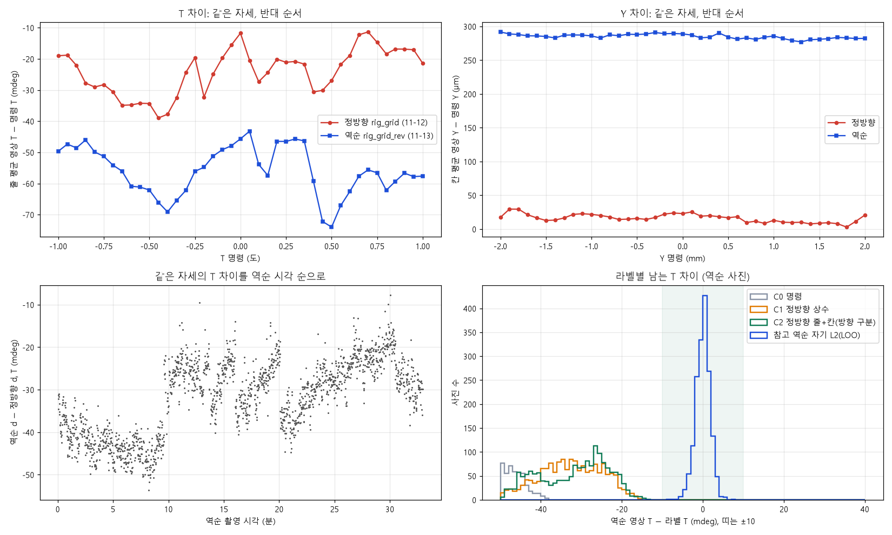

# 결과: 역순 격자로 라벨 보정(L2) 확인, 두 날 평균 라벨로 다시 학습 (11-13)

## 문제

`data/raw/rig_grid_rev.zip`(11-13)은 `rig_grid`(11-12)와 같은 자세 1680개를 촬영 순서만 반대로 찍은 것이다. 이것으로 세 가지를 확인했다.

1. 앞 실험(`20261113_0950`)의 라벨 보정 L2(줄 + 칸 효과)가 위치 때문인지, 촬영 순서(시간) 때문인지.
2. 장비 모델(`00000_final_Y_T_ssafy`, 11-12 L2 학습)이 처음 보는 날·순서의 사진에서 어떤지.
3. 같은 자세를 반대 순서로 찍은 두 세트의 평균으로 라벨을 다시 붙여 학습하면 어떤지 → `20261113_1509_ssafy2_두날평균라벨모듈`.

절대 영점은 보고서 정의를 따른다. "값이 0 인 상태"이고, 세트마다 그 상태가 되는 명령을 세트 사진 전체로 구한다(영상 − 명령의 중앙값). 센터 사진은 측정 기준 영상일 뿐 라벨 영점이 아니다.

## 한 일

| 단계 | 내용 | 파일 |
|---|---|---|
| 1 | 사진 목록 (센터 1 + 격자 1680 + 다시 찍은 센터 17) | `실험/prepare_rev_inputs.py` → `결과/촬영목록_rev.tsv` |
| 2 | 장비 모듈 자료로 측정 → 1698장 모두 거부(바 측정) | (기록만) |
| 3 | 역순 센터를 측정 기준으로 한 자료를 만들어 측정 | `실험/make_rev_assets.py` → `실험/assets_rev/`, `결과/features7_rev.tsv` |
| 4 | 두 측정 기준의 차이를 센터 계열 18장으로 구함 | `실험/rev_center_offset.py`(값 5개), `실험/bar_offset.py`(바 2개) |
| 5 | 같은 자세끼리 정방향·역순 비교, 보정값 옮기기, 모델 예측 채점 | `실험/evaluate_rev.py` → `결과/평가요약.txt`, `역순비교.tsv`, `그림_역순비교.png` |
| 6 | 두 세트 평균 라벨, 분할 → C++ 학습·평가 | `실험/make_ssafy2_inputs.py` → `결과/ssafy2/`, `final00_tool eval` |
| 7 | 모듈 `20261113_1509_ssafy2_두날평균라벨모듈` 구성, 공개 API 확인 | `experiments/hye/20261113_1509_ssafy2_두날평균라벨모듈/` |

## 결과 1. 장비 모듈 자료로는 측정이 안 된다

- 11-13 아침 STM32 리셋 뒤, 역순 센터의 화면이 장비 측정 기준(`rig_1st/center.bmp`)보다 세로로 QR +14 px, 나사 +7~8 px, 위 바 +8 px, 아래 바 +14 px 옮겨 있었다(가로 정수 이동 0).
- 바 탐색 범위가 ±11.5 px 라 1698장 모두 "Line normal-profile match failed" 로 거부됐다.
- 역순 센터를 측정 기준으로 쓰면 1698장 모두 측정된다. 장비 측정 기준으로 옮기는 상수(장비 기준 값 = 역순 기준 값 + 상수)는 센터 계열 18장으로 구했다.

| 값 | QR 가로 평균 | 나사1 | 나사2 | 나사3 | 나사4 | 위 바 기울기 | 아래 바 기울기 |
|---|---:|---:|---:|---:|---:|---:|---:|
| 기준 차이 | −0.3546 | +0.3915 | +0.8913 | +0.4509 | +0.9331 | −0.1005 | +0.0655 |
| 18장 표준편차 | 0.0046 | 0.0167 | 0.0071 | 0.0142 | 0.0114 | 0.0063 | 0.0064 |

- Python 측정은 정방향 센터에서 C++ 값과 0.006 px(값 5개), 0.0002(바 기울기) 안에서 같다.
- 왼쪽 나사(1, 3)는 +0.39~0.45 px, 오른쪽 나사(2, 4)는 +0.89~0.93 px 다. Y, T 로 설명되지 않는 좌우 0.5 px 차이라 배율이나 카메라 방향이 조금 바뀐 것으로 보인다. 역순 사진의 "자세 2개로 설명 안 되는 값" rms 가 나사 0.22~0.37 → 0.35~0.52 px 로 커졌다.

## 결과 2. 세트 영점

| 세트 | 명령 0 의 절대 자세 (영상 − 명령 중앙값, 세트 사진 전체) |
|---|---|
| rig_grid (11-12) | Y +19.3 µm, T −22.8 mdeg |
| rig_grid_rev (11-13) | Y +286.2 µm, T −55.6 mdeg |

리셋으로 명령 0 의 자리가 Y +267 µm, T −33 mdeg 바뀌었다. 역순 세트의 센터 명령 사진 18장의 영상 자세는 33분 동안 Y +280~+322 µm, T −62~−38 mdeg 로 움직였다.

## 결과 3. L2 보정은 다른 날·순서로 옮겨지지 않는다

같은 자세 1679개, 영상 − 명령 (세트 상수를 뺀 모양):

| 비교 | T | Y |
|---|---|---|
| 정방향과 역순의 같은 자세 상관 | 0.41 | −0.08 |
| T 줄 평균 41개의 상관 / Y 칸 평균 41개의 상관 | 0.42 | 0.59 |
| 다시 찍은 센터로 시간 흐름을 뺀 뒤 같은 자세 상관 | 0.72 | 0.27 |

역순 사진에 라벨을 붙였을 때 영상 자세와의 차이 (세트 영점은 역순 사진 전체 회귀):

| 역순 라벨 | σT | σY | 통과 |
|---|---:|---:|---:|
| 명령 + 세트 영점 (L1) | 8.1 mdeg | 13.2 µm | 1280 / 1679 |
| + 정방향 줄·칸 보정 (L2 를 옮김) | 8.5 | 23.0 | 1131 |
| + 정방향 같은 자세 값 그대로 | 8.7 | 25.6 | 1077 |
| 참고: 역순 자신으로 만든 L2 | 1.8 | 9.1 | 1679 |

- L2 가 가정한 "스테이지 위치마다 고정된 오차"는 다음 날 반대 순서 촬영에서 재현되지 않는다. 옮겨 쓰면 아무것도 안 할 때보다 나쁘다.
- 차이에 시간 성분이 있다: 같은 자세의 (역순 − 정방향) 차이는 촬영 시각에 대해 T R² 0.44, Y R² 0.61 이다.
- 한 세트 안에서는 T 줄 순서 = 촬영 순서라 T 위치 곡선과 시간 흐름을 자료만으로 가를 수 없다.

## 결과 4. 장비 모델(ssafy)은 처음 보는 역순 사진에서 영상 자세를 그대로 읽는다

공개 API, 역순 센터 측정 기준 자료 + 기준 차이(값 5개 몫)로 옮긴 예측, 1679장:

| 비교 기준 | 통과 | σY | σT |
|---|---:|---:|---:|
| 같은 사진의 영상 자세 | 1679 / 1679 | 4.6 µm | 0.7 mdeg |
| 명령 + 세트 영점 | 1300 / 1679 (77%) | 14.1 µm | 8.1 mdeg |
| 두 세트 평균 라벨 (결과 5, 계수식으로 계산) | 1675 / 1679 | 14.9 µm | 4.2 mdeg |

- "명령 + 세트 영점" 77% 는 스테이지가 명령한 자리에 정확히 가지 않는 몫을 포함한다(센터 명령 18장이 T 24 mdeg 범위로 흩어짐).

## 결과 5. 두 세트 평균 라벨과 ssafy_2

라벨: 명령 + 자기 세트 영점 + (정방향 d − k 와 역순 d − k 의 같은 자세 평균). 라벨 − 영상 자세는 σT 4.34 mdeg, σY 12.8 µm, 허용 안 1674/1679 (L1 은 σT 7.8, 1220).

C++ `final00_tool eval`, 3638장 (rig_1st 280 L2, rig_grid 1679, rig_grid_rev 1679), 같은 자세는 한 묶음:

| 검증 | 결과 |
|---|---|
| 주: 개발 2910장 섞은 80/20 10회 | 탈락 15.3장 (0.5%), rms Y 0.0102, T 0.0037 |
| 보조: 계열별 절반 10회 | 탈락 16.0장 |
| 세트 통째로 빼기 | rig_1st 97.3%, rig_grid 96.4%, rig_grid_rev 92.5% |
| 마지막 확인 728장 | 탈락 7장 |
| 전체 학습 후 다시 넣기 | 탈락 23 / 3638 |

- 같은 평균 라벨로 보면 ssafy(1675, 1675)와 ssafy_2(다시 넣은 값 1669, 1672)는 같은 수준이다. 라벨 잡음 σT 4.3 mdeg 가 바닥을 정한다.
- 세트 통째로 빼기 92.5% 는 낮게 나온다. 남은 세트의 평균 라벨에 뺀 세트의 시간 흐름 절반이 자세의 함수로 들어 있어 한 세트로 학습한 모델이 그 모양을 따라간다(Python 재현 92.5%, 바를 빼도 92.4%, 반대 방향 90.7%).
- 공개 API(`20261113_1509_ssafy2_두날평균라벨모듈`)로 정방향 격자 99장: 99장 측정, 97장 통과, 계수식 계산과 차이 1e-14.



## 해석

- 값 7개 모델은 날과 순서가 바뀌어도 영상이 재는 자세를 일관되게 읽는다(σT 0.7 mdeg).
- 장비 라벨의 T 오차는 위치보다 시간에 따라 바뀌는 몫이 크다. 한 세트에서 만든 보정(L2)은 그 세트 안의 라벨 정리일 뿐 고정 보정표가 아니다.
- 반대 순서 두 세트의 평균은 시간 흐름의 직선 몫을 지워 라벨 잡음을 σT 7.8 → 4.3 mdeg 로 줄인다.
- 실제 정확도(판이 실제로 센터에 왔는가)는 이 자료로 증명되지 않는다.

## 한계

- 모든 라벨과 비교 기준이 영상 값 또는 스테이지 명령에서 나온다. 독립된 정답이 없다.
- 측정 기준 차이는 센터 계열 18장으로 구한 상수다. 나사 좌우 0.5 px 차이처럼 Y, T 로 설명되지 않는 변화가 있어 역순 값에 Y 수 µm 치우침이 들어갈 수 있다(모델 − 영상 자세 평균 Y +6.9 µm, T −1.1 mdeg).
- 모듈은 고정된 측정 기준 영상을 쓴다. 바가 11.5 px 넘게 밀린 날은 거부된다. 그날 센터로 측정 기준을 옮기는 기능은 없다(이 실험에서는 Python 으로 했다).
- rig_1st 는 역순 짝이 없어 L2 그대로다. 평가 전용 촬영(`rig_eval`)은 아직 받지 않았다. 실제 복귀 검증은 하지 않았다.
- Python 분석(측정 기준 차이, 라벨, 비교)이며 측정·학습·평가·예측은 C++ 도구로 했다.

## 다시 실행

저장소 루트에서. 사진은 `data/raw/rig_grid_rev.zip` 을 `data/clean/rig_20261113_rev/` 에 그대로 푼 것이다. 도구 인자 경로는 ASCII 로 준다.

```
python "experiments/hye/20261113_1345_역순격자로라벨보정확인_정방향보정값옮겨적용/실험/prepare_rev_inputs.py" .batch_build/rev00/run1
python "experiments/hye/20261113_1345_역순격자로라벨보정확인_정방향보정값옮겨적용/실험/make_rev_assets.py"
(실험/assets_rev 를 .batch_build/rev00/assets_rev 로 복사)
final00_tool measure .batch_build/rev00/assets_rev .batch_build/rev00/run1/photos.tsv .batch_build/rev00/run1/measure   → 결과/features7_rev.tsv 로 복사
final00_tool predict .batch_build/rev00/assets_rev .batch_build/rev00/run1/photos.tsv <labels> .batch_build/rev00/run1/predict   → 결과/predictions_rev.tsv 로 복사
python "<실험>/rev_center_offset.py"
python "<실험>/bar_offset.py"
python "<실험>/evaluate_rev.py"
python "<실험>/make_ssafy2_inputs.py"
final00_tool eval <결과/ssafy2 의 features7.tsv labels.tsv splits.tsv 를 ASCII 폴더로 복사> <출력>
```

`final00_tool` 은 `experiments/hye/00000_final_Y_T_ssafy/tool/standalone` 으로 빌드한다.
