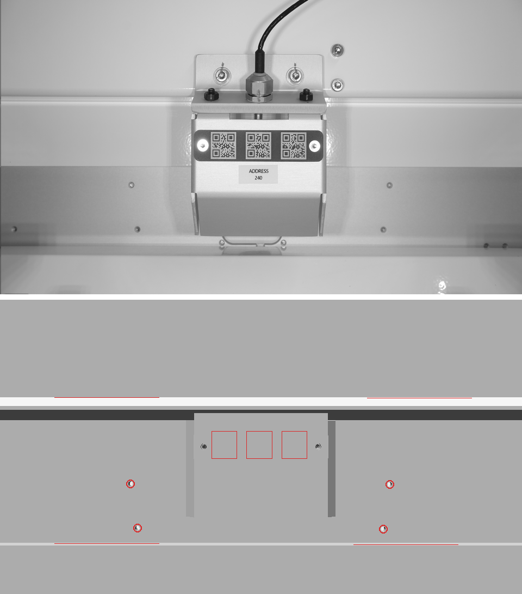

# SEMES 재현 타깃 (QR 플레이트 + 배경)

SEMES 장비 사진(center.bmp)과 같은 기하를 책상 위에 만드는 타깃이다. 김성현 알고리즘(배경 깊이 차이)과 이혜원 알고리즘(위·아래 가로선)을 모두 시험할 수 있다.
배경판은 사서 쓰고, 나머지만 3D 프린터로 뽑는다 (출력 약 230 g, 3.5~6.5시간 추정).



## 준비물

| 구분 | 내용 |
|---|---|
| 구매 | 흰색 무광 포맥스(PVC 발포판) 5T **400 × 360** 재단, 양면테이프(VHB) |
| 볼트 | M4×20 + 너트 4 (옆 받침), M4×16 + 너트 4 (받침), M3×10 버튼 볼트 + 너트 4 (배경 나사), M3×12 2 (플레이트) |
| 출력 (`../stl/`, 흰색 무광 PLA) | 17 QR플레이트 · 20 플레이트받침 (앞면을 바닥에) · 21 옆받침 왼쪽/오른쪽 (눕혀서) · 23 위턱띠/아래단띠 (베드 대각선) |
| 인쇄 | `drill_template_A4x4.pdf` (판 구멍 1:1 도면, A4 4장), `qr_label_A4_69mm.pdf` 1쪽 (QR 라벨) — 모두 **100% 인쇄** |

## 조립

1. 도면 4장을 회색 테두리대로 잘라 이어 붙이고, 판 **앞면**(카메라 쪽)에 대고 구멍 12개를 뚫는다 (Ø3.4 ×4, Ø4.4 ×8).
2. 판을 옆 받침 2개의 발 위에 세우고 M4×20으로 조인다 (판 양 끝, 화면 밖).
3. 위턱띠·아래단띠를 도면의 선에 맞춰 붙인다 (위 띠는 윗모서리, 아래 띠는 윗면을 선에).
4. 플레이트받침을 판 가운데에 M4×16 4개로 단다.
5. QR 라벨을 오려 플레이트에 붙이고, 나사 자리에 구멍을 뚫어 M3×12 2개로 받침에 단다.
6. 배경 나사 4개(M3 버튼 볼트)를 앞에서 꽂고 뒤에서 너트로 조인다.
7. 옆 받침 발 뒤 끝을 책상 모서리에 맞추고 C클램프 2개로 고정한다.
8. 카메라 장비를 앞뒤로 밀어 렌즈 앞면 → QR 플레이트 앞면을 307.8에 맞춘다. 최종 배율은 카메라 정식 배치 후 QR 흰 사각형 크기(SEMES 186.6 × 199.5 px)로 맞춘다.

## 치수 근거 (렌즈 앞면 = 0, 책상 윗면 = 0, 단위 mm)

| 항목 | 값 | 근거 |
|---|---|---|
| 렌즈 중심 높이 | 251 | 장비 3D 도면. **조립 후 실측** |
| 렌즈 앞면 → QR 플레이트 앞면 | 307.8 | WD (멘토 공식) |
| 플레이트 → 배경판 앞면 | 88 | 김성현 모델 계수의 배경/플레이트 Y 감도 비 (1.28배 깊이) |
| QR 플레이트 | 69 × 15, QR 13, 간격 18 | SEMES center.bmp 실측 (멘토 79는 사진과 안 맞음) |
| 플레이트 받침 앞면 | 69 × 58.6 | SEMES 브래킷 실측 |
| 위 턱 띠 윗모서리 | 높이 281.5 | 화면 y 716 (이혜원 위 가로선) |
| 아래 단 띠 윗면 | 높이 191.6, 돌출 10 | 화면 y 1788 (이혜원 아래 가로선) |
| 배경 나사 4개 | 판 왼쪽 아래 기준 (114.2, 222.2) (284.7, 221.7) (118.7, 194.9) (280.5, 194.3) | 화면 (960,1352) W2(2867,1357) W3(1010,1677) (2820,1684) |

SEMES 카메라 값은 fx 4450, fy 4747 (3840×2160, 가로만 15/16 축소), 플레이트 면 14.35 px/mm를 썼다.
우리 장비의 회전축 → 플레이트는 약 383 (SEMES 약 323)이라 Θ 1°에 약 96 px 움직인다. 알고리즘을 우리 장비에서 다시 학습하므로 똑같이 맞추지 않는다.

## 다시 만들기

```bash
python3 -m venv .venv && .venv/bin/pip install -r requirements.txt
.venv/bin/python make_target_board.py      # ../stl/ 의 17·20·21·23 STL, 판 확인용 STL, 구멍 도면 PDF
.venv/bin/python render_view_board.py <SEMES center.bmp>   # preview_camera_view.png
python3 make_qr_label.py -o qr_label_A4_69mm.pdf           # QR 라벨 (libqrencode, Pillow)
```

- 렌즈 높이를 실측하면 `make_target.py` 의 `LENS_H` 를 고치고 다시 돌린 뒤 **도면을 새로 뽑아 판을 뚫는다** (구멍·띠 높이가 따라 바뀜).
- 판을 이미 뚫었다면 `LENS_H` 대신 `make_target_board.py` 의 `LIFT` 를 바꾼다. 옆 받침(21)만 길어져 판 전체가 그만큼 올라가고, 판 구멍·띠·도면은 그대로다.
  현재 `LIFT = 25.5`: 2026-11-12 원래 받침(발 두께 6) 위에서 찍은 사진의 QR 이 SEMES `center.bmp` 보다 화면 아래로 395 px(약 25.6 mm) 내려가 있었다.
  실제 렌즈 중심은 책상에서 약 251 + 25.5 = 276.5 mm 로 본다.
- 배경 깊이는 `BG_DEPTH`, 책상 모서리까지 발 길이는 `make_target_board.py` 의 `FOOT_BACK`.
- `make_target.py`(전부 출력, 약 980 g)와 `make_target_simple.py`(중간, 약 620 g)는 비교용으로 남긴 이전 버전이다. 치수 계산은 `make_target.py` 에 모여 있어 다른 두 스크립트가 가져다 쓴다.
- `19_배경판_포맥스_400x360x5_구매품.stl` 은 확인용이고 출력하지 않는다.
- `make_qr_label.py` 는 `hardware/qr_target/make_qr_target.py`(feat/lye/camera-calib)에서 플레이트 가로만 66 → 69로 바꾼 것이다.

## 아직 확인 안 된 것

- 렌즈 중심 높이 (조립 후 실측). 화면 기준으로는 `LIFT` 25.5 를 반영함 (2026-11-12)
- 배경 깊이 88: 멘토 "렌즈끝~벽 303.66"과 맞지 않음
- 플레이트 가로: 멘토 79 / 사진 실측 69.2
- C클램프가 2개뿐이면 장비 바닥판 고정과 겹침
