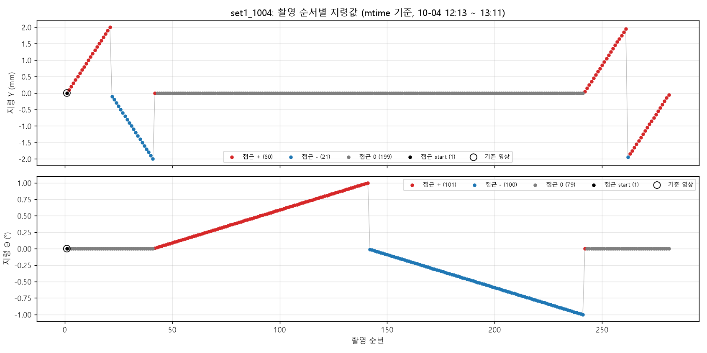
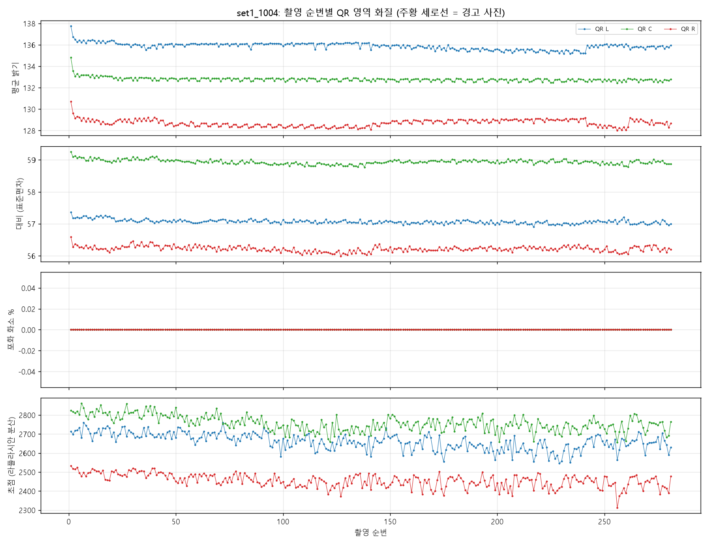
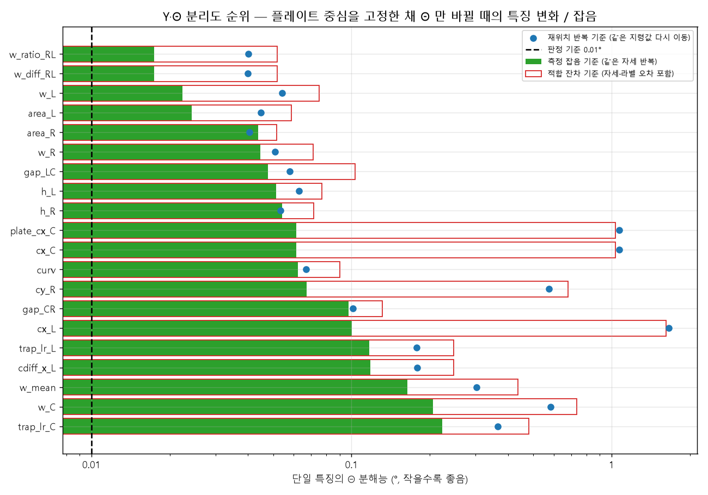
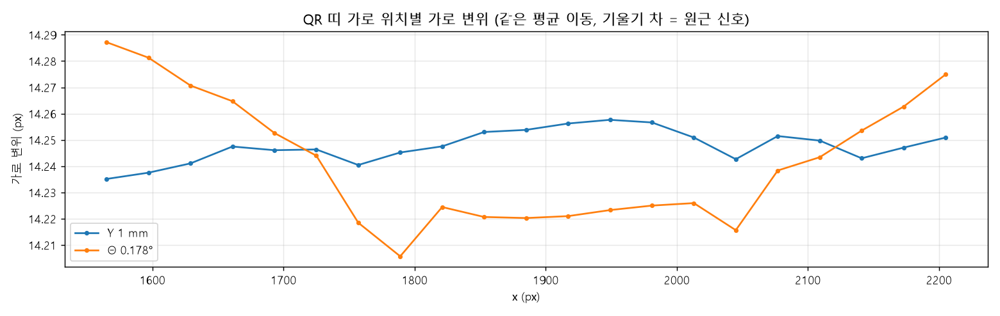
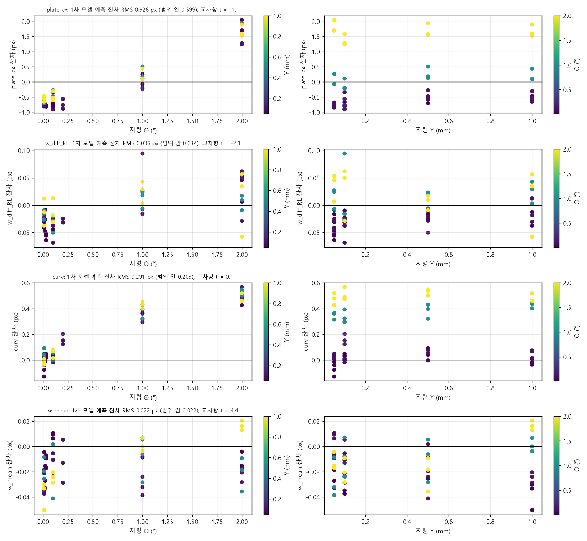
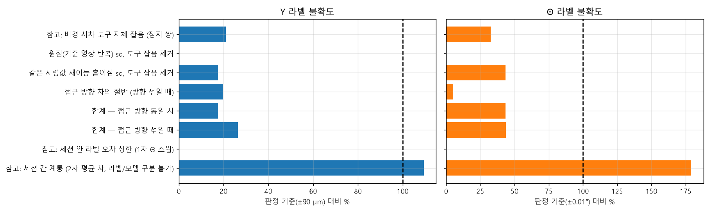

# QR Y·Θ 분리 — 1·2차 데이터 EDA 보고서

- 작성일: 2026-10-26
- 계획: [`EDA_PLAN.md`](EDA_PLAN.md) Stage 0~5
- 툴: [`eda_tool/`](eda_tool/README.md) (Python, `qr_eda.py --all` 한 줄로 재현)
- 데이터: `data/img/1st` (1차, 281장), `data/img/2nd` (2차, 60장)
- 판정 기준: 사진마다 **Θ ±0.01°, Y ±90 µm**
- 그림 위주 요약본: `eda_results/EDA_보고서.pdf`, 누적 표: `eda_results/summary_all_sets.csv`

---

## 0. 한눈에 보기

| 단계 | 핵심 결론 |
|---|---|
| Stage 0 데이터 | 341장 모두 해석, 중복·누락 0. **촬영 시각 = 파일 수정일시** (생성일시는 복사 시각). 1차 Y 스윕은 **두 번에 나눠 촬영**(0.1 mm 배수 → 50분 뒤 나머지)했고, 음수 Y 는 묶음마다 **접근 방향이 다름** |
| Stage 1 화질 | 재촬영이 필요한 사진 **없음**. 연속 촬영 차영상 잡음 σ ≈ 0.70 (밝기 단위). 1·2차 화질 차이는 작음 (밝기 −0.7 %, 가운데 QR 초점 −6 %) |
| Stage 2 Y vs Θ | **가장 좋은 단서는 좌·우 QR 가로 폭 차(R−L)**: Θ 1° 당 +0.659 px, Y 1 mm 당 −0.026 px. 단일 단서 Θ 분해능 **0.0175°(측정 잡음) / 0.040°(재위치) / 0.052°(적합 잔차)**. 여러 단서를 합쳐도 재위치 기준 **약 0.018°** — 0.01° 에 못 미침 |
| Stage 3 혼합·날짜 | 날짜가 바뀌면 **Θ 감도 자체가 바뀜** (폭 차 +12 %, QR 간격 곡률 3배, 가운데 QR 사다리꼴은 부호 반전). 1차 모델을 2차에 그대로 쓰면 안 됨. 기준 영상(center1~3)은 이동해서 찍은 자세의 원점을 대표하지 못함 |
| Stage 4 라벨 | 접근 방향을 통일해도 **라벨(지령값) 자체의 불확도 Θ 0.0043°(기준의 43 %), Y 16 µm(18 %)**. 접근 방향 차이(백래시)는 Y 약 −35 ± 23 µm (유의 수준 미달). 세션 간 계통 차 Θ −0.018°, Y +98 µm 는 라벨 문제인지 모델 문제인지 구분 불가 |
| Stage 5 툴 | 새 세트 폴더 + `set.yaml` 만 넣고 한 줄 실행 → 표·그림·영상·PDF. 캐시로 새 사진만 계산 (시험: 새 사진 1장만 계산, 30초) |

**종합**: QR 만으로 Θ 를 0.01° 로 맞추는 데 필요한 신호(0.01° 당 약 0.003~0.008 px)는 측정 잡음 수준에서는 보이지만, **장비가 다시 움직일 때마다 생기는 기하 변화와 라벨 불확도가 같은 크기 이상**이라 현재 데이터로는 0.01° 를 검증할 수도, 달성할 수도 없습니다. 알고리즘보다 **촬영 절차(접근 방향·세션 보정)와 정답(라벨) 확보**가 먼저입니다.

---

## 1. 데이터 (Stage 0)

### 1.1 구성

| 세트 | 촬영 | 장수 | 지령값 | 기준 영상 |
|---|---|---|---|---|
| set1_1004 | 10/04 12:13 ~ 13:11 (58분, 중앙 간격 4초) | 281 | Y −2.00 ~ +2.00 mm (0.05 간격, 80장) 또는 Θ −1.00 ~ +1.00° (0.01 간격, 200장), 한 축씩 | center.bmp 1장 |
| set2_1015 | 10/15 19:33 ~ 22:21 (168분, 중앙 간격 34초) | 60 | Y {0.05, 0.10, 0.50, 1.00} × Θ {0.01 ~ 2.00} 동시 이동 19조합 × 3장 | center1~3 (19:33, 19:43, **21:54**) |

- 해상도 3840 × 2160, 24-bit RGB BMP (세 채널 동일한 회색), EXIF 없음. 해시 중복 0.
- 2차 세트의 `.txt` 는 **절대 좌표** (`Y_Actual`, `T_Actual`). 기준 위치 좌표 (Y −1.300, Θ −1.670)를 빼면 폴더 이름의 지령값과 **57장 모두 정확히 일치**합니다. txt 가 지령값인지 엔코더 값인지는 파일만으로 알 수 없습니다.
- 파일 이름 규칙은 `eda_results/set_yaml_draft/1st.yaml`, `2nd.yaml` 에 기록했습니다 (확인 후 `data/img/<세트>/set.yaml` 로 복사 권장).

### 1.2 촬영 시각과 순서

- **생성일시**: 모든 파일이 10/20 14:01 같은 초 → 복사 시각이라 사용 불가.
- **수정일시**: 파일마다 다르고 간격이 규칙적 → 촬영 시각으로 채택.
- 파일 이름 순서와 촬영 순서가 다릅니다 (예: `Y+0.10` 12:14 → `Y+0.05` 13:01).

**1차 세트 촬영 순서** (그림)
1. center → Y +0.1 ~ +2.0 (0.1 mm 배수, + 방향) → Y −0.1 ~ −2.0 (− 방향)
2. Θ +0.01 ~ +1.00 (+ 방향) → Θ −0.01 ~ −1.00 (− 방향)
3. 약 50분 뒤 Y +0.05 ~ +1.95 (나머지 값) → Y −1.95 ~ −0.05 (**아래에서 위로, + 방향**)

이 순서 때문에 생기는 영향입니다.
- 기존 실험들의 "값 순서로 짝수 번째 = 학습, 홀수 번째 = 검증" 분할은 Y 스윕에서 **첫 묶음 = 학습, 두 번째 묶음 = 검증**과 같습니다. 즉 시간이 50분 떨어진 검증이었습니다.
- 음수 Y 는 묶음마다 접근 방향이 반대입니다 (첫 묶음 −, 두 번째 묶음 +). 백래시가 있으면 음수 Y 쪽 오차에 섞입니다 (Stage 4 에서 크기 추정).

2차 세트는 Θ 를 0 → 큰 값으로 올리며 찍고, 같은 지령값 3장은 지령 변화가 없습니다 (접근 "0"). 다만 영상으로 보면 2번째 장이 다시 움직여 찍힌 경우가 많습니다 (Stage 1·4).

영상: `eda_results/videos/set1_1004_shooting.mp4`, `set2_1015_shooting.mp4` (+ GIF, `_realtime.mp4`)

---

## 2. 화질과 환경 (Stage 1)

| 항목 | 1차 | 2차 |
|---|---|---|
| 영상 평균 밝기 (중앙값) | 171.6 | 170.4 |
| QR L / C / R 평균 밝기 | 136.0 / 132.8 / 128.7 | 134.9 / 131.8 / 127.7 |
| 가운데 QR 초점 (라플라시안 분산) | 2757 | 2585 (−6 %) |
| QR 영역 포화 화소 | 0 % | 0 % |
| 화질 경고 사진 | 0 | 0 |

- **재촬영 필요 사진 없음**. 경고 기준은 세트 내 중앙값 ± 3 MAD **와** 실무 최소 편차(밝기·대비 2 %, 초점·잡음 10 %)를 함께 넘는 경우입니다. 3 MAD 만 쓰면 0.2 % 밝기 차도 경고가 되어 의미가 없었습니다.
- **밝기 추이**: 1차 첫 3장이 조금 밝고(예열), Θ 스윕 동안 왼쪽 QR 은 어두워지고 오른쪽 QR 은 밝아집니다 (조명 각도). 밝기는 Θ 에 따라 바뀌므로 **단서로 쓰면 안 되고**, 측정은 밝기 변화에 둔감해야 합니다.
- **촬영 잡음**: 장비가 움직이지 않은 연속 촬영 쌍(플레이트 이동 < 0.03 px)의 차영상으로 구한 평탄 영역 잡음 σ ≈ **0.70**, QR 띠 σ ≈ 1.43 (밝기 단위).
- **반사**: QR 옆 나사 머리가 사진의 40~50 % 에서 포화됩니다. QR 안은 포화 없음. 이 반사 때문에 Y ≤ −1.15 mm 에서 기존 검출(닫기 9×9)이 왼쪽 QR 을 놓쳤고, 닫기 5×5 로 341장 모두 검출했습니다.

---

## 3. Y 이동 vs Θ 회전 (Stage 2, 1차 세트)

### 3.1 측정

- QR 3개의 밝은 사각형 변을 가로지르는 밝기 단면 120개에서 서브픽셀 경계를 찾고, 변마다 직선을 맞춘 뒤 교점으로 꼭짓점 12개를 구했습니다 (341장 모두 성공).
- **꼭짓점 정밀도**: 장비가 움직이지 않은 연속 촬영에서 꼭짓점 차이 std ≈ 0.04 px → 한 꼭짓점 σ ≈ **0.03 px (약 2 µm)**.
- Center 정의 (C-1, `center/center_definition.json`): QR 중심 = 대각선 교점(꼭짓점 평균과 L −0.04 px, R +0.03 px 차이, 원근 방향과 일치), 플레이트 중심 = QR 3개 중심 평균. 정의를 바꿔도 Θ 스윕 잔차(약 0.17 px)는 같아 **잔차는 정의가 아니라 자세에서 옴**.

### 3.2 감도

| | 값 |
|---|---|
| 플레이트 중심 x 감도 | Y **14.25 px/mm**, Θ **80.06 px/°** (R² 0.9999) |
| 같은 화면 이동 | Y 1 mm ↔ Θ **0.178°** |

### 3.3 Y·Θ 를 가르는 단서 (분리도 순위, `tables/separability.csv`)

플레이트 중심을 고정한 채 Θ 만 바뀔 때 특징이 얼마나 변하는지(신호)와 세 가지 잡음을 비교했습니다.

| 순위 | 특징 | Θ 1° 당 | Y 1 mm 당 | Θ 0.01° 신호 | Θ 분해능: 측정 잡음 | 재위치 | 적합 잔차 |
|---|---|---|---|---|---|---|---|
| 1 | 가로 폭 비 R/L | +0.0035 | −0.0001 | — | 0.0174° | 0.0402° | 0.0518° |
| 2 | **가로 폭 차 R−L** | **+0.659 px** | −0.026 px | 0.0080 px | **0.0175°** | **0.0400°** | **0.0518°** |
| 3 | 왼쪽 QR 폭 | −0.334 px | +0.019 px | 0.0044 px | 0.0224° | 0.0540° | 0.0752° |
| 4 | 왼쪽 QR 면적 | −97.8 px² | +5.3 px² | 1.27 px² | 0.0243° | 0.0449° | 0.0586° |
| 6 | 오른쪽 QR 폭 | +0.325 px | −0.007 px | 0.0036 px | 0.0446° | 0.0509° | 0.0711° |

- 잡음 세 가지: **측정 잡음** = 장비가 움직이지 않은 연속 촬영 6쌍, **재위치** = 같은 지령값을 다시 이동해 찍은 38쌍, **적합 잔차** = 스윕을 2차식으로 맞춘 잔차(자세·라벨 오차 포함).
- 왼쪽 QR 은 Θ 에 따라 좁아지고 오른쪽 QR 은 넓어집니다. 이 값(−0.334, +0.325 px/°)은 1차 Gabor 실험의 배율(−0.183, +0.168 px/100 px per °, QR 폭 187 px 환산 −0.34, +0.31 px/°)과 **독립된 방법으로 일치**합니다.
- **여러 단서 결합** (대각 잡음 가정, 낙관적): Θ σ **0.0094°** (측정 잡음) → **0.018°** (재위치). 재위치 기준 값이 기존 실험들의 "QR 만 쓰는 방법 한계 0.017~0.02°" 와 같습니다.
- **재위치하면 폭이 2~3배 더 흔들립니다**: Θ·Y 에 거의 반응하지 않는 가운데 QR 폭도 재위치 쌍에서 σ 0.0084 → 0.024 px. 장비가 움직일 때마다 Θ 외의 기하(거리·기울기 추정)가 조금씩 바뀐다는 뜻입니다.

### 3.4 변위장 — Θ 는 U 자, Y 는 평평

QR 띠를 64 px 패치로 나눠 기준 영상 대비 이동을 구하고 지령값에 대해 회귀했습니다. 같은 평균 이동(Y 1 mm ↔ Θ 0.178°)에서

- **Θ**: 가로 위치에 따라 이동이 **U 자**로 달라집니다 (가장자리가 가운데보다 약 0.06 px 더 이동) — 팬 회전의 원근 효과.
- **Y**: 거의 평평합니다 (약 0.02 px 이내).
- 0.01° 로 환산하면 이 차이는 **약 0.003 px** 로, 계획서의 "Θ 0.01° 구분에 약 0.003 px 필요" 와 맞습니다. U 자의 기울기가 왼쪽 QR 축소·오른쪽 QR 확대(폭 차 단서)로 나타납니다.

- 짝지은 차영상(Y 2 mm vs Θ 0.36°, 이동 맞춤 후)은 QR 테두리와 나사 반사에서만 차이가 보입니다 (`figures/s2_paired_diff_*.png`).
- 위상 상관(OpenCV) 서브픽셀 값에 치우침이 있어(0.30 px → 0.254 px) 변위장은 정성 비교용입니다.

### 3.5 선형성

- 플레이트 중심: Y·Θ 모두 R² > 0.9998. Θ 스윕 잔차는 이웃 사진끼리 상관 0.94 (매끄러운 계통 곡선), Y 스윕 잔차는 −0.66 (두 촬영 묶음이 번갈아 나와 묶음 간 차이 약 0.19 px ≈ 13 µm).
- 폭 차 R−L 은 Θ 에 대해 R² 0.989, Y 에는 R² 0.33 (거의 반응 없음).

영상: `videos/set1_1004_sync_Y.mp4`, `set1_1004_sync_T.mp4` (꼭짓점·중심 겹침 + 특징 그래프 동기화)

---

## 4. 2차 세트 — 혼합 이동과 날짜 차이 (Stage 3)

### 4.1 1차 범위 밖

2차 57장 중 **Θ = 2.00° 12장(21 %)** 이 1차 학습 범위(±1°) 밖입니다. Y 는 모두 범위 안 (0.05 ~ 1.00 mm).

### 4.2 중첩 검사 (`tables/superposition.csv`)

1차 모델 `f = c + aY·Y + aT·Θ + qT·Θ²` 로 2차를 예측(절편은 2차 기준 영상으로 다시 맞춤)하고, 2차만으로 교차항 `Y·Θ` 를 넣어 맞췄습니다.

| 특징 | Θ 감도 1차 → 2차 | 1차 모델 예측 잔차 RMS (범위 안 / Θ 2°) | 교차항 t |
|---|---|---|---|
| 플레이트 중심 x | 80.06 → 80.47 px/° | 0.60 / 1.65 px | −1.1 |
| 폭 차 R−L | 0.659 → **0.737** px/° (+12 %) | 0.034 / 0.041 px | −2.1 |
| 곡률 (QR 간격 비대칭) | 0.26 → **0.77** px/° (3배) | 0.20 / 0.50 px | 0.1 |
| 가운데 QR 사다리꼴 | +0.22 → **−0.70** px/° (부호 반전) | 0.43 / 1.22 px | 0.4 |
| QR 폭 평균 | −0.005 → 0.001 px/° | 0.022 / 0.019 px | **4.4** |

- **날짜가 바뀌면 Θ 감도가 바뀝니다.** 특히 QR 간격·사다리꼴처럼 원근 기하에 민감한 단서는 3배 차이나 부호 반전까지 보입니다. 회전축 위치나 카메라 설치가 달라졌을 가능성이 큽니다 (추정, 미확인).
- **교차항**: 플레이트 중심에는 없고(t −1.1), 폭 관련 단서에는 약하게 있습니다 (QR 폭 평균 t 4.4, Y 1 mm·Θ 2° 에서 약 0.05 px). 폭 차 R−L 의 교차항(t −2.1)은 Y 1·Θ 2 에서 −0.05 px ≈ Θ 0.075° 에 해당해, 작아 보여도 0.01° 기준에서는 무시할 수 없습니다.
- **Θ² 외삽 금지**: 플레이트 중심 x 의 Θ 2° 예측 잔차 +1.6 px 는 1차에서 맞춘 Θ² 항(−0.39 px/deg²)을 2° 로 외삽한 탓입니다 (2차 단독 적합에서는 Θ² 항 ≈ 0).
- **기준 영상이 원점을 대표하지 못함**: Θ ≈ 0 근처 자세들의 플레이트 중심 잔차가 기준 영상 대비 약 −0.6 px (≈ −42 µm) 치우쳐 있습니다.

### 4.3 세트별 원점 (C-2, `center/center_by_set.csv`)

| | 1차 center | 2차 center1~3 평균 | 차이 |
|---|---|---|---|
| 플레이트 중심 x | 1901.30 px | 1901.08 px | −0.22 px (Y 환산 −15 µm 또는 Θ 환산 −0.003°) |
| 플레이트 중심 y | 1068.39 px | 1068.85 px | +0.46 px |
| QR 폭 평균 (배율) | 187.367 px | 187.416 px | +263 ppm |
| 영상 밝기 | 173.7 | 170.7 | −3.0 |

- center1~3 반복: 플레이트 중심 x sd 0.041 px (Y 2.9 µm / Θ 0.0005°), 범위 0.08 px.
- 2차 세션 동안 QR 폭이 **촬영 순서대로 커집니다** (+160 → +287 → +342 ppm, 1차 대비). 폭 차 R−L 은 그대로 (0.96 px) — 배율(거리·초점)만 천천히 변하는 모양입니다 (열 변형 등, 추정).
- 플레이트만으로는 원점 차이가 Y 인지 Θ 인지 가를 수 없습니다 (그래서 Stage 4 에서 배경 시차 도구 사용).

영상: `videos/set2_1015_sync.mp4`

---

## 5. 라벨(지령값) 신뢰도 (Stage 4)

배경 시차 추정(`Hypothesis_2/Center_check`, 벽 나사 깊이 차로 Y·Θ 분리)을 **정답 확인 도구로만** 사용했습니다. 이 도구 자체의 잡음(장비가 움직이지 않은 쌍)은 **Y 18.9 µm, Θ 0.0033°** 이며, 아래 값은 이 잡음을 뺀 값입니다.

| 성분 | Y | Θ | 기준 대비 |
|---|---|---|---|
| 같은 지령값 재이동 흩어짐 | 15.8 µm | **0.0043°** | Y 18 %, **Θ 43 %** |
| 접근 방향 차의 절반 (방향이 섞일 때) | 17.7 µm | 0.0005° | Y 20 %, Θ 5 % |
| 원점(기준 영상 반복) | 도구 잡음 이하 | 도구 잡음 이하 | — |
| **합계 — 접근 방향 통일** | **16 µm** | **0.0043°** | **Y 18 %, Θ 43 %** |
| 합계 — 접근 방향 섞임 | 24 µm | 0.0044° | Y 26 %, Θ 44 % |
| 참고: 세션 간 계통 (2차 평균) | +98 µm | −0.018° | Y 109 %, Θ 179 % |

**정답 자체의 불확도 = Θ 0.0043°, Y 16 µm (판정 기준의 43 %, 18 %)** — 접근 방향을 통일했을 때.

- **접근 방향(백래시)**: Y 스윕 이중차분(음수 Y 는 묶음마다 방향이 다르고 양수 Y 는 같음)으로 + 접근이 − 접근보다 **실제 위치가 약 35 ± 23 µm 작음** (1.6σ, 95 % 유의 수준 미달). Θ 는 0.001 ± 0.004° 로 차이 없음.
- **재이동**: 2차 세트 같은 지령값 3장 중 2번째 장이 평균에서 Θ +0.0025° 쪽으로 치우칩니다 — Stage 1 의 "2번째 장 약 +0.3 px 이동"은 대부분 **Θ** 성분입니다.
- **세션 안**: 1차 Θ 스윕의 지령값 − 배경 시차 RMS 0.0058° 는 도구의 이론 잡음(0.0063°)보다 작아, 세션 안 라벨 오차는 도구로 구분되지 않을 만큼 작습니다.
- **세션 간**: 2차 세트는 배경 시차 대비 평균 Y +98 µm, Θ −0.018° (Θ 에 비례해 약 −2 %) 차이가 납니다. 라벨(장비) 쪽인지 배경 시차 모델(1차 학습) 쪽인지는 이 데이터로 가를 수 없습니다.

---

## 6. 결론과 권고

### 6.1 결론

1. **단서는 있다.** Θ 는 원근 때문에 좌·우 QR 의 가로 폭을 반대로 바꾸고(R−L 폭 차, 0.659 px/°), Y 는 거의 바꾸지 않습니다. 장비가 가만히 있을 때의 측정 잡음만 보면 단서 하나로 0.0175°, 여러 단서로 약 0.009° 까지 가능합니다.
2. **하지만 장비가 움직일 때마다 생기는 변화가 더 크다.** 같은 지령값으로 다시 이동하면 단서 잡음이 2~3배가 되어 결합 분해능이 약 0.018° 로 떨어집니다. 이는 기존 실험들의 한계(0.017~0.02°)와 같습니다.
3. **날짜가 바뀌면 감도가 바뀐다.** 한 세션에서 학습한 모델을 다른 세션에 그대로 쓸 수 없습니다.
4. **정답 자체가 기준의 절반 가까이 흔들린다.** 재이동 흩어짐만으로 Θ 0.0043° (기준의 43 %). 이 상태에서는 알고리즘이 0.01° 를 달성했는지 **검증할 수 없습니다**.

### 6.2 권고 (우선순위)

1. **촬영 절차 통일** — 항상 같은 방향에서 접근(예: 음수 쪽에서 + 방향), 이동 후 일정 시간 정지 뒤 촬영. 지령값 txt 가 지령인지 엔코더인지 SEMES 에 확인.
2. **반복 촬영 데이터** — 같은 지령값을 "정지 상태 연속 N장"과 "다시 이동해 N장"으로 나눠 찍기. 측정 잡음과 재위치 흩어짐을 분리할 수 있는 쌍이 지금은 6쌍뿐입니다.
3. **세션 보정** — 세션마다 기준 영상 + Θ 몇 점(예: ±0.5°, ±1°)을 찍어 감도와 원점을 다시 맞추는 절차를 알고리즘에 포함.
4. **외부 정답** — 배경 시차 도구는 세션 안에서만 유효합니다. 0.01° 검증에는 각도계·간섭계 등 독립 측정이 필요합니다.
5. **알고리즘** — 단서는 폭 차 R−L(또는 U 자 변위장 전체)을 중심으로, Θ² 외삽 금지, 교차항 Y·Θ 를 보정 데이터로 확인 후 반영.

---

## 7. 한계

- 측정 잡음(정지 쌍) 추정은 **6쌍**으로 했습니다. 순위는 바뀌지 않지만 값의 불확도는 큽니다.
- 2차 세트는 Y 0.05 ~ 1.00 mm, Θ 0 이상만 있어 교차항·음수 쪽은 확인하지 못했습니다.
- 배경 시차 도구는 1차 세트 짝수 번째로 학습되어 있어, 1차 세트 라벨 확인은 홀수 번째(두 번째 촬영 묶음)만 사용했습니다.
- 결합 분해능은 특징 간 상관을 무시한 낙관 값입니다.
- 변위장은 OpenCV 위상 상관의 서브픽셀 치우침 때문에 정성 비교입니다.

---

## 8. 검증 절차와 수정 이력

각 단계가 끝날 때 결과를 확인한 뒤 다음 단계로 넘어갔습니다.

| 단계 | 확인한 것 | 발견·수정 |
|---|---|---|
| 0 | 341장 해석, 기대 지령값과 누락·초과 0, txt 와 폴더 이름 일치, 시각 통계, 타임라인 그림 | pandas 3 의 datetime 단위 때문에 시각 통계가 틀린 것을 발견 → 초 단위 변환으로 수정 |
| 1 | 341장 화질 값, 경고 목록, 잡음·반사 그림 | QR 검출 11장 실패(나사 반사 붙음) → 닫기 5×5 로 수정. 경고 문자열 오류, 3 MAD 만으로 과다 경고 → 실무 최소 편차 추가 |
| 2 | 꼭짓점 341/341, 정지 쌍 꼭짓점 정밀도, 감도의 기존 결과 일치, 분리도 표 | numpy 2 의 2차원 cross 미지원 수정. OpenCV 5 위상 상관이 창 함수 인자에서 0 을 돌려주는 문제 발견 → 창 함수 제거. 정지 쌍 6개 한계 → 재위치 잡음(38쌍) 열 추가 |
| 3 | 1차·2차 감도 비교, 원점 표, 범위 밖 비율 | 단계별 실행 시 앞 단계 기록이 지워지는 문제 → 실행 기록 누적 저장 |
| 4 | 라벨 이중차분, 재이동 흩어짐 | 두 번째 묶음 −1.95 mm 가 − 접근으로 섞인 것을 발견 → 의도한 방향만 사용. 배경 시차 도구 자체 잡음을 정지 쌍으로 분리해 차감 |
| 5 | `--all` 재현(약 2분, 수치 동일), 새 세트 시험 | 결과 폴더를 바꾸면 set.yaml 초안을 못 찾는 문제 → 초안 위치 고정. 합성 영상(1 px 이동)의 플레이트 중심 차 0.9999 px 확인, 새 사진 1장만 계산 확인, 임시 폴더 삭제 |

---

## 9. 산출물

| 위치 | 내용 |
|---|---|
| `eda_results/tables/` | catalog, inventory_summary, quality, noise_repeats, reflection_summary, features, linearity, separability, patch_flow, superposition(+residuals), drift, label_check, label_within_session, label_uncertainty |
| `eda_results/center/` | center_definition.json, center_by_image.csv, center_by_set.csv |
| `eda_results/figures/` | 단계별 그림 29개 |
| `eda_results/videos/` | 촬영 과정(A-1), 화질 경고판, 동기화판(A-2) — GIF·MP4·실시간 비율 MP4 |
| `eda_results/summary_all_sets.csv` | 세트당 1행 누적 요약 |
| `eda_results/EDA_보고서.pdf` | 그림 위주 요약 (첫 장 미리보기 `EDA_보고서_요약.png`) |
| `eda_results/set_yaml_draft/` | 1·2차 세트 set.yaml 초안 |

재현: `src\KSH\EDA` 에서 `.venv\Scripts\python eda_tool\qr_eda.py --all` (준비는 [`eda_tool/README.md`](eda_tool/README.md)).
